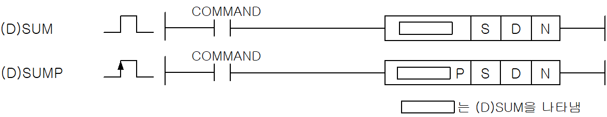
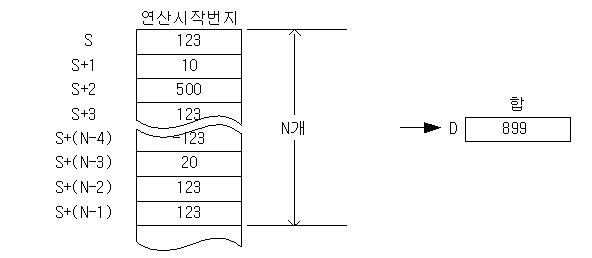
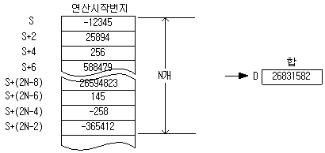

# SUMP

Manual section(s): 4.24.13. Original Korean notes below may cover the other variants on the same page; apply the widths and execution form of `SUMP`.

Execution form: the source explicitly pairs this command as `(P)`; `SUMP` is the pulse-type P form. Manual §2.4.2 defines `P` as pulse-type notation. Select the paired forms deliberately and retain the instruction's actual execution conditions; unrelated mnemonics ending in P are not classified by suffix alone.

## Editing route

Use `get_ir` → `apply_patch` for this instruction edit. `insert_ladder_instruction` is the internal writer route, not a separate MCP tool. Preserve the exported revision and native constraints.
The writer mnemonic is `SUMP`; the catalog records opcode `646` and `3` operands in order.
Inspect the CPU/project and target cells first. Use the inspected revision and positions, preserve expected values, dry-run when useful, then save and inspect the result. See the [editing skill](../../SKILL.md) and [ladder workflow](../ladder.md).

## Operands

| Order | Operand | Description (Korean manual) | Reviewed types | Device areas | Constant |
| --- | --- | --- | --- | --- | --- |
| 1 | S | SUM연산을 시작할 데이터의 주소 | INT/DINT | PMK, F, L, T, C, Z, U, N, D, R | Not allowed |
| 2 | D | 연산 결과를 저장할 주소 | INT/DINT | PMK, L, T, C, Z, U, N, D, R | Not allowed |
| 3 | N | S로부터 SUM연산을 실행할 워드 개수 | WORD | PMK, F, L, T, C, Z, U, N, D, R | Allowed |

These are the current library's reviewed operand rules. A shared type union is not a per-variant type choice; use the manual behavior to select the required width. Missing permissions stay unknown.

## CPU and acceptance

No separately reviewed CPU-model restriction is available in the current catalog; this means unknown, not universal compatibility.
Check the applicable model, firmware, modules and memory spans stated in the manual notes. Local parsing, writer validation and IL conversion do not prove native compilation or PLC behavior. Native acceptance requires XG5000 Open → Check Program → Save As → comparison.

## Manual flags

- SUM (Word Summary)
- 워드 데이터 S로부터 N개까지의 범위 내에서 데이터 합을 D에 저장합니다.
- 덧셈 연산은 Signed연산으로 합니다.
- 연산 결과가 제로이면 제로 플래그를 셋(Set)합니다.
- 연산 도중 오버플로우가 발생하면 캐리 플래그와 에러 플래그를 셋(Set)합니다.
- 오버 플로우가 발생되어도 오버플로우를 무시하고 계산한 값을 결과에 저장합니다. 따라서 원하지 않는 값이 결과에 저장될 수 있으므로 캐리 플래그를 반드시 확인해야 합니다
- N이 0 이면 연산을 하지 않습니다.
- DSUM (Double Word Summary)
- 더블 워드 데이터 S로부터 N개까지의 범위 내에서 데이터 합을 D에 저장합니다.
- N이 0이면 연산을 하지 않습니다.

| 플래그 | 내 용 | 디바이스 번호 |
| --- | --- | --- |
| 에러 | N값이 해당 디바이스의 범위를 벗어날 때 연산 도중 오버플로우 발생시 에러 플래그가 셋(Set) 됩니다. | F110 |
| 제로 | 연산 결과가 제로이면 셋(Set)합니다. | F111 |
| 캐리 | 연산도중 오버플로우가 발생하면 셋(Set)합니다. | F112 |

## Manual applicability and restrictions

- 적용 기종 : XGK, XGB

## Manual flag and step matrix

The shared usage table marks affected flags with `O`, and `-` where it lists no effect. Native steps are the manual's instruction size, not the number of operand arguments. Conditions for setting/clearing flags are in the behavior notes.

| Manual instruction group | Native steps | 에러 (F110) | 제로 (F111) | 캐리 (F112) |
| --- | --- | --- | --- | --- |
| SUM(P) DSUM(P) | 4~6 | O | O | O |

## Referenced manual figures

These figures belong to the shared source topic. Read the source corrections above before using variant-specific layouts or example values.

## Provenance

Source: `XGK(B)InstructionHelp_Kr_V3.5.chm`, SHA-256 `b866d589d800addcb039f9f09b182592464d6367faa55abf6dde9ac34a1580e0`.

- `42413sumsumpdsumdsump.htm` — §4.24.13; source SHA-256 `822984ec604219a55dff6e4293d38044a902ae526f8bd184b6115efaa7d7941b`.
- Additional behavior/operand evidence: `42413sumsumpdsumdsump.htm`, `245.htm`.
