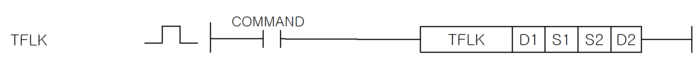
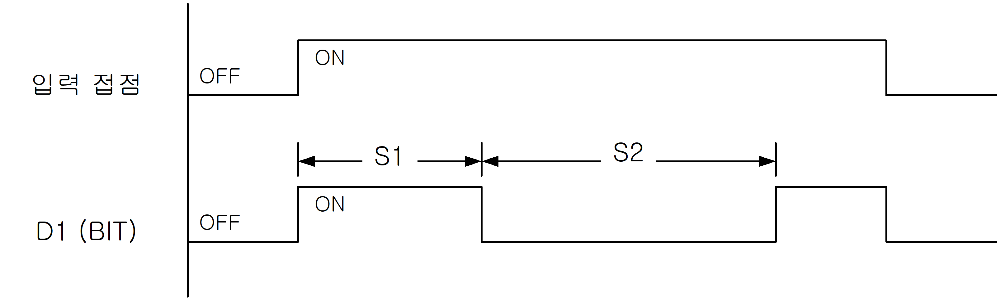

# TFLK

Manual section(s): 4.33.3. Original Korean notes below may cover the other variants on the same page; apply the widths and execution form of `TFLK`.

## Editing route

Use `get_ir` → `apply_patch` for this instruction edit. `insert_ladder_instruction` is the internal writer route, not a separate MCP tool. Preserve the exported revision and native constraints.
The writer mnemonic is `TFLK`; the catalog records opcode `945` and `4` operands in order.
Inspect the CPU/project and target cells first. Use the inspected revision and positions, preserve expected values, dry-run when useful, then save and inspect the result. See the [editing skill](../../SKILL.md) and [ladder workflow](../ladder.md).

## Operands

| Order | Operand | Description (Korean manual) | Reviewed types | Device areas | Constant |
| --- | --- | --- | --- | --- | --- |
| 1 | D1 | 설정시간으로 On/Off시킬 비트 번호 | BIT | PMK, D.x | Not allowed |
| 2 | S1 | D1으로 설정된 비트를 On시킬 시간 | WORD | PMK, F, L, T, C, Z, U, N, D, R | Allowed |
| 3 | S2 | D1으로 설정된 비트를 Off시킬 시간 | WORD | PMK, F, L, T, C, Z, U, N, D, R | Allowed |
| 4 | D2 | (D2+0) : 수행중인 현재시간 (D2+1) : 사용할 시간 단위 설정 ( 0-1ms, 1-10ms, 2-100ms, 3-1s ) (D2+2) ~ (D2+3) : 시스템 영역 ( word * 2) | WORD | PMK, L, T, C, Z, U, N, D, R | Not allowed |

These are the current library's reviewed operand rules. A shared type union is not a per-variant type choice; use the manual behavior to select the required width. Missing permissions stay unknown.

## CPU and acceptance

No separately reviewed CPU-model restriction is available in the current catalog; this means unknown, not universal compatibility.
Check the applicable model, firmware, modules and memory spans stated in the manual notes. Local parsing, writer validation and IL conversion do not prove native compilation or PLC behavior. Native acceptance requires XG5000 Open → Check Program → Save As → comparison.

## Manual behavior notes (Korean)

- TFLK
- 입력 접점이 On되었을 때, D1으로 지정된 비트를 S1시간동안 On시켰다가 S2시간동안 Off시키는 명령어 입니다.
- 접점이 Off되면 D2로 지정된 수행중인 현재시간은 초기화되고, D1으로 설정한 비트값도 Off 됩니다. 다시 접점을 On시키면 처음부터 다시 명령어를 수행합니다.
- D2+1 영역에 사용할 시간단위를 설정합니다.
- 0 - 1ms, 1 - 10ms, 2 - 100ms, 3 - 1s, 4이상일 경우 에러없고, 모두 1s로 설정됩니다.
- 이 명령어 수행을 위해서 2워드의 시스템 영역이 필요합니다. 이를 위해 D2+2, D2+3워드 영역을 명령어 내부에서 사용합니다. 따라서 D2설정시에는 각 디바이스의 범위를 고려해서 설정해야 합니다.

## Manual applicability and restrictions

- 적용 기종 : XGK, XGB

## Manual flag and step matrix

The shared usage table marks affected flags with `O`, and `-` where it lists no effect. Native steps are the manual's instruction size, not the number of operand arguments. Conditions for setting/clearing flags are in the behavior notes.

| Manual instruction group | Native steps | 에러 (F110) | 제로 (F111) | 캐리 (F112) |
| --- | --- | --- | --- | --- |
| TFLK | 4~7 | O | - | - |

## Additional source notes after examples

The manual places some execution restrictions and timing conditions after its example heading. Retain those checks below. Example addresses and circuit assumptions describe the source example and are not defaults for a new program.

- TFLK 명령은 접점이 On되지 않아도 내부적으로 처리되는 부분이 있으므로, 간접지정(#)이나 인덱스([Z]) 사용시 주의하시기 바랍니다.
- TFLK명령의 오퍼랜드 중 하나에 M100[Z10]을 사용하고 Z10의 값이 M영역의 범위를 벗어날 수 있는 1947을 초과한 값이면 접점이 On되지 않았어도 에러가 발생하게 됩니다.

## Referenced manual figures

These figures belong to the shared source topic. Read the source corrections above before using variant-specific layouts or example values.

## Provenance

Source: `XGK(B)InstructionHelp_Kr_V3.5.chm`, SHA-256 `b866d589d800addcb039f9f09b182592464d6367faa55abf6dde9ac34a1580e0`.

- `4333tflk.htm` — §4.33.3; source SHA-256 `0070951eb474089750bb3c713db4979c66933d732aca14c2a8a8f004fe71d65b`.
- Additional behavior/operand evidence: `4333tflk.htm`.
