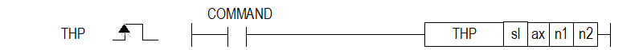

# THP

Manual section(s): 4.41.35. Original Korean notes below may cover the other variants on the same page; apply the widths and execution form of `THP`.

## Editing route

Use `get_ir` → `apply_patch` for this instruction edit. `insert_ladder_instruction` is the internal writer route, not a separate MCP tool. Preserve the exported revision and native constraints.
The writer mnemonic is `THP`; the catalog records opcode `1008` and `4` operands in order.
Inspect the CPU/project and target cells first. Use the inspected revision and positions, preserve expected values, dry-run when useful, then save and inspect the result. See the [editing skill](../../SKILL.md) and [ladder workflow](../ladder.md).

## Operands

| Order | Operand | Description (Korean manual) | Reviewed types | Device areas | Constant |
| --- | --- | --- | --- | --- | --- |
| 1 | sl | 위치 모듈이 장착된 베이스(x)와 슬롯(y) 번호:h00xy | WORD | Unknown | Unknown |
| 2 | ax | 기본 파라미터 티칭을 실행할 지령 축 (0:X 축, 1:Y 축, 2:Z 축) | WORD | PMK, L, Z, N, D, R | Allowed |
| 3 | n1 | 티칭 데이터 (원점 복귀 파라미터 중 변경할 항목의 변경값) | DINT | PMK, L, Z, N, D, R | Allowed |
| 4 | n2 | 원점 복귀 파라미터 중 변경할 항목 (1~9), hFF | WORD | PMK, L, Z, N, D, R | Allowed |

These are the current library's reviewed operand rules. A shared type union is not a per-variant type choice; use the manual behavior to select the required width. Missing permissions stay unknown.

## CPU and acceptance

No separately reviewed CPU-model restriction is available in the current catalog; this means unknown, not universal compatibility.
Check the applicable model, firmware, modules and memory spans stated in the manual notes. Local parsing, writer validation and IL conversion do not prove native compilation or PLC behavior. Native acceptance requires XG5000 Open → Check Program → Save As → comparison.

## Manual behavior notes (Korean)

- ※ 오퍼랜드 설정 범위는 XGF-PxxA를 기준으로 합니다. 축에 대한 오퍼랜드(ax)의 설정 범위는 제품에서 지원하는 제어 축 수에 따라 다르니, 제품 사용설명서를 참조하여 주십시오.
- 이 명령은 위치결정 모듈에 원점복귀 파라미터 티칭 지령을 내리는 명령입니다.
- sl(위치결정 모듈의 슬롯번호)로 지정된 위치결정 모듈의 ax로 지정된 축의 원점복귀 파라미터 중 n2의 항목을 n1값으로 변경하는 원점복귀 파라미터 티칭 명령을 합니다..
- n2값은 아래와 같이 설정할 수 있습니다.

| 설정값 | 항 목 | 항 목 |
| --- | --- | --- |
| 1 | 원점 어드레스 |  |
| 2 | 원점복귀 고속 속도 |  |
| 3 | 원점복귀 저속 속도 |  |
| 4 | 원점복귀 가감속 시간 |  |
| 5 | 원점복귀 드웰타임 |  |
| 6 | 원점보정량 |  |
| 7 | 원점복귀 재기동 시간 |  |
| 8 | 원점복귀 방법 | 0:DOG/원점(Off) 1:DOG/원점(On) 2:상하한/원점 3:DOG 4:고속원점복귀 5:상하한 |
| 9 | 원점복귀 방향 | 0:정방향 1:역방향 |

## Manual flags

| 플래그 | 내 용 | 디바이스 번호 |
| --- | --- | --- |
| 에러 | ax 값이 범위를 벗어날 경우 | F110 |

## Manual applicability and restrictions

- 적용 기종 : XGK, XBF
- ax의 설정값이 제품에서 지원하는 설정 범위와 다른 값을 입력하면 에러가 발생(F110이 Set)됩니다.

## Manual flag and step matrix

The shared usage table marks affected flags with `O`, and `-` where it lists no effect. Native steps are the manual's instruction size, not the number of operand arguments. Conditions for setting/clearing flags are in the behavior notes.

| Manual instruction group | Native steps | 에러 (F110) | 제로 (F111) | 캐리 (F112) |
| --- | --- | --- | --- | --- |
| THP | 4~7 | O | - | - |

## Additional source notes after examples

The manual places some execution restrictions and timing conditions after its example heading. Retain those checks below. Example addresses and circuit assumptions describe the source example and are not defaults for a new program.

- 원점 복귀 파라미터 티칭 명령으로 수정한 파라미터 값은 전원이 ON 되어 있는 동안에만 유효합니다.
- 원점 복귀 파라미터 티칭 명령으로 수정한 파라미터 값을 플래시 메모리에 저장하려면 원점 복귀 파라미터 티칭 후 파라미터/운전데이터 저장 명령 WRT 를 사용하여 수정한 파라미터 값을 플래시 메모리에 저장해야 합니다.
- 복수 티칭 데이터 개수에 따라 여러 스캔이 소요될 수 있습니다.
- 티칭 완료 플래그는 존재하지 않습니다. 따라서 복수개의 티칭을 실행하고 티칭 개수에 따라 약간의 딜레이를 주고 다음 지령을 실행 해주시기 바랍니다. (항목 개수에 따라 수백 ms이상)

## Referenced manual figures

These figures belong to the shared source topic. Read the source corrections above before using variant-specific layouts or example values.

## Provenance

Source: `XGK(B)InstructionHelp_Kr_V3.5.chm`, SHA-256 `b866d589d800addcb039f9f09b182592464d6367faa55abf6dde9ac34a1580e0`.

- `44135thp.htm` — §4.41.35; source SHA-256 `20c1516b826c60c4c2037e08c3dcf871909429eb0f7080107efcb22a760d45b2`.
- Additional behavior/operand evidence: `44135thp.htm`.
