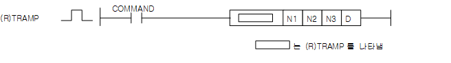
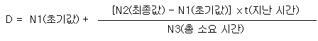

# TRAMP

Manual section(s): 4.24.19. Original Korean notes below may cover the other variants on the same page; apply the widths and execution form of `TRAMP`.

## Editing route

Use `get_ir` → `apply_patch` for this instruction edit. `insert_ladder_instruction` is the internal writer route, not a separate MCP tool. Preserve the exported revision and native constraints.
The writer mnemonic is `TRAMP`; the catalog records opcode `946` and `4` operands in order.
Inspect the CPU/project and target cells first. Use the inspected revision and positions, preserve expected values, dry-run when useful, then save and inspect the result. See the [editing skill](../../SKILL.md) and [ladder workflow](../ladder.md).

## Operands

| Order | Operand | Description (Korean manual) | Reviewed types | Device areas | Constant |
| --- | --- | --- | --- | --- | --- |
| 1 | N1 | 초기값 | INT/REAL | PMK, F, L, T, C, Z, U, N, D, R | Allowed |
| 2 | N2 | 최종값 | INT/REAL | PMK, F, L, T, C, Z, U, N, D, R | Allowed |
| 3 | N3 | 소요 시간(초) | WORD | PMK, F, L, T, C, Z, U, N, D, R | Allowed |
| 4 | D | 현재 결과 | INT/REAL | PMK, L, N, D, R | Not allowed |

These are the current library's reviewed operand rules. A shared type union is not a per-variant type choice; use the manual behavior to select the required width. Missing permissions stay unknown.

## CPU and acceptance

No separately reviewed CPU-model restriction is available in the current catalog; this means unknown, not universal compatibility.
Check the applicable model, firmware, modules and memory spans stated in the manual notes. Local parsing, writer validation and IL conversion do not prove native compilation or PLC behavior. Native acceptance requires XG5000 Open → Check Program → Save As → comparison.

## Manual behavior notes (Korean)

- TRAMP
- N3로 지정된 시간(초)동안, 초기값에서 최종값까지 직선으로 변화되는 값을 D에 저장하고, D+2에는 타이머 값(접근시 오동작)이 DWORD 타입으로 저장됩니다.
- 수행이 완료되면 D의 값은 N2의 값과 같아집니다.
- 수행 조건이 해재되면 D는 최종결과를 그대로 표시하지만 내부 타이머가 초기화 되므로 재 수행 시 처음부터 동작합니다.
- 명령어 동작 중의 결과값(D)는 다음과 같이 연산됩니다.
- 연산중 소수점 이하의 값이 발생시 정수형으로 변환되는 과정에서 오차가 발생할 수 있습니다.
- 소요시간(N3)이 0인 경우는 연산이 이뤄지지 않으며 D에는 N2값을 출력합니다.
- D+2에는 연산을 위한 타이머 값이 저장되기 때문에 사용자가 임의로 변경하였을 경우 원치 않는 결과가 발생이 될 수 있습니다.
- 최종값(N2)까지의 이행이 완료되면 연산 결과(D)에는 최종값(N2)이 표시됩니다.
- 본 명령의 실행 도중에 지령이 OFF했을 경우, D값의 내용은 변화하지 않습니다.
- 완료된 TRAMP 명령어의 지령을 OFF a ON 하면 초기값부터 TRAMP 명령을 다시 수행합니다.
- RTRAMP는 REAL 타입 데이터로 동작합니다.

## Manual applicability and restrictions

- 적용 기종 : XGK, XGB(XBC-U, XBM-H/H2/HP)

## Manual flag and step matrix

The shared usage table marks affected flags with `O`, and `-` where it lists no effect. Native steps are the manual's instruction size, not the number of operand arguments. Conditions for setting/clearing flags are in the behavior notes.

| Manual instruction group | Native steps | 에러 (F110) | 제로 (F111) | 캐리 (F112) |
| --- | --- | --- | --- | --- |
| (R)TRAMP | 4~7 | - | - | - |

## Additional source notes after examples

The manual places some execution restrictions and timing conditions after its example heading. Retain those checks below. Example addresses and circuit assumptions describe the source example and are not defaults for a new program.

- TRAMP 명령은 접점이 ON되지 않아도 내부적으로 처리되는 부분이 있으므로, 간접지정(#)이나 인덱스([Z]) 사용시 주의하시기 바랍니다.
- RAMP명령의 오퍼랜드 중 하나에 M100[Z10]을 사용하고 Z10의 값이 M영역의 범위를 벗어날 수 있는 1947을 초과한 값이면 접점이 ON되지 않았어도 에러가 발생하게 됩니다.

## Referenced manual figures

These figures belong to the shared source topic. Read the source corrections above before using variant-specific layouts or example values.

## Provenance

Source: `XGK(B)InstructionHelp_Kr_V3.5.chm`, SHA-256 `b866d589d800addcb039f9f09b182592464d6367faa55abf6dde9ac34a1580e0`.

- `42419tramprtramp.htm` — §4.24.19; source SHA-256 `8a4154710588fffff20b247ddf79b35610562e19228419ce806773fac5947c06`.
- Additional behavior/operand evidence: `42419tramprtramp.htm`.
