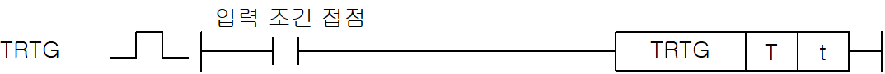
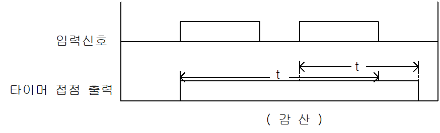

# TRTG

Produce a timer pulse whose duration restarts on a new rising input.

Manual section(s): 4.9.7. Original Korean notes below may cover the other variants on the same page; apply the widths and execution form of `TRTG`.

## Editing route

Use `insert_ladder_instruction` after calling `describe_operation` for its current schema.
The writer mnemonic is `TRTG`; the catalog records opcode `921` and `2` operands in order.
Inspect the CPU/project and target cells first. Use the inspected revision and positions, preserve expected values, dry-run when useful, then save and inspect the result. See the [editing skill](../../SKILL.md) and [ladder workflow](../ladder.md).

## Behavior

- Input On starts the contact and countdown from the preset.
- A new Off-to-On input before zero reloads the preset. Zero or RST turns the contact Off; RST also clears the value.

## Instruction constraints

- T selects the timer device; t is its WORD preset. The delay is the preset multiplied by the base time configured for that timer number.
- Available base times are 0.1 ms, 1 ms, 10 ms, and 100 ms; XGB does not support 0.1 ms.
- The same timer number cannot be used twice, even when indexed. Indexed timer/preset operands are limited to Z0..Z3; an indexed RST must match the timer operand form.

## Operands

| Order | Operand | Description (Korean manual) | Reviewed types | Device areas | Constant |
| --- | --- | --- | --- | --- | --- |
| 1 | T | 사용하고자 하는 타이머 접점 | WORD | T | Not allowed |
| 2 | t | 타이머의 설정치를 나타내고 정수나 워드 디바이스 지정 가능 설정시간 = 기본주기(0.1ms:XGB는 지원안함, 1ms, 10ms, 100ms) x 설정치(t) | WORD | PMK, U, D, R | Allowed |

These are the current library's reviewed operand rules. A shared type union is not a per-variant type choice; use the manual behavior to select the required width. Missing permissions stay unknown.

## CPU and acceptance

No separately reviewed CPU-model restriction is available in the current catalog; this means unknown, not universal compatibility.
Check the applicable model, firmware, modules and memory spans stated in the manual notes. Local parsing, writer validation and IL conversion do not prove native compilation or PLC behavior. Native acceptance requires XG5000 Open → Check Program → Save As → comparison.

## Manual behavior notes (Korean)

- 입력조건이 성립되면 타이머 출력이 On되고 타이머의 현재치가 설정치로부터 감소하기 시작하여 0 이 되면 타이머 출력은 Off됩니다.
- 타이머 현재치가 0이 되기 전에 또 다시 입력 조건이 Off ® On하면 타이머 현재치는 설정치로 재설정됩니다.
- 리셋(Reset) 입력조건이 성립하면 타이머 접점은 Off되고 현재치는 0이 됩니다

## Manual applicability and restrictions

- 적용 기종 : XGK, XGB

## Manual flag and step matrix

The shared usage table marks affected flags with `O`, and `-` where it lists no effect. Native steps are the manual's instruction size, not the number of operand arguments. Conditions for setting/clearing flags are in the behavior notes.

| Manual instruction group | Native steps | 에러 (F110) | 제로 (F111) | 캐리 (F112) |
| --- | --- | --- | --- | --- |
| TRTG | 2~3 | - | - | - |

## Referenced manual figures

These figures belong to the shared source topic. Read the source corrections above before using variant-specific layouts or example values.

## Provenance

Source: `XGK(B)InstructionHelp_Kr_V3.5.chm`, SHA-256 `b866d589d800addcb039f9f09b182592464d6367faa55abf6dde9ac34a1580e0`.

- `497trtg.htm` — §4.9.7; source SHA-256 `41d9ff139bb76a73b8a0fe59debea6405f6bdf63743056420400561b596a165e`.
- Additional behavior/operand evidence: `491.htm`, `497trtg.htm`.
