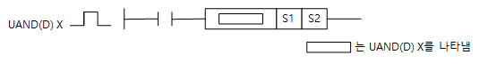

# UANDD>

Combine the current circuit result with an AND comparison: UANDD>.

Manual section(s): 4.15.20. Original Korean notes below may cover the other variants on the same page; apply the widths and execution form of `UANDD>`.

## Editing route

Use `insert_ladder_comparison` after calling `describe_operation` for its current schema.
The writer mnemonic is `UD>`; the catalog records opcode `1510` and `2` operands in order.
Inspect the CPU/project and target cells first. Use the inspected revision and positions, preserve expected values, dry-run when useful, then save and inspect the result. See the [editing skill](../../SKILL.md) and [ladder workflow](../ladder.md).

## Behavior

- Compare S1 > S2 as 32-bit unsigned integer; the comparison is On when the relation holds and Off otherwise.
- Combine the comparison result with the current bit result (BR) using AND.

## Instruction constraints

- The page applies to XGK and specified XGB XBC-U/XBM-H/H2/HP models; confirm the selected CPU support.

## Operands

| Order | Operand | Description (Korean manual) | Reviewed types | Device areas | Constant |
| --- | --- | --- | --- | --- | --- |
| 1 | S1 | S2와 비교하게 되는 데이터나 데이터 주소 | UDINT | PMK, F, L, T, C, Z, U, N, D, R | Allowed |
| 2 | S2 | S1과 비교하게 되는 데이터나 데이터 주소 | UDINT | PMK, F, L, T, C, Z, U, N, D, R | Allowed |

These are the current library's reviewed operand rules. A shared type union is not a per-variant type choice; use the manual behavior to select the required width. Missing permissions stay unknown.

## CPU and acceptance

No separately reviewed CPU-model restriction is available in the current catalog; this means unknown, not universal compatibility.
Check the applicable model, firmware, modules and memory spans stated in the manual notes. Local parsing, writer validation and IL conversion do not prove native compilation or PLC behavior. Native acceptance requires XG5000 Open → Check Program → Save As → comparison.

## Manual behavior notes (Korean)

- UAND X ( =, >, <, >=, <=, < >)
- S1 과 S2를 비교하여 X조건과 일치하면 On, 불일치하면 Off하고 이 결과와 현재의 BR값을 AND하여 새로운 연산결과로 취한다.
- S1 과 S2의 비교는Unsigned연산으로 실행합니다.
- UANDD X ( D=, D>, D<, D>=, D<=, D< >)

| X조건 | 조건 | 연산결과 |
| --- | --- | --- |
| = | S1 = S2 | On |
| <= | S1 ￡ S2 | On |
| >= | S1 ³ S2 | On |
| < > | S1 ¹ S2 | On |
| < | S1 < S2 | On |
| > | S1 > S2 | On |

## Manual applicability and restrictions

- 적용 기종 : XGK, XGB(XBC-U, XBM-H/H2/HP)

## Manual flag and step matrix

The shared usage table marks affected flags with `O`, and `-` where it lists no effect. Native steps are the manual's instruction size, not the number of operand arguments. Conditions for setting/clearing flags are in the behavior notes.

| Manual instruction group | Native steps | 에러 (F110) | 제로 (F111) | 캐리 (F112) |
| --- | --- | --- | --- | --- |
| UAND X UANDD X | 2~3 | - | - | - |

## Referenced manual figures

These figures belong to the shared source topic. Read the source corrections above before using variant-specific layouts or example values.

## Provenance

Source: `XGK(B)InstructionHelp_Kr_V3.5.chm`, SHA-256 `b866d589d800addcb039f9f09b182592464d6367faa55abf6dde9ac34a1580e0`.

- `41520uandxuanddx.htm` — §4.15.20; source SHA-256 `5c6b5227f93da8671e5c6849ecc3c8aca240a6b14cc20078de019fccf398e2ed`.
- Additional behavior/operand evidence: `344.htm`, `41519uloadxuloaddx1.htm`.
