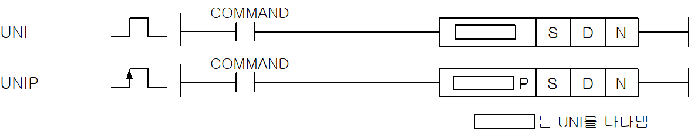
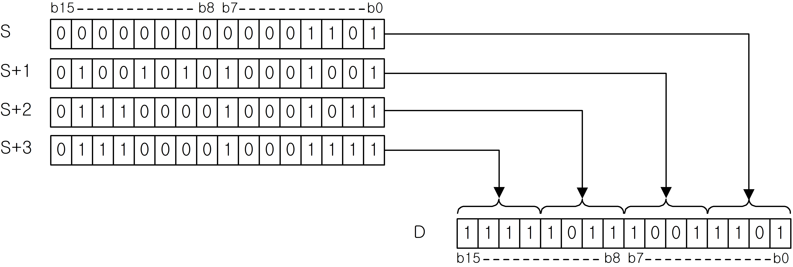

# UNIP

Manual section(s): 4.24.6. Original Korean notes below may cover the other variants on the same page; apply the widths and execution form of `UNIP`.

Execution form: the source explicitly pairs this command as `(P)`; `UNIP` is the pulse-type P form. Manual §2.4.2 defines `P` as pulse-type notation. Select the paired forms deliberately and retain the instruction's actual execution conditions; unrelated mnemonics ending in P are not classified by suffix alone.

## Editing route

Use `insert_ladder_instruction` after calling `describe_operation` for its current schema.
The writer mnemonic is `UNIP`; the catalog records opcode `630` and `3` operands in order.
Inspect the CPU/project and target cells first. Use the inspected revision and positions, preserve expected values, dry-run when useful, then save and inspect the result. See the [editing skill](../../SKILL.md) and [ladder workflow](../ladder.md).

## Operands

| Order | Operand | Description (Korean manual) | Reviewed types | Device areas | Constant |
| --- | --- | --- | --- | --- | --- |
| 1 | S | UNI연산을 실행할 데이터 주소 | WORD | PMK, F, L, T, C, Z, U, N, D, R | Not allowed |
| 2 | D | 연산 결과를 저장할 주소 | WORD | PMK, L, T, C, Z, U, N, D, R | Not allowed |
| 3 | N | S로부터 결합될 4bit 데이터의 개수 | WORD | PMK, F, L, T, C, Z, U, N, D, R | Allowed |

These are the current library's reviewed operand rules. A shared type union is not a per-variant type choice; use the manual behavior to select the required width. Missing permissions stay unknown.

## CPU and acceptance

No separately reviewed CPU-model restriction is available in the current catalog; this means unknown, not universal compatibility.
Check the applicable model, firmware, modules and memory spans stated in the manual notes. Local parsing, writer validation and IL conversion do not prove native compilation or PLC behavior. Native acceptance requires XG5000 Open → Check Program → Save As → comparison.

## Manual flags

- UNI (Unite)
- S로부터 N개 워드내의 하위 4bit들을 결합하여 워드 데이터D에 저장합니다. 이때, 상위 12bit는 무시됩니다.
- 각각의 4bit 데이터는 하위로부터 순서대로 결합하여 워드 데이터 D에 저장됩니다.
- 워드 데이터 D의 하위 N개 4bit 데이터를 제외하고는 모두 0이 됩니다.
- N이 4를 초과하면 에러 플래그를 셋(Set)합니다.

| 플래그 | 내 용 | 디바이스 번호 |
| --- | --- | --- |
| 에러 | S부터 N개의 범위가 해당 디바이스의 허용 범위를 초과할 경우 셋(Set)합니다. N 이 4를 초과할 경우 셋(Set)합니다. | F110 |

## Manual applicability and restrictions

- 적용 기종 : XGK, XGB

## Manual flag and step matrix

The shared usage table marks affected flags with `O`, and `-` where it lists no effect. Native steps are the manual's instruction size, not the number of operand arguments. Conditions for setting/clearing flags are in the behavior notes.

| Manual instruction group | Native steps | 에러 (F110) | 제로 (F111) | 캐리 (F112) |
| --- | --- | --- | --- | --- |
| UNI(P) | 4~6 | O | - | - |

## Referenced manual figures

These figures belong to the shared source topic. Read the source corrections above before using variant-specific layouts or example values.

## Provenance

Source: `XGK(B)InstructionHelp_Kr_V3.5.chm`, SHA-256 `b866d589d800addcb039f9f09b182592464d6367faa55abf6dde9ac34a1580e0`.

- `4246uniunip.htm` — §4.24.6; source SHA-256 `32423db7f890cb02052f69b2ced8b9e6e4f75a125420b6e3ee045acf081e6709`.
- Additional behavior/operand evidence: `4246uniunip.htm`, `245.htm`.
