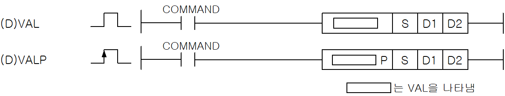
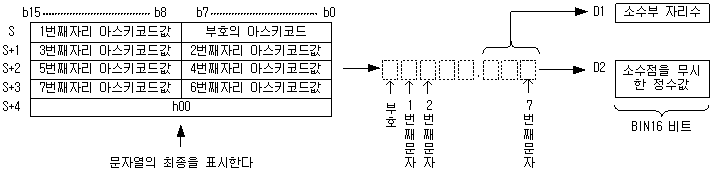
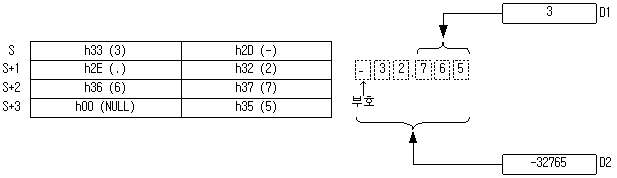
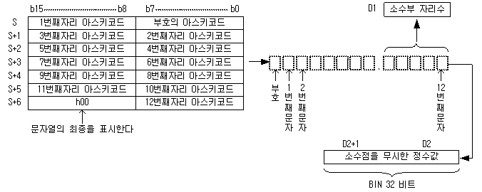

# VALP

Manual section(s): 4.26.9. Original Korean notes below may cover the other variants on the same page; apply the widths and execution form of `VALP`.

Execution form: the source explicitly pairs this command as `(P)`; `VALP` is the pulse-type P form. Manual §2.4.2 defines `P` as pulse-type notation. Select the paired forms deliberately and retain the instruction's actual execution conditions; unrelated mnemonics ending in P are not classified by suffix alone.

## Editing route

Use `get_ir` → `apply_patch` for this instruction edit. `insert_ladder_instruction` is the internal writer route, not a separate MCP tool. Preserve the exported revision and native constraints.
The writer mnemonic is `VALP`; the catalog records opcode `702` and `3` operands in order.
Inspect the CPU/project and target cells first. Use the inspected revision and positions, preserve expected values, dry-run when useful, then save and inspect the result. See the [editing skill](../../SKILL.md) and [ladder workflow](../ladder.md).

## Operands

| Order | Operand | Description (Korean manual) | Reviewed types | Device areas | Constant |
| --- | --- | --- | --- | --- | --- |
| 1 | S | BIN데이터로 변환할 문자열의 시작 주소 | STRING | PMK, L, Z, U, N, D, R | Not allowed |
| 2 | D1 | 변환후 BIN데이터의 자리수를 저장할 위치 | WORD | PMK, L, Z, U, N, D, R | Not allowed |
| 3 | D2 | 변환후 BIN데이터를 저장할 위치 | INT/DINT | PMK, L, Z, U, N, D, R | Not allowed |

These are the current library's reviewed operand rules. A shared type union is not a per-variant type choice; use the manual behavior to select the required width. Missing permissions stay unknown.

## CPU and acceptance

No separately reviewed CPU-model restriction is available in the current catalog; this means unknown, not universal compatibility.
Check the applicable model, firmware, modules and memory spans stated in the manual notes. Local parsing, writer validation and IL conversion do not prove native compilation or PLC behavior. Native acceptance requires XG5000 Open → Check Program → Save As → comparison.

## Manual flags

- VAL (Value)
- S에 지정된 문자열을 BIN데이터로 변환하여 D1에 소수부 자리수를 저장하고, D2에 문자열의 소수점을 무시하고 16bit BIN 데이터로 변환한 데이터를 저장합니다.
- ASCII문자열의 범위는 ‘0’ ~ ‘9’이며, 부호, 소수점(‘.’) 이외의 경우에 대해서는 에러 플래그를 셋(Set)합니다. VAL의 경우 변환가능한 S의 범위는 -32768 ~ 32767입니다.
- DVAL (Double Value)
- S에 지정된 문자열을 BIN데이터로 변환하여 D1에 소수부 자리수를 저장하고, D2에 변환된 데이터를 저장합니다.
- ASCII문자열의 범위는 ‘0’ ~ ’9’이며, 부호, 소수점 이외의 경우에 대해서는 에러 플래그를 셋(Set)합니다. DVAL의 경우 변환가능한 S의 범위는 -2147483648 ~ 2147483647입니다.

| 플래그 | 내 용 | 디바이스 번호 |
| --- | --- | --- |
| 에러 | ASCII 문자열 값이 ‘0’~’9’, 부호( ‘-‘, ‘+’ ), 소수점(‘.’) 이외일 때 ASCII 문자열의 길이가 최대 스트링 길이를 초과할 때 점, 부호(‘+’,’-‘), 공백만 사용할 경우 숫자형 문자열(‘0’~’9’)이 나온 이후에 공백이 올 때 | F110 |

## Manual applicability and restrictions

- 적용 기종 : XGK, XGB

## Manual flag and step matrix

The shared usage table marks affected flags with `O`, and `-` where it lists no effect. Native steps are the manual's instruction size, not the number of operand arguments. Conditions for setting/clearing flags are in the behavior notes.

| Manual instruction group | Native steps | 에러 (F110) | 제로 (F111) | 캐리 (F112) |
| --- | --- | --- | --- | --- |
| VAL(P) DVAL(P) | 4~6 | O | - | - |

## Additional source notes after examples

The manual places some execution restrictions and timing conditions after its example heading. Retain those checks below. Example addresses and circuit assumptions describe the source example and are not defaults for a new program.

- VAL 에 입력되는 문자열은 +, -, .(점), 공백, 숫자만 시작이 가능합니다.
- 부호(+,-)로 시작된 문자열 뒤에 숫자 또는 점이 나오기 전까지 공백이 있어도 정상동작 합니다.
- 숫자가 나온 이후에는 공백이 있으면 에러처리하고, 숫자없이 점이 올경우, 점앞에는 0이 있는 것으로 간주합니다.
- 점, 부호(+,-),공백만 사용할 경우는 에러 처리합니다.
- 허용 예) ___.123, __0.001, __+__1.33, -__.4 ( _ : 공백을 의미 )
- 에러 예) 1.24__, 1_23, +-0, __.__ 와 .(점), +, - ,공백 등이 단독으로 사용될 경우

## Referenced manual figures

These figures belong to the shared source topic. Read the source corrections above before using variant-specific layouts or example values.

## Provenance

Source: `XGK(B)InstructionHelp_Kr_V3.5.chm`, SHA-256 `b866d589d800addcb039f9f09b182592464d6367faa55abf6dde9ac34a1580e0`.

- `4269valvalpdvaldvalp1.htm` — §4.26.9; source SHA-256 `7184fdf03abb1e113b58079cc1935075d31bf9afaf27189490518cdb5cc27deb`.
- Additional behavior/operand evidence: `4269valvalpdvaldvalp1.htm`, `245.htm`.
