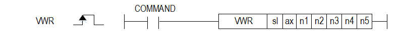

# VWR

Manual section(s): 4.41.45. Original Korean notes below may cover the other variants on the same page; apply the widths and execution form of `VWR`.

## Editing route

Use `insert_ladder_instruction` after calling `describe_operation` for its current schema.
The writer mnemonic is `VWR`; the catalog records opcode `1197` and `7` operands in order.
Inspect the CPU/project and target cells first. Use the inspected revision and positions, preserve expected values, dry-run when useful, then save and inspect the result. See the [editing skill](../../SKILL.md) and [ladder workflow](../ladder.md).

## Operands

| Order | Operand | Description (Korean manual) | Reviewed types | Device areas | Constant |
| --- | --- | --- | --- | --- | --- |
| 1 | sl | 위치 모듈이 장착된 베이스(x)와 슬롯(y) 번호:h00xy | WORD | Unknown | Unknown |
| 2 | ax | 명령을 내릴 축(0:X축,1:Y축,2:Z축) | WORD | PMK, L, Z, N, D, R | Allowed |
| 3 | n1 | 쓸 데이터가 저장된 선두 디바이스 | WORD | PMK, L, Z, N, D, R | Allowed |
| 4 | n2 | 모듈 내부 메모리 데이터 쓰기 선두 번지 (0 ~ 12147) | WORD | PMK, L, Z, N, D, R | Allowed |
| 5 | n3 | 블록 간 옵셋 (0 ~ 12147) | WORD | PMK, L, Z, N, D, R | Allowed |
| 6 | n4 | 한 블록의 크기 (1 ~ 128) | WORD | PMK, L, Z, N, D, R | Allowed |
| 7 | n5 | 읽을 블록의 개수 (1 ~ 128) | WORD | PMK, L, Z, N, D, R | Allowed |

These are the current library's reviewed operand rules. A shared type union is not a per-variant type choice; use the manual behavior to select the required width. Missing permissions stay unknown.

## CPU and acceptance

No separately reviewed CPU-model restriction is available in the current catalog; this means unknown, not universal compatibility.
Check the applicable model, firmware, modules and memory spans stated in the manual notes. Local parsing, writer validation and IL conversion do not prove native compilation or PLC behavior. Native acceptance requires XG5000 Open → Check Program → Save As → comparison.

## Manual behavior notes (Korean)

- ※ 오퍼랜드 설정 범위는 XGF-PxxA를 기준으로 합니다. 축에 대한 오퍼랜드(ax)의 설정 범위는 제품에서 지원하는 제어 축 수에 따라 다르니, 제품 사용설명서를 참조하여 주십시오.
- 해당 지령은 위치결정 모듈 내부 메모리의 파라미터, 운전데이터, 캠데이터 중 “쓰기 주소” 위치 에서부터 “블록 크기” 만큼의 데이터를 PLC 프로그램에서 설정한 데이터로 WORD 단위 쓰기를 실행 합니다.
- “블록 개수” 가 2 이상인 경우 “쓰기 주소” 에서 부터 “블록 옵셋”만큼 떨어져 있는 블록들에 나머지 데이터들을 “블록 개수”-1 횟수만큼 차례로 데이터 쓰기를 실행합니다.
- 한 명령으로 읽을 수 있는 최대 데이터 크기 (블록 크기 x 블록 개수)는 128 WORD 입니다.
- “가변 데이터 쓰기” 명령은 운전 중에는 실행할 수 없습니다.

## Manual flags

| 플래그 | 내 용 | 디바이스 번호 |
| --- | --- | --- |
| 에러 | ax 값이 범위를 벗어날 경우 | F110 |

## Manual applicability and restrictions

- 적용 기종 : XGK: XBC-U와 XBM은 2번과 3번 슬롯에서만 네트워크 위치 모듈(XBF-PNxxB)을 사용할 수 있습니다.
- ax의 설정값이 제품에서 지원하는 설정 범위와 다른 값을 입력하면 에러가 발생(F110이 Set)됩니다.

## Manual flag and step matrix

The shared usage table marks affected flags with `O`, and `-` where it lists no effect. Native steps are the manual's instruction size, not the number of operand arguments. Conditions for setting/clearing flags are in the behavior notes.

| Manual instruction group | Native steps | 에러 (F110) | 제로 (F111) | 캐리 (F112) |
| --- | --- | --- | --- | --- |
| VWR | 4~7 | O | - | - |

## Additional source notes after examples

The manual places some execution restrictions and timing conditions after its example heading. Retain those checks below. Example addresses and circuit assumptions describe the source example and are not defaults for a new program.

- “가변 데이터 쓰기” 명령을 실행한 경우 변경한 값은 위치결정 모듈에 전원이 인가된 동안만 유지됩니다.
- 변경한 데이터를 계속 보존하기 위해서는 “파라미터/운전데이터 저장” 명령(WRT)을 실행 하시기 바랍니다.
- 다음과 같은 경우에 에러가 되어 “가변 데이터 쓰기” 명령을 실행할 수 없습니다.
- (1) 데이터 범위 설정 에러: 쓸 데이터 크기(블록 크기 x 블록 개수)가 0이거나 128 WORD 를 초과한 경우
- (2) 블록 중복 에러: 데이터를 쓸 모듈 내부 메모리 블록 이 서로 중복되는 경우 (블록 개수가 2 이상이고, 블록 옵셋이 블록 크기보다 작은 경우)
- (3) 운전 중 실행 금지 에러: 위치결정 모듈의 한 축이라도 운전중인 경우

## Referenced manual figures

These figures belong to the shared source topic. Read the source corrections above before using variant-specific layouts or example values.

## Provenance

Source: `XGK(B)InstructionHelp_Kr_V3.5.chm`, SHA-256 `b866d589d800addcb039f9f09b182592464d6367faa55abf6dde9ac34a1580e0`.

- `44145vwr1.htm` — §4.41.45; source SHA-256 `7134aae1e1abd1f2ca7659036d0c7861b7978a049d3f21942d00fe5d77c33165`.
- Additional behavior/operand evidence: `44145vwr1.htm`.
