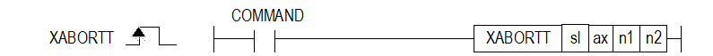

# XABORTTEX

Release or reset an external trigger latch on a positioning axis.

Manual section(s): 4.42.69. Original Korean notes below may cover the other variants on the same page; apply the widths and execution form of `XABORTTEX`.

## Editing route

Use `insert_ladder_instruction` after calling `describe_operation` for its current schema.
The writer mnemonic is `XABORTTEX`; the catalog records opcode `1600` and `4` operands in order.
Inspect the CPU/project and target cells first. Use the inspected revision and positions, preserve expected values, dry-run when useful, then save and inspect the result. See the [editing skill](../../SKILL.md) and [ladder workflow](../ladder.md).

## Behavior

- sl/ax select the module and axis. n1 selects probe1/2 rising edge (0/1), falling edge (2/3), or index-Z pulse (4/5).
- n2=0 resets trigger-complete status; n2=1 resets both captured position and completion status.

## Instruction constraints

- The page ax range is1..8 for XGF-PN8B; invalid ax sets F110. Completion remains On until reset with this instruction.

## Source corrections

- The support matrix misspells XTABORTT, whereas title/body/ST specify XABORTT. The ST example includes a third numeric operand absent from the actual operand table; do not copy that extra parameter.

## Operands

| Order | Operand | Description (Korean manual) | Reviewed types | Device areas | Constant |
| --- | --- | --- | --- | --- | --- |
| 1 | sl | 위치 모듈이 장착된 베이스(x)와 슬롯(y) 번호:h00xy | WORD | Unknown | Unknown |
| 2 | ax | 캠 지령을 내릴 종축 (1 ~ 8:1축 ~ 8축) | WORD | PMK, L, Z, N, D, R | Allowed |
| 3 | n1 | 트리거 리셋할 신호 | WORD | PMK, L, Z, N, D, R | Allowed |
| 4 | n2 | 트리거 리셋 항목 | WORD | PMK, L, Z, N, D, R | Allowed |

These are the current library's reviewed operand rules. A shared type union is not a per-variant type choice; use the manual behavior to select the required width. Missing permissions stay unknown.

## CPU and acceptance

No separately reviewed CPU-model restriction is available in the current catalog; this means unknown, not universal compatibility.
Check the applicable model, firmware, modules and memory spans stated in the manual notes. Local parsing, writer validation and IL conversion do not prove native compilation or PLC behavior. Native acceptance requires XG5000 Open → Check Program → Save As → comparison.

## Manual behavior notes (Korean)

- ※ 오퍼랜드 설정 범위는 XGF-PN8B를 기준으로 합니다. 축에 대한 오퍼랜드(ax)의 설정 범위는 제품에서 지원하는 제어 축수에 따라 다르니, 제품 사용설명서를 참조하여 주십시오.
- 이 명령은 위치결정 모듈의 외부 트리거 기능을 해제하기 위해 사용되는 명령입니다.
- sl(위치결정 모듈의 슬롯번호)로 지정된 위치결정 모듈의 ax로 지정된 축의 트리거 기능을 해제합니다.
- n1에 지정된 트리거 해제할 신호는 다음과 같이 지정할 수 있습니다.
- 0:터치 프로브 1 상승 엣지
- 1:터치 프로브 2 상승 엣지
- 2:터치 프로브 1 하강 엣지
- 3:터치 프로브 2 하강 엣지
- 4:터치 프로브 1 인덱스(Z) 펄스
- 5:터치 프로브 2 인덱스(Z) 펄스
- n2에 지정된 트리거 리셋 항목은 다음과 같이 지정할 수 있습니다.
- 0:트리거 완료 상태 리셋
- 1:트리거 위치 데이터 및 트리거 완료 상태 리셋

## Manual flags

| 플래그 | 내 용 | 디바이스 번호 |
| --- | --- | --- |
| 에러 | ax 값이 범위를 벗어날 경우 | F110 |

## Manual applicability and restrictions

- 적용 기종 : XGK, XBC, XBM, XBF
- ax의 설정값이 제품에서 지원하는 설정 범위와 다른 값을 입력하면, 에러가 발생(F110이 Set)합니다.

## Additional source notes after examples

The manual places some execution restrictions and timing conditions after its example heading. Retain those checks below. Example addresses and circuit assumptions describe the source example and are not defaults for a new program.

- 터치 프로브 또는 인덱스(Z) 펄스 신호가 On되어 래치가 완료되면 상태 정보의 축 정보 중 Bit 5:“트리거 완료” 비트에 정보가 저장됩니다.
- “트리거 완료” 상태 비트는 트리거 해제 명령(XABORTT)으로 리셋 되기 전까지 On 상태를 유지합니다.

## Referenced manual figures

These figures belong to the shared source topic. Read the source corrections above before using variant-specific layouts or example values.

## Provenance

Source: `XGK(B)InstructionHelp_Kr_V3.5.chm`, SHA-256 `b866d589d800addcb039f9f09b182592464d6367faa55abf6dde9ac34a1580e0`.

- `44269xabortt.htm` — §4.42.69; source SHA-256 `57d7364bf39d55f342c26c734a909873f34093f91674a82da743ee931407e70a`.
- Additional behavior/operand evidence: `44269xabortt.htm`.
