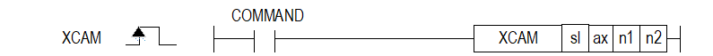
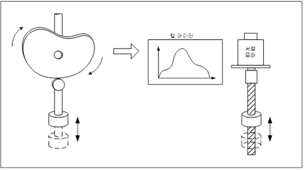

# XCAM

Manual section(s): 4.42.39. Original Korean notes below may cover the other variants on the same page; apply the widths and execution form of `XCAM`.

## Editing route

Use `get_ir` → `apply_patch` for this instruction edit. `insert_ladder_instruction` is the internal writer route, not a separate MCP tool. Preserve the exported revision and native constraints.
The writer mnemonic is `XCAM`; the catalog records opcode `1159` and `4` operands in order.
Inspect the CPU/project and target cells first. Use the inspected revision and positions, preserve expected values, dry-run when useful, then save and inspect the result. See the [editing skill](../../SKILL.md) and [ladder workflow](../ladder.md).

## Operands

| Order | Operand | Description (Korean manual) | Reviewed types | Device areas | Constant |
| --- | --- | --- | --- | --- | --- |
| 1 | sl | 위치 모듈이 장착된 베이스(x)와 슬롯(y) 번호:h00xy | WORD | Unknown | Unknown |
| 2 | ax | 캠 지령을 내릴 종축 (1 ~ 8:1축 ~ 8축) | WORD | PMK, L, Z, N, D, R | Allowed |
| 3 | n1 | 캠운전 주축 (1 ~ 8:1축 ~ 8축, 9:엔코더) | WORD | PMK, L, Z, N, D, R | Allowed |
| 4 | n2 | 운전에 적용할 캠 데이터 블록 번호(1 ~ 8, 9:사용자 캠) | WORD | PMK, L, Z, N, D, R | Allowed |

These are the current library's reviewed operand rules. A shared type union is not a per-variant type choice; use the manual behavior to select the required width. Missing permissions stay unknown.

## CPU and acceptance

No separately reviewed CPU-model restriction is available in the current catalog; this means unknown, not universal compatibility.
Check the applicable model, firmware, modules and memory spans stated in the manual notes. Local parsing, writer validation and IL conversion do not prove native compilation or PLC behavior. Native acceptance requires XG5000 Open → Check Program → Save As → comparison.

## Manual behavior notes (Korean)

- ※ 오퍼랜드 설정 범위는 XGF-PN8B를 기준으로 합니다. 축에 대한 오퍼랜드(ax)의 설정 범위는 제품에서 지원하는 제어 축 수에 따라 다르니, 제품 사용설명서를 참조하여 주십시오.
- 캠(CAM) 운전은 기계적인 캠 동작을 캠 커브로 나타내어지는 캠 데이터로 변환하여 주축으로 설정된 모터의 위치에 동기 하여 캠 축 제어를 실행합니다.
- ax로 지정된 종축에 n1축을 주축으로 하여 n2의 CAM 데이터로 CAM운전을 하라는 명령을 합니다.
- 캠 데이터는 XG-PM의 프로젝트 창에 캠 데이터에서 설정할 수 있으며 캠 운전을 시작하기 전에 위치결정 모듈에 쓰기 완료 되어있어야 합니다.
- 사용자 캠(CAM) 운전을 사용하기 위해서는 캠 블록 번호를 9번으로 설정해야 합니다.
- 사용자 캠(CAM) 운전의 경우 운전중이라도 가변데이터 쓰기 명령으로 사용자 캠 데이터의 변경이 가능합니다.
- 사용자 캠(CAM) 운전의 경우 XG-PM에서 캠데이터를 설정하는 것이 아니라 PLC Program에서 캠데이터를 디바이스에서 설정하여 운전되며, 캠데이터의 수가 30개인 점 입니다.
- 사용자 캠(CAM) 운전설정에 대한 자세한 내용은 각 모듈의 사용자 설명서 9장 사용자 캠운전(CAM) 장을 참고하시기 바랍니다.
- 캠데이터 포인트는 가변데이터 쓰기 명령(XVWR)을 사용하여 각 축의 지정된 메모리 주소에 저장하면 됩니다. (각 모듈의 사용자 설명서 2장 사용자 캠데이터 메모리 주소 참고 할 것)

## Manual flags

| 플래그 | 내 용 | 디바이스 번호 |
| --- | --- | --- |
| 에러 | ax 값이 범위를 벗어날 경우 | F110 |

## Manual applicability and restrictions

- 적용 기종 : XGK, XBC, XBM, XBF
- ax의 설정값이 제품에서 지원하는 설정 범위와 다른 값을 입력하면 에러가 발생(F110이 Set)됩니다.

## Manual flag and step matrix

The shared usage table marks affected flags with `O`, and `-` where it lists no effect. Native steps are the manual's instruction size, not the number of operand arguments. Conditions for setting/clearing flags are in the behavior notes.

| Manual instruction group | Native steps | 에러 (F110) | 제로 (F111) | 캐리 (F112) |
| --- | --- | --- | --- | --- |
| XCAM | 4~7 | O | - | - |

## Additional source notes after examples

The manual places some execution restrictions and timing conditions after its example heading. Retain those checks below. Example addresses and circuit assumptions describe the source example and are not defaults for a new program.

- 변경된 사용자 캠 데이터가 반영되는 시점은 현재 동작하고 있는 사용자 캠 데이터의 한 사이클이 완료된 다음부터 입니다.
- 포인트 단위 설정 후 캠(CAM) 블록 데이터를 설정할 때, 「주축끝위치」는 포인트 단위의 정수 배로 설정해야 합니다.
- 예를 들어 주축의 단위가 “degree” 이고, 포인트 단위가 10 인 경우 「주축끝위치」는 40, 90, 180, ... 등 10의 배수로 설정해야 합니다.
- 다음의 경우는 에러가 되어 캠 운전 명령을 실행할 수 없습니다.
- M코드 신호가 On된 상태에서 캠 운전 명령을 실행한 경우 에러(702)가 발생합니다.
- 설정된 주축이 설정 가능한 축이 아니거나, 주축 설정을 명령축과 같게 설정한 경우 에러(704)가 발생합니다.
- 주축의 속도가 빨라서 캠 운전 데이터의 종축 위치로 계산되는 종축의 속도가 속도 제한치를 벗어나는 경우 에러(708)가 발생합니다.
- 종축의 속도가 속도 제한치를 벗어나는 경우 에러가 발생하고, 기본 파라미터의 「급정지시 감속시간」으로 감속 정지합니다.

## Referenced manual figures

These figures belong to the shared source topic. Read the source corrections above before using variant-specific layouts or example values.

## Provenance

Source: `XGK(B)InstructionHelp_Kr_V3.5.chm`, SHA-256 `b866d589d800addcb039f9f09b182592464d6367faa55abf6dde9ac34a1580e0`.

- `44239xcam.htm` — §4.42.39; source SHA-256 `a3e66a5f823e03a75aa1df631ef31356781c7750be32b7c4d521d68f7487ea92`.
- Additional behavior/operand evidence: `44239xcam.htm`.
