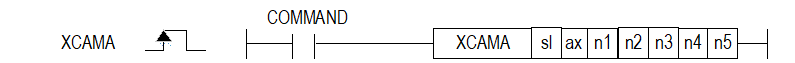
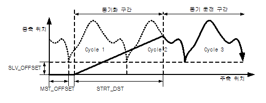

# XCAMA

Manual section(s): 4.42.67. Original Korean notes below may cover the other variants on the same page; apply the widths and execution form of `XCAMA`.

## Editing route

Use `insert_ladder_instruction` after calling `describe_operation` for its current schema.
The writer mnemonic is `XCAMA`; the catalog records opcode `1568` and `7` operands in order.
Inspect the CPU/project and target cells first. Use the inspected revision and positions, preserve expected values, dry-run when useful, then save and inspect the result. See the [editing skill](../../SKILL.md) and [ladder workflow](../ladder.md).

## Operands

| Order | Operand | Description (Korean manual) | Reviewed types | Device areas | Constant |
| --- | --- | --- | --- | --- | --- |
| 1 | sl | 위치 모듈이 장착된 베이스(x)와 슬롯(y) 번호:h00xy | WORD | Unknown | Unknown |
| 2 | ax | 지령을 실행할 축(종축):1~8(실축) | WORD | PMK, L, Z, N, D, R | Allowed |
| 3 | n1 | 주축 설정 1~8(실축), 9:엔코더1 | WORD | PMK, L, Z, N, D, R | Allowed |
| 4 | n2 | 운전에 적용할 캠 데이터 블록(1 ~ 9) | WORD | PMK, L, Z, N, D, R | Allowed |
| 5 | n3 | 캠운전 시작 이동량 (-2147483648 ~ 2147483647) | DINT | PMK, L, Z, N, D, R | Allowed |
| 6 | n4 | 주축옵셋 (-2147483648 ~ 2147483647) | DINT | PMK, L, Z, N, D, R | Allowed |
| 7 | n5 | 종축옵셋 (-2147483648 ~ 2147483647) | DINT | PMK, L, Z, N, D, R | Allowed |

These are the current library's reviewed operand rules. A shared type union is not a per-variant type choice; use the manual behavior to select the required width. Missing permissions stay unknown.

## CPU and acceptance

No separately reviewed CPU-model restriction is available in the current catalog; this means unknown, not universal compatibility.
Check the applicable model, firmware, modules and memory spans stated in the manual notes. Local parsing, writer validation and IL conversion do not prove native compilation or PLC behavior. Native acceptance requires XG5000 Open → Check Program → Save As → comparison.

## Manual behavior notes (Korean)

- ※ 오퍼랜드 설정 범위는 XGF-PN8B를 기준으로 합니다. 축에 대한 오퍼랜드(ax)의 설정 범위는 제품에서 지원하는 제어 축수에 따라 다르니, 제품 사용설명서를 참조하여 주십시오.
- 절대위치 캠 운전 명령(XCAMA)을 실행하고 주축이 운전을 시작하면 주축이 STRT_DST에 설정한 거리에 도달할 때까지 동기위치로 도달하는 운전을 실행합니다.
- 동기 위치는 주축이 STRT_DST만큼 이동 했을 때 위치에서 캠 블록에 설정된 캠 데이터 값에 따른 종축의 위치입니다.
- 종축의 동기위치는 SLV_OFFSET와 MST_OFFSET값에 의하여 이동할 수 있습니다.
- 주축이 STRT_DST에 설정된 거리에 도달하면 캠 블록에 설정된 캠데이터 값에 따라 캠 운전을 실행합니다.
- 절대위치 캠 운전의 주축으로 엔코더 사용이 가능합니다.
- 각축마다 다른 캠 블록 번호를 설정할 수 있습니다. 또한 동일한 캠 블록으로 여러 축의 캠 운전도 가능합니다.
- 사용자 캠(CAM) 운전을 사용하기 위해서는 캠 블록 번호를 9번으로 설정해야 합니다.
- 시작거리(STRT_DST)를 설정하여 캠명령 실행시 캠 동기가 시작되는 주축의 위치를 변경할 수 있습니다.
- 시작거리가 작은 값으로 설정되면 종축이 급격하게 운전하여 충격이 발생할 수 있습니다.
- 주축 옵셋과 종축옵셋을 설정하여 종축의 캠운전을 시작하는 위치를 변경할 수 있습니다.

## Manual flags

| 플래그 | 내 용 | 디바이스 번호 |
| --- | --- | --- |
| 에러 | ax 값이 범위를 벗어날 경우 | F110 |

## Manual applicability and restrictions

- 적용 기종 : XGK, XBC, XBM, XBF
- ax의 설정값이 제품에서 지원하는 설정 범위와 다른 값을 입력하면, 에러가 발생(F110이 Set)합니다.

## Manual flag and step matrix

The shared usage table marks affected flags with `O`, and `-` where it lists no effect. Native steps are the manual's instruction size, not the number of operand arguments. Conditions for setting/clearing flags are in the behavior notes.

| Manual instruction group | Native steps | 에러 (F110) | 제로 (F111) | 캐리 (F112) |
| --- | --- | --- | --- | --- |
| XCAMA | 4~7 | O | - | - |

## Additional source notes after examples

The manual places some execution restrictions and timing conditions after its example heading. Retain those checks below. Example addresses and circuit assumptions describe the source example and are not defaults for a new program.

- 다음의 경우는 에러가 되어 절대위치 캠 운전 명령을 실행할 수 없습니다.
- M코드 신호가 On 된 상태에서 캠 운전 명령을 실행한 경우 에러(에러코드:702)가 발생합니다.
- M코드 해제 (XMOF) 명령으로 M 코드를 Off 로 만든 후 사용하시기 바랍니다.
- 주축으로 설정한 축이 현재 네트워크에 연결되지 않았거나, 주축 설정을 명령축과 같게 설정한 경우 에러(에러코드:704)가 발생합니다.
- 현재 네트워크에 연결되어 있는 축들 중에서 주축을 설정하십시오.
- 주축의 속도가 빨라서 캠 운전 데이터의 종축 위치로 계산되는 종축의 속도가 속도 제한치를 벗어나는 경우 에러(에러코드:708)가 발생합니다.
- 종축의 속도가 속도 제한치를 넘지 않도록 주축의 운전 속도를 낮추어 운전해야 합니다.
- 종축의 속도가 속도 제한치를 벗어나는 경우 에러가 발생하고, 기본 파라미터의 감속시간1의 시간으로 감속 정지합니다.

## Referenced manual figures

These figures belong to the shared source topic. Read the source corrections above before using variant-specific layouts or example values.

## Provenance

Source: `XGK(B)InstructionHelp_Kr_V3.5.chm`, SHA-256 `b866d589d800addcb039f9f09b182592464d6367faa55abf6dde9ac34a1580e0`.

- `44267xcama.htm` — §4.42.67; source SHA-256 `847e0fc4426b32d74b95a7b0eb4f8a6ef2973a63a4c0c23b880b35fb54395dad`.
- Additional behavior/operand evidence: `44267xcama.htm`.
