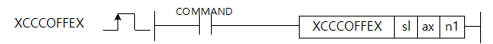

# XCCCOFF

Manual section(s): 4.42.74. Original Korean notes below may cover the other variants on the same page; apply the widths and execution form of `XCCCOFF`.

## Editing route

Use `get_ir` → `apply_patch` for this instruction edit. `insert_ladder_instruction` is the internal writer route, not a separate MCP tool. Preserve the exported revision and native constraints.
The writer mnemonic is `XCCCOFF`; the catalog records opcode `1761` and `3` operands in order.
Inspect the CPU/project and target cells first. Use the inspected revision and positions, preserve expected values, dry-run when useful, then save and inspect the result. See the [editing skill](../../SKILL.md) and [ladder workflow](../ladder.md).

## Operands

| Order | Operand | Description (Korean manual) | Reviewed types | Device areas | Constant |
| --- | --- | --- | --- | --- | --- |
| 1 | sl | 위치결정모듈이 장착되어 있는 슬롯번호 | WORD | Unknown | Unknown |
| 2 | ax | 명령을 내릴 축 | WORD | Unknown | Unknown |
| 3 | n1 | Cross-coupled 제어를 해제할 짝 축 | WORD | Unknown | Unknown |

These are the current library's reviewed operand rules. A shared type union is not a per-variant type choice; use the manual behavior to select the required width. Missing permissions stay unknown.

## CPU and acceptance

No separately reviewed CPU-model restriction is available in the current catalog; this means unknown, not universal compatibility.
Check the applicable model, firmware, modules and memory spans stated in the manual notes. Local parsing, writer validation and IL conversion do not prove native compilation or PLC behavior. Native acceptance requires XG5000 Open → Check Program → Save As → comparison.

## Manual behavior notes (Korean)

- 이 명령은 설정된 Cross-coupled 제어를 해제하기 위해 사용되는 명령입니다.
- Cross-coupled 제어 실행 명령어가 실행되지 않은 축을 입력한 경우에는 실행되지 않습니다.
- ax에 Cross-coupled제어가 실행 중인 축1(축)을 지정하고 n1에 축2(연결축) 등으로 지정합니다.
- Cross-coupled 제어 해제 명령을 사용할 수 있는 버전 정보는 아래와 같습니다.

| 항목 | 내 용 |
| --- | --- |
| XGF-PN4B OS | V2.10 이상 |
| XGF-PN8B OS | V2.10 이상 |
| 고성능 XGK CPU | V1.60 이상 |
| XG5000 | V4.52 이상 |

## Manual flags

| 플래그 | 내 용 | 디바이스 번호 |
| --- | --- | --- |
| 에러 | ax값이 범위를 벗어날 경우 | F110 |

## Manual applicability and restrictions

- ax로 지정하는 지령축에 0이나 9이상의 값이 입력되면 에러(F110)를 SET합니다.

| 지원 기종 | XGK | XGK | XGK | XGK | XGK | XGK-N | XGK-N | XGK-N | XBC(내장) | XBC(내장) | XBC(내장) | XBC(내장) | XBM(내장) | XBM(내장) | XBM(내장) | XBF |
| --- | --- | --- | --- | --- | --- | --- | --- | --- | --- | --- | --- | --- | --- | --- | --- | --- |
| 지원 기종 | U | H | A | S | E | UN | HN | SN | U | H | SU | E | S | H | V2(P) | PNxxB |
| 지원 기종 | X | X | X | X | X | O*1 | O*1 | O*1 | X | X | X | X | X | X | X | O*2 |

## Manual flag and step matrix

The shared usage table marks affected flags with `O`, and `-` where it lists no effect. Native steps are the manual's instruction size, not the number of operand arguments. Conditions for setting/clearing flags are in the behavior notes.

| Manual instruction group | Native steps | 에러 (F110) | 제로 (F111) | 캐리 (F112) |
| --- | --- | --- | --- | --- |
| XCCCOFFEX | 4~7 | O | - | - |

## Referenced manual figures

These figures belong to the shared source topic. Read the source corrections above before using variant-specific layouts or example values.

## Provenance

Source: `XGK(B)InstructionHelp_Kr_V3.5.chm`, SHA-256 `b866d589d800addcb039f9f09b182592464d6367faa55abf6dde9ac34a1580e0`.

- `44271xgearip3.htm` — §4.42.74; source SHA-256 `c7e127c602f217edba651b5069d4c9eb23075c16ae1337b539d75297cae1a2e8`.
- Additional behavior/operand evidence: `44271xgearip3.htm`.
