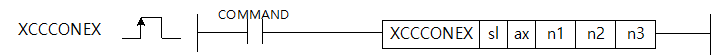

# XCCCONEX

Manual section(s): 4.42.72. Original Korean notes below may cover the other variants on the same page; apply the widths and execution form of `XCCCONEX`.

## Editing route

Use `insert_ladder_instruction` after calling `describe_operation` for its current schema.
The writer mnemonic is `XCCCONEX`; the catalog records opcode `1751` and `5` operands in order.
Inspect the CPU/project and target cells first. Use the inspected revision and positions, preserve expected values, dry-run when useful, then save and inspect the result. See the [editing skill](../../SKILL.md) and [ladder workflow](../ladder.md).

## Operands

| Order | Operand | Description (Korean manual) | Reviewed types | Device areas | Constant |
| --- | --- | --- | --- | --- | --- |
| 1 | sl | 위치결정모듈이 장착되어 있는 슬롯번호 | WORD | Unknown | Unknown |
| 2 | ax | 명령을 내릴 축 | WORD | Unknown | Unknown |
| 3 | n1 | Cross-coupled 제어로 함께 제어할 짝 축 | WORD | Unknown | Unknown |
| 4 | n2 | Cross-coupled 제어 비례 이득 (단위: 1/1000) | DWORD | Unknown | Unknown |
| 5 | n3 | 슬레이브 운전 모드 선택(0: CSV, 1: CSP) | WORD | Unknown | Unknown |

These are the current library's reviewed operand rules. A shared type union is not a per-variant type choice; use the manual behavior to select the required width. Missing permissions stay unknown.

## CPU and acceptance

No separately reviewed CPU-model restriction is available in the current catalog; this means unknown, not universal compatibility.
Check the applicable model, firmware, modules and memory spans stated in the manual notes. Local parsing, writer validation and IL conversion do not prove native compilation or PLC behavior. Native acceptance requires XG5000 Open → Check Program → Save As → comparison.

## Manual behavior notes (Korean)

- 이 명령어는 무인운반차(Autmated Guided Vehicle), 갠트리(Gantry) 스테이지 등 물리적으로 결합/연결된 두 축을 동기 제어할 때 안정적인 제어를 할 수 있도록 제공하는 기능입니다.
- 물리적으로 결합/연결된 두 축을 동기제어하는 경우 그 중 한 축의 제어를 위한 모터 출력이 다른 축에 영향을 주어 제어 성능이 나빠질 수 있습니다. 이러한 경우에 Cross-coupeld 제어를 적용하면 각 축에서 발생한 위치에러 오차를 서로 공유하여 다른 축에서 발생한 위치에러가 제어를 방해하는 요소로 작용하지 않게 제어를 수행 합니다.
- Cross-coupled 제어 실행 명령어는 단독 동작하지 않으며 마스터 위치 제어 루프 실행 명령어가 동작하고 있는 축에서만 동작합니다.
- ax와 n1에 동일한 축을 지정하면 에러가 발생합니다.
- n2에 지정된 Cross-coupled 제어 비례이득의 단위는 1/1000이며 다음과 같이 지정할 수 있습니다.
- - 0 ~ 4294967295
- 명령어 실행 중에 이득을 갱신하려면 명령어의 오퍼랜드를 수정하고 다시 실행하면 됩니다. ‘운전중’에도 제어 이득을 갱신할 수 있습니다.
- n3에 지정된 슬레이브 운전모드 선택은 미사용 항목이며 추후 계획된 기능을 위해 미리 예약해둔 오퍼랜드 입니다. 어떤 값을 입력하더라도 CSV모드로 Cross-coupled 제어가 동작합니다.
- Cross-coupled 제어 실행의 이득이 적절하지 않은 경우 시스템이 불안정해질 수 있으니 주의가 필요합니다.
- Cross-coupled 제어 실행 명령을 사용할 수 있는 버전 정보는 아래와 같습니다.

| 항목 | 내 용 |
| --- | --- |
| XGF-PN4B OS | V2.10 이상 |
| XGF-PN8B OS | V2.10 이상 |
| 고성능 XGK CPU | V1.60 이상 |
| XG5000 | V4.52 이상 |

## Manual flags

| 플래그 | 내 용 | 디바이스 번호 |
| --- | --- | --- |
| 에러 | ax값이 범위를 벗어날 경우 | F110 |

## Manual applicability and restrictions

- ax로 지정하는 지령축에 0이나 9이상의 값이 입력되면 에러(F110)를 SET합니다.

| 지원 기종 | XGK | XGK | XGK | XGK | XGK | XGK-N | XGK-N | XGK-N | XBC(내장) | XBC(내장) | XBC(내장) | XBC(내장) | XBM(내장) | XBM(내장) | XBM(내장) | XBF |
| --- | --- | --- | --- | --- | --- | --- | --- | --- | --- | --- | --- | --- | --- | --- | --- | --- |
| 지원 기종 | U | H | A | S | E | UN | HN | SN | U | H | SU | E | S | H | V2(P) | PNxxB |
| 지원 기종 | X | X | X | X | X | O*1 | O*1 | O*1 | X | X | X | X | X | X | X | O*2 |

## Manual flag and step matrix

The shared usage table marks affected flags with `O`, and `-` where it lists no effect. Native steps are the manual's instruction size, not the number of operand arguments. Conditions for setting/clearing flags are in the behavior notes.

| Manual instruction group | Native steps | 에러 (F110) | 제로 (F111) | 캐리 (F112) |
| --- | --- | --- | --- | --- |
| XCCCONEX | 4~7 | O | - | - |

## Additional source notes after examples

The manual places some execution restrictions and timing conditions after its example heading. Retain those checks below. Example addresses and circuit assumptions describe the source example and are not defaults for a new program.

- Cross-coupled 제어는 기존 위치 제어 루프를 변형해서 사용하기 때문에 마스터 위치 루프 제어가 실행된 상태에서만 동작하도록 되어있습니다.
- 축이 운전 중이지 않을 때 경우 마스터 위치루프 제어를 실행/해제 할 수 있습니다.
- 축이 운전 중일 때 마스터 위치루프 제어를 실행하거나 해제하면 에러(841)가 발생합니다.
- 마스터 위치루프제어를 실행하려는 축의 RxPDO에 목표 속도(0x60FF) 오브젝트가 있어야 합니다.
- 목표속도 오브젝트가 없는 경우 에러(842)가 발생합니다.
- Cross-coupled 제어는 마스터 위치제어 루프 명령어가 실행 중인 두 축에 실행할 수 있습니다.
- 입력된 두 축이 마스터 위치제어 루프 명령어가 활성화되지 않은 경우 에러(843)가 발생합니다.
- Cross-coupled 제어는 서로 다른 축에 실행되어야 합니다. 명령어에 입력된 축이 동일한 경우 에러(844)가 발생합니다.
- Cross-coupled 제어가 실행 중이지 않은 축에 해제 명령이 실행된 경우 에러(845)가 발생합니다.

## Referenced manual figures

These figures belong to the shared source topic. Read the source corrections above before using variant-specific layouts or example values.

## Provenance

Source: `XGK(B)InstructionHelp_Kr_V3.5.chm`, SHA-256 `b866d589d800addcb039f9f09b182592464d6367faa55abf6dde9ac34a1580e0`.

- `44271xgearip1.htm` — §4.42.72; source SHA-256 `a57f33e0662c2547d669620f151340d0227bdedde7fcc3550a6668d620dc4af2`.
- Additional behavior/operand evidence: `44271xgearip1.htm`.
