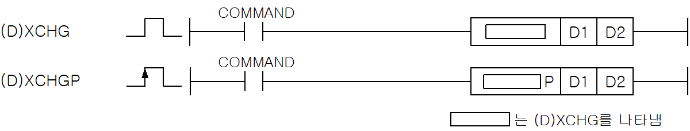
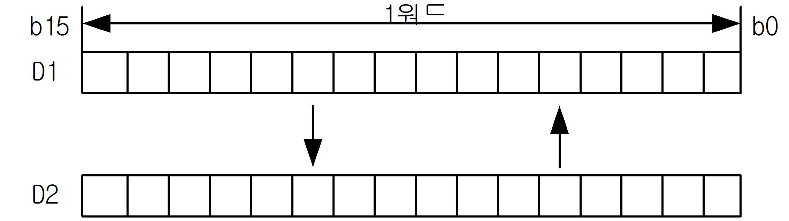

# XCHG

Manual section(s): 4.19.1. Original Korean notes below may cover the other variants on the same page; apply the widths and execution form of `XCHG`.

Execution form: the source explicitly pairs this command as `(P)`; `XCHG` is the non-P partner. Manual §2.4.2 defines `P` as pulse-type notation. Select the paired forms deliberately and retain the instruction's actual execution conditions; unrelated mnemonics ending in P are not classified by suffix alone.

## Editing route

Use `insert_ladder_instruction` after calling `describe_operation` for its current schema.
The writer mnemonic is `XCHG`; the catalog records opcode `207` and `2` operands in order.
Inspect the CPU/project and target cells first. Use the inspected revision and positions, preserve expected values, dry-run when useful, then save and inspect the result. See the [editing skill](../../SKILL.md) and [ladder workflow](../ladder.md).

## Operands

| Order | Operand | Description (Korean manual) | Reviewed types | Device areas | Constant |
| --- | --- | --- | --- | --- | --- |
| 1 | D1 | 교환하고자 하는 데이터의 디바이스 번호 | WORD/DWORD | PMK, L, T, C, Z, U, N, D, R | Not allowed |
| 2 | D2 | 교환하고자 하는 데이터의 디바이스 번호 | WORD/DWORD | PMK, L, T, C, Z, U, N, D, R | Not allowed |

These are the current library's reviewed operand rules. A shared type union is not a per-variant type choice; use the manual behavior to select the required width. Missing permissions stay unknown.

## CPU and acceptance

No separately reviewed CPU-model restriction is available in the current catalog; this means unknown, not universal compatibility.
Check the applicable model, firmware, modules and memory spans stated in the manual notes. Local parsing, writer validation and IL conversion do not prove native compilation or PLC behavior. Native acceptance requires XG5000 Open → Check Program → Save As → comparison.

## Manual behavior notes (Korean)

- XCHG ( Exchange )
- D1로 지정된 워드 데이터와 D2로 지정된 워드 데이터를 서로 교환합니다.
- DXCHG ( Double Exchange )
- (D1+1,D1)으로 지정된 더블 워드데이터와 (D2+1,D2)로 지정된 더블 워드데이터를 서로 교환합니다.

## Manual applicability and restrictions

- 적용 기종 : XGK, XGB

## Manual flag and step matrix

The shared usage table marks affected flags with `O`, and `-` where it lists no effect. Native steps are the manual's instruction size, not the number of operand arguments. Conditions for setting/clearing flags are in the behavior notes.

| Manual instruction group | Native steps | 에러 (F110) | 제로 (F111) | 캐리 (F112) |
| --- | --- | --- | --- | --- |
| XCHG(P) DXCHG(P) | 2~4 | - | - | - |

## Referenced manual figures

These figures belong to the shared source topic. Read the source corrections above before using variant-specific layouts or example values.

## Provenance

Source: `XGK(B)InstructionHelp_Kr_V3.5.chm`, SHA-256 `b866d589d800addcb039f9f09b182592464d6367faa55abf6dde9ac34a1580e0`.

- `4191xchgxchgpdxchgdxchgp.htm` — §4.19.1; source SHA-256 `fff18a10636bb5c88e5b4b5bd72588522026c13b1e4d2b1671bc557f80a5570b`.
- Additional behavior/operand evidence: `4191xchgxchgpdxchgdxchgp.htm`, `245.htm`.
