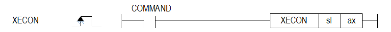

# XECON

Manual section(s): 4.42.47. Original Korean notes below may cover the other variants on the same page; apply the widths and execution form of `XECON`.

## Editing route

Use `insert_ladder_instruction` after calling `describe_operation` for its current schema.
The writer mnemonic is `XECON`; the catalog records opcode `1125` and `2` operands in order.
Inspect the CPU/project and target cells first. Use the inspected revision and positions, preserve expected values, dry-run when useful, then save and inspect the result. See the [editing skill](../../SKILL.md) and [ladder workflow](../ladder.md).

## Operands

| Order | Operand | Description (Korean manual) | Reviewed types | Device areas | Constant |
| --- | --- | --- | --- | --- | --- |
| 1 | sl | 위치 모듈이 장착된 베이스(x)와 슬롯(y) 번호:h00xy | WORD | Unknown | Unknown |
| 2 | ax | 지령을 실행할 축 (0:X 축, 1:Y 축, 2:Z 축) | WORD | PMK, L, Z, N, D, R | Allowed |

These are the current library's reviewed operand rules. A shared type union is not a per-variant type choice; use the manual behavior to select the required width. Missing permissions stay unknown.

## CPU and acceptance

No separately reviewed CPU-model restriction is available in the current catalog; this means unknown, not universal compatibility.
Check the applicable model, firmware, modules and memory spans stated in the manual notes. Local parsing, writer validation and IL conversion do not prove native compilation or PLC behavior. Native acceptance requires XG5000 Open → Check Program → Save As → comparison.

## Manual behavior notes (Korean)

- ※ 오퍼랜드 설정 범위는 XGF-PN8B를 기준으로 합니다. 축에 대한 오퍼랜드(ax)의 설정 범위는 제품에서 지원하는 제어 축 수에 따라 다르니, 제품 사용설명서를 참조하여 주십시오.
- 이 명령은 위치결정 모듈에 EtherCAT 통신 연결 지령을 내리는 명령입니다.
- sl(위치결정 모듈의 슬롯번호)로 지정된 위치결정 모듈의 ax 로 지정된 축에 EtherCAT 통신 연결 명령을 합니다..
- 서보 연결 명령의 입력 조건 접점으로 Link up/down 정보를 사용하면 케이블이 연결된 경우에만 서보 연결명령을 실행 할 수 있습니다.
- 프로그램에서 서보 연결 명령은 각 축에 한번씩 실행하는 것이 아니라 1축 ~ 8축 중 하나의 명령축에만 실행하시기 바랍니다.
- 서보 연결 시 명령어 실행시간아 긴 관계로 프로그램 작성 시 주의바랍니다. (L7NH 8축기준 실행시간은 최대 2.4초 소요됨)
- 서보 드라이브가 정상적으로 연결되면 U 디바이스의 연결된 축에 해당하는 Bit가 Set됩니다.

| 축 | 신호방향: PLC CPU 위치결정 모듈 | 신호방향: PLC CPU 위치결정 모듈 |
| --- | --- | --- |
| 축 | 입력신호 | 내 용 |
| 1축 | Uxx.00.0 | 1축 운전 준비 |
| 2축 | Uxx.00.1 | 2축 운전 준비 |
| 3축 | Uxx.00.2 | 3축 운전 준비 |
| 4축 | Uxx.00.3 | 4축 운전 준비 |
| 5축 | Uxx.00.4 | 5축 운전 준비 |
| 6축 | Uxx.00.5 | 6축 운전 준비 |
| 7축 | Uxx.00.6 | 7축 운전 준비 |
| 8축 | Uxx.00.7 | 8축 운전 준비 |

## Manual flags

| 플래그 | 내 용 | 디바이스 번호 |
| --- | --- | --- |
| 에러 | ax 값이 범위를 벗어날 경우 | F110 |

## Manual applicability and restrictions

- 적용 기종 : XGK, XBC, XBM, XBF
- ax의 설정값이 제품에서 지원하는 설정 범위와 다른 값을 입력하면 에러가 발생(F110이 Set)됩니다.

## Manual flag and step matrix

The shared usage table marks affected flags with `O`, and `-` where it lists no effect. Native steps are the manual's instruction size, not the number of operand arguments. Conditions for setting/clearing flags are in the behavior notes.

| Manual instruction group | Native steps | 에러 (F110) | 제로 (F111) | 캐리 (F112) |
| --- | --- | --- | --- | --- |
| XECON | 4~7 | O | - | - |

## Additional source notes after examples

The manual places some execution restrictions and timing conditions after its example heading. Retain those checks below. Example addresses and circuit assumptions describe the source example and are not defaults for a new program.

- 서보 연결 지령을 다음과 같은 방식으로 사용하면, 해당 지령축(1축)에 실행되는 다른 명령어 실행이 간헐적으로 누락될 수 있습니다.
- TxxS 플래그를 이용하여 서보연결 Retry하지 말 것 (동일 스캔에 동일 축에 서로 다른 지령이 실행 되기 때문)

## Referenced manual figures

These figures belong to the shared source topic. Read the source corrections above before using variant-specific layouts or example values.

## Provenance

Source: `XGK(B)InstructionHelp_Kr_V3.5.chm`, SHA-256 `b866d589d800addcb039f9f09b182592464d6367faa55abf6dde9ac34a1580e0`.

- `44247xecon.htm` — §4.42.47; source SHA-256 `44146fb27a58ae769add8a2f08565a7524aee29a04545b7029b603abe39692da`.
- Additional behavior/operand evidence: `44247xecon.htm`.
