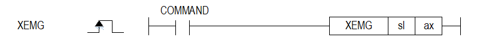

# XEMGEX

Manual section(s): 4.42.26. Original Korean notes below may cover the other variants on the same page; apply the widths and execution form of `XEMGEX`.

## Editing route

Use `insert_ladder_instruction` after calling `describe_operation` for its current schema.
The writer mnemonic is `XEMGEX`; the catalog records opcode `1697` and `2` operands in order.
Inspect the CPU/project and target cells first. Use the inspected revision and positions, preserve expected values, dry-run when useful, then save and inspect the result. See the [editing skill](../../SKILL.md) and [ladder workflow](../ladder.md).

## Operands

| Order | Operand | Description (Korean manual) | Reviewed types | Device areas | Constant |
| --- | --- | --- | --- | --- | --- |
| 1 | sl | 위치 모듈이 장착된 베이스(x)와 슬롯(y) 번호:h00xy | WORD | Unknown | Unknown |
| 2 | ax | 부동 원점 설정을 실행할 축:1~8(실축) | WORD | PMK, L, Z, N, D, R | Allowed |

These are the current library's reviewed operand rules. A shared type union is not a per-variant type choice; use the manual behavior to select the required width. Missing permissions stay unknown.

## CPU and acceptance

No separately reviewed CPU-model restriction is available in the current catalog; this means unknown, not universal compatibility.
Check the applicable model, firmware, modules and memory spans stated in the manual notes. Local parsing, writer validation and IL conversion do not prove native compilation or PLC behavior. Native acceptance requires XG5000 Open → Check Program → Save As → comparison.

## Manual behavior notes (Korean)

- ※ 오퍼랜드 설정 범위는 XGF-PN8B를 기준으로 합니다. 축에 대한 오퍼랜드(ax)의 설정 범위는 제품에서 지원하는 제어 축수에 따라 다르니, 제품 사용설명서를 참조하여 주십시오.
- 해당 지령은 명령축에 내부 비상정지 명령을 내립니다.
- 비상 정지 실행 시 감속시간은 축 별 기본 파라미터의 “급정지시 감속시간”항목에 설정된 시간이 됩니다.

## Manual flags

| 플래그 | 내 용 | 디바이스 번호 |
| --- | --- | --- |
| 에러 | ax 값이 범위를 벗어날 경우 | F110 |

## Manual applicability and restrictions

- 적용 기종 : XGK, XBC, XBM, XBF
- ax의 설정값이 제품에서 지원하는 설정 범위와 다른 값을 입력하면, 에러가 발생(F110이 Set)합니다.

## Manual flag and step matrix

The shared usage table marks affected flags with `O`, and `-` where it lists no effect. Native steps are the manual's instruction size, not the number of operand arguments. Conditions for setting/clearing flags are in the behavior notes.

| Manual instruction group | Native steps | 에러 (F110) | 제로 (F111) | 캐리 (F112) |
| --- | --- | --- | --- | --- |
| XEMG | 4~7 | O | - | - |

## Additional source notes after examples

The manual places some execution restrictions and timing conditions after its example heading. Retain those checks below. Example addresses and circuit assumptions describe the source example and are not defaults for a new program.

- 비상정지가 실행 되는 경우는 2가지 경우가 있으니 참고하시기 바랍니다.
- 내부 비상 정지 시에는 에러 481이 발생하고 외부 비상 정지 시에는 에러 491이 발생됩니다.
- 비상 정지 실행 후 M코드 신호는 Off 됩니다.
- 비상 정지에는 내부 비상 정지와 외부 비상 정지 2가지 방식이 있습니다.
- XG-PM 및 시퀀스 프로그램의 「비상 정지」 명령 XEMG 에 의해 기본 파라미터의 「급정지시 감속시간」에 설정된 시간으로 감속하여 정지되고, 에러를 발생합니다.
- 서보 드라이브의 비상정지 입력 신호가 On 되면 기본 파라미터의 「급정지시 감속시간」에 설정된 시간으로 감속하여 정지되고, 에러를 발생합니다.
- 관련 파라미터 설정 (기본 파라미터)

## Referenced manual figures

These figures belong to the shared source topic. Read the source corrections above before using variant-specific layouts or example values.

## Provenance

Source: `XGK(B)InstructionHelp_Kr_V3.5.chm`, SHA-256 `b866d589d800addcb039f9f09b182592464d6367faa55abf6dde9ac34a1580e0`.

- `44226xemg.htm` — §4.42.26; source SHA-256 `9badcd45724a6f4ba4458a7da60c66528fd5ad0af60a5c5d94bc65b08df0023f`.
- Additional behavior/operand evidence: `44226xemg.htm`.
