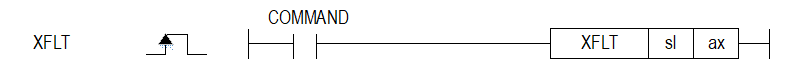

# XFLT

Manual section(s): 4.42.2. Original Korean notes below may cover the other variants on the same page; apply the widths and execution form of `XFLT`.

## Editing route

Use `get_ir` → `apply_patch` for this instruction edit. `insert_ladder_instruction` is the internal writer route, not a separate MCP tool. Preserve the exported revision and native constraints.
The writer mnemonic is `XFLT`; the catalog records opcode `1099` and `2` operands in order.
Inspect the CPU/project and target cells first. Use the inspected revision and positions, preserve expected values, dry-run when useful, then save and inspect the result. See the [editing skill](../../SKILL.md) and [ladder workflow](../ladder.md).

## Operands

| Order | Operand | Description (Korean manual) | Reviewed types | Device areas | Constant |
| --- | --- | --- | --- | --- | --- |
| 1 | sl | 위치 모듈이 장착된 베이스(x)와 슬롯(y) 번호:h00xy | WORD | Unknown | Unknown |
| 2 | ax | 부동 원점 설정을 실행할 축:1~8(실축) | WORD | PMK, L, Z, N, D, R | Allowed |

These are the current library's reviewed operand rules. A shared type union is not a per-variant type choice; use the manual behavior to select the required width. Missing permissions stay unknown.

## CPU and acceptance

No separately reviewed CPU-model restriction is available in the current catalog; this means unknown, not universal compatibility.
Check the applicable model, firmware, modules and memory spans stated in the manual notes. Local parsing, writer validation and IL conversion do not prove native compilation or PLC behavior. Native acceptance requires XG5000 Open → Check Program → Save As → comparison.

## Manual behavior notes (Korean)

- ※ 오퍼랜드 설정 범위는 XGF-PN8B를 기준으로 합니다. 축에 대한 오퍼랜드(ax)의 설정 범위는 제품에서 지원하는 제어 축수에 따라 다르니, 제품 사용설명서를 참조하여 주십시오.
- ax로 지정된 축의 현재의 위치를 원점 위치로 변경하고, 원점 결정 상태가 됩니다.
- 부동 원점 설정 명령을 실행 후 현재 위치는 “0”으로 변경 됩니다.
- XBF-DxxxUP, XBM-H(P) 및 XGF-PxxH 등의 펄스타입 모듈의 경우:
- (1) 현재의 위치를 원점 복귀 파라미터의 「원점복귀 완료위치」로 변경하고, 원점 결정 상태가 됩니다.
- (2) 부동 원점 설정 명령을 실행 후 현재 위치는 원점복귀 파라미터의 「원점복귀 완료위치」로 변경 됩니다.
- 관련 파라미터 (원점 복귀 파라미터)

| 항목 | 내용 |
| --- | --- |
| 원점복귀 완료위치 | 원점 복귀 완료 또는 부동 원점 설정 후의 위치를 설정합니다. |

## Manual flags

| 플래그 | 내 용 | 디바이스 번호 |
| --- | --- | --- |
| 에러 | ax 값이 범위를 벗어날 경우 | F110 |

## Manual applicability and restrictions

- 적용 기종 : XGK, XBC, XBM, XBF
- ax의 설정값이 제품에서 지원하는 설정 범위와 다른 값을 입력하면 에러가 발생(F110이 Set)됩니다.

## Manual flag and step matrix

The shared usage table marks affected flags with `O`, and `-` where it lists no effect. Native steps are the manual's instruction size, not the number of operand arguments. Conditions for setting/clearing flags are in the behavior notes.

| Manual instruction group | Native steps | 에러 (F110) | 제로 (F111) | 캐리 (F112) |
| --- | --- | --- | --- | --- |
| XFLT | 4~7 | O | - | - |

## Additional source notes after examples

The manual places some execution restrictions and timing conditions after its example heading. Retain those checks below. Example addresses and circuit assumptions describe the source example and are not defaults for a new program.

- 에러가 발생될 때 에러 원인을 제거한 후 에러를 리셋한 후, 다시 부동 원점을 설정하고 운전하고자 하는 운전 스텝 번호를 기동 스텝 번호 변경 명령으로 변경한 후 실행해야 합니다.
- 펄스 출력 위치결정 타입의 경우, 부동 원점 설정 명령은 드라이브 레디 신호가 “Off” 상태에서는 에러(에러코드:212)가 발생하고 실행되지 않습니다.
- 드라이브 레디 신호가 “On” 상태에서 부동 원점 설정 명령을 실행하시기 바랍니다.
- 네트워크 위치결정 타입의 경우, 부동 원점 설정 명령은 서보오프 상태에서는 에러(에러코드:212)가 발생하고 실행되지 않습니다.
- 「서보온」 명령을 실행한 후 서보온 신호가 On 상태에서 부동 원점 설정 명령을 실행하시기 바랍니다.

## Referenced manual figures

These figures belong to the shared source topic. Read the source corrections above before using variant-specific layouts or example values.

## Provenance

Source: `XGK(B)InstructionHelp_Kr_V3.5.chm`, SHA-256 `b866d589d800addcb039f9f09b182592464d6367faa55abf6dde9ac34a1580e0`.

- `4422xflt.htm` — §4.42.2; source SHA-256 `d148ec5b4abe12857f811f040b454d0949e8dd95ad8e7797d3ee1cfd48f8c508`.
- Additional behavior/operand evidence: `4422xflt.htm`.
