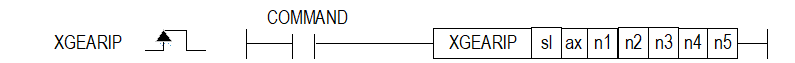

# XGEARIPEX

Synchronize a follower speed at specified master and follower positions.

Manual section(s): 4.42.71. Original Korean notes below may cover the other variants on the same page; apply the widths and execution form of `XGEARIPEX`.

## Editing route

Use `insert_ladder_instruction` after calling `describe_operation` for its current schema.
The writer mnemonic is `XGEARIPEX`; the catalog records opcode `1674` and `7` operands in order.
Inspect the CPU/project and target cells first. Use the inspected revision and positions, preserve expected values, dry-run when useful, then save and inspect the result. See the [editing skill](../../SKILL.md) and [ladder workflow](../ladder.md).

## Behavior

- sl/ax select the module and follower axis. n1 is the REAL follower/master ratio; positive ratios follow the master direction and negative ratios reverse it.
- n2 and n3 specify the master/follower synchronization positions (DINT); n4 is the master travel distance before synchronization (DINT). n5 selects master axis 1..8 or encoder1/2 as 9/10.
- The operation can take multiple scans. The worked example starts synchronization at master position n2 minus n4.

## Instruction constraints

- Use a different network-connected master axis or an encoder; the master cannot be the command/follower axis. Zero ratio is prohibited; the page states nonzero -32,768..32,767.
- The command cannot execute with M-code On (353), servo Off (354), invalid master selection (355), zero/out-of-range ratio (356), or follower speed above its limit (357).
- Master homing prevents the command (358), except for the stated LS Mecapion L7N/L7NH/XIP master cases.
- The ax convention 1..8 is for XGF-PN8B and must match the actual module. XBC-U/XBM can use XBF-PNxxB network positioning in slots 2/3 only.

## Source corrections

- The Korean restriction calls the prohibited-zero quantity the master ratio, while the operand table exposes one synchronization ratio n1; preserve the stated zero/range condition without inventing a separate operand.

## Operands

| Order | Operand | Description (Korean manual) | Reviewed types | Device areas | Constant |
| --- | --- | --- | --- | --- | --- |
| 1 | sl | 위치 모듈이 장착된 베이스(x)와 슬롯(y) 번호:h00xy | WORD | Unknown | Unknown |
| 2 | ax | 직접 기동 지령을 실행할 축:1~8(실축) | WORD | PMK, L, Z, N, D, R | Allowed |
| 3 | n1 | 동기비율(종축비/주축비) | REAL | PMK, L, Z, N, D, R | Allowed |
| 4 | n2 | 동기상태가 될 주축의 위치 | DINT | PMK, L, Z, N, D, R | Allowed |
| 5 | n3 | 동기상태가 될 종축의 위치 | DINT | PMK, L, Z, N, D, R | Allowed |
| 6 | n4 | 동기운전이 시작될 주축의 거리 | DINT | PMK, L, Z, N, D, R | Allowed |
| 7 | n5 | 제어워드 (주축 설정:1~8:1축~8축, 9:엔코더1, 10:엔코더2) | WORD | PMK, L, Z, N, D, R | Allowed |

These are the current library's reviewed operand rules. A shared type union is not a per-variant type choice; use the manual behavior to select the required width. Missing permissions stay unknown.

## CPU and acceptance

No separately reviewed CPU-model restriction is available in the current catalog; this means unknown, not universal compatibility.
Check the applicable model, firmware, modules and memory spans stated in the manual notes. Local parsing, writer validation and IL conversion do not prove native compilation or PLC behavior. Native acceptance requires XG5000 Open → Check Program → Save As → comparison.

## Manual behavior notes (Korean)

- ※ 오퍼랜드 설정 범위는 XGF-PN8B를 기준으로 합니다. 축에 대한 오퍼랜드(ax)의 설정 범위는 제품에서 지원하는 제어 축수에 따라 다르니, 제품 사용설명서를 참조하여 주십시오.
- 이 명령은 위치결정 모듈의 지정된 위치에서 속도동기 운전을 시작하고 속도동기가 이루어지는 위치를 지정할 수있는 속도동기 동작을 실행하기 위해 사용되는 명령입니다.
- sl(위치결정 모듈의 슬롯번호)로 지정된 위치결정 모듈의 ax로 지정된 축에 동기위치 지정 속도동기 명령을 내립니다.
- n1에 동기비율을 설정합니다. 동기비율이 양수이면 주축의 운전방향으로 운전하고, 음수이면 주축의 반대방향으로 운전합니다.
- EX. 동기비율이 0.5로 설정 되었다면, 주축이 3000 이동할 때 종축은 1500 이동합니다.)
- 이 동작은 여러 스캔만에 완료될 수 있습니다.

## Manual flags

| 플래그 | 내 용 | 디바이스 번호 |
| --- | --- | --- |
| 에러 | ax 값이 범위를 벗어날 경우 | F110 |

## Manual applicability and restrictions

- 적용 기종 : XGK, XBC, XBM, XBF
- ax의 설정값이 제품에서 지원하는 설정 범위와 다른 값을 입력하면, 에러가 발생(F110이 Set)합니다.

## Manual flag and step matrix

The shared usage table marks affected flags with `O`, and `-` where it lists no effect. Native steps are the manual's instruction size, not the number of operand arguments. Conditions for setting/clearing flags are in the behavior notes.

| Manual instruction group | Native steps | 에러 (F110) | 제로 (F111) | 캐리 (F112) |
| --- | --- | --- | --- | --- |
| XGEARIP | 4~7 | O | - | - |

## Additional source notes after examples

The manual places some execution restrictions and timing conditions after its example heading. Retain those checks below. Example addresses and circuit assumptions describe the source example and are not defaults for a new program.

- 속도 동기 명령은 M코드 On 신호가 On 되어 있는 상태에서 실행할 수 없습니다. (ErrorCode:353)
- 속도 동기 명령은 서보 오프 상태에서 실행할 수 없습니다.(ErrorCode:354)
- 제어 워드 설정 이외의 값을 설정하면 오류가 발생 됩니다.
- 속도 동기 명령의 주축설정을 네트워크에 연결된 축들 중 명령축과 다른 축 또는 엔코더 중 하나로 설정하십시오.
- 주축 설정은 1(1축)~8(8축), 9(엔코더1), 10(엔코더2) 값으로 설정합니다.(ErrorCode:355)
- 속도 동기 명령의 주축비는 0으로 설정할 수 없습니다. 0을 제외한 -32768 ~ 32767 사이의 값을 설정하십시오.(ErrorCode:356)
- 속도 동기 명령의 종축의 속도가 속도 제한치를 넘을 수 없습니다.(ErrorCode:357)
- 속도 동기 명령은 주축이 원점복귀 운전 중인 경우 실행할 수 없습니다.(ErrorCode:358) (주축이 LS메카피온 L7N/L7NH/XIP인 경우 제외)

## Referenced manual figures

These figures belong to the shared source topic. Read the source corrections above before using variant-specific layouts or example values.

## Provenance

Source: `XGK(B)InstructionHelp_Kr_V3.5.chm`, SHA-256 `b866d589d800addcb039f9f09b182592464d6367faa55abf6dde9ac34a1580e0`.

- `44271xgearip.htm` — §4.42.71; source SHA-256 `b8095991474b670da3780856f7d14b7ebe2afc76865aac2f1beb35476204a6a3`.
- Additional behavior/operand evidence: `44271xgearip.htm`.
