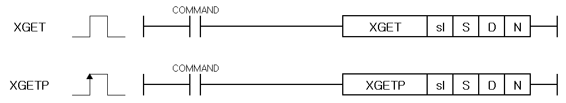

# XGETP

Read XGT network-positioning parameters directly.

Manual section(s): 4.43.4. Original Korean notes below may cover the other variants on the same page; apply the widths and execution form of `XGETP`.

## Editing route

No matching public writer route is exposed for this exact instruction form. Use this file to interpret existing code; preserve its records when editing other parts of a project. Manual documentation alone does not enable insertion.

## Behavior

- Read N WORDs from module address S to CPU destination D; sl selects h00xy. Multiple reads per scan and reads alongside a start command are permitted.
- This P-suffix variant executes once when the enabling input changes from Off to On.

## Instruction constraints

- The page applies to XGK-N/XGF-PN4B/PN8B. Use the parameter-direct-read/write memory map in section 5.1.4, distinct from the variable-data appendix map.
- Errors set PUT/GET flag bits; absent modules only set those flags while other described failures also set F110/F115.

## Source corrections

- Some copied body sentences describe writing during operation; they are not additional XGET write behavior.
- The flag table refers to ax even though XGET has no ax operand; its accompanying 0..255/512..521 ranges describe internal module addresses. Do not add a separate axis argument.

## Operands

| 오퍼랜드 | 내 용 | 데이터 크기 |
| --- | --- | --- |
| sl | 위치결정 모듈이 장착된 베이스 및 슬롯 번호 | WORD |
| S | 데이터를 Read할 위치결정 모듈 내부 메모리의 선두 번지 | WORD |
| D | Read된 데이터가 저장될 디바이스의 선두 번지 | WORD |
| N | Read할 데이터의 워드 수 | WORD |

This source table is not a separately reviewed writer rule. Retain shared variant distinctions and let the current writer reject unsupported operands.

## CPU and acceptance

No separately reviewed CPU-model restriction is available in the current catalog; this means unknown, not universal compatibility.
Check the applicable model, firmware, modules and memory spans stated in the manual notes. Local parsing, writer validation and IL conversion do not prove native compilation or PLC behavior. Native acceptance requires XG5000 Open → Check Program → Save As → comparison.

## Manual behavior notes (Korean)

- sl의 설정 방식은 16진수 2자리로 설정하고 아래의 프로그램과 같이 h0013인 경우 첫번째 숫자 ‘1’은 베이스의 번호, 두번째 ‘3’은 슬롯번호를 의미합니다.
- WORD 단위로 읽기가 실행됩니다.
- 파라미터 직접 읽기 명령은 기동 명령과 동시에 실행할 수 있습니다.
- 파라미터 직접 읽기 명령은 한 스캔에 복수 개 실행이 가능합니다.
- 파라미터 직접 읽기/쓰기를 위한 위치결정 모듈 내부 메모리 번지 정보는 XGF-PN4B/8B 사용설명서의‘5.1.4 파라미터 직접 읽기/쓰기’를 참조하시기 바랍니다.
- 주의) 부록 2.1 가변 데이터 읽기/쓰기 명령의 모듈 내부 메모리 주소값이 혼용되지 않도록 주의해 주시기 바랍니다.
- 펑션블록(XGI 타입 CPU)에서는 XPM_GET/XPM_PUT 함수로 파라미터 직접 읽기/쓰기 기능이 제공됩니다.

## Manual flags

| 플래그 | 내 용 | 디바이스 번호 |
| --- | --- | --- |
| PUT/GET 에러 | 1. 지정한 베이스/슬롯에 모듈이 없거나 모션 모듈이 아닌 경우 2. PUT/GET 명령을 제대로 실행하지 못 했을 경우 3. CPU별 지원하는 max base 범위를 넘어선 경우 4. 지정한 슬롯에 장착된 모듈에 S로 지정한 어드레스가 없을 경우 5. ax값이 범위를 벗어날 경우 (XGF-PN4B: 0~255, 512~521, XGF-PN8B: 0~521) | F0015~F0022 |

## Manual applicability and restrictions

- 적용 기종 : XGK-N
- sl로 지정된 위치에 위치결정 모듈이 없거나 XGET 명령을 정상적으로 수행하지 못 했을 경우 PUT/GET에러 플래그인 XGK F0015~F0022(WORD)의 해당 위치 비트가 셋(Set) 됩니다. 이 때 연산에러 플래그인 F110, F115eh 함께 셋(Set)됩니다.
- sl로 지정된 위치에 모듈이 존재하지 않는 경우에는 PUT/GET 에러 플래그 F0015~F0022 만 셋(Set)되며, 연산에러 플래그 F110, F115는 셋(Set)되지 않습니다.

## Manual flag and step matrix

The shared usage table marks affected flags with `O`, and `-` where it lists no effect. Native steps are the manual's instruction size, not the number of operand arguments. Conditions for setting/clearing flags are in the behavior notes.

| Manual instruction group | Native steps | 에러 (F110) | 제로 (F111) | 캐리 (F112) |
| --- | --- | --- | --- | --- |
| XGET(P) | 4~7 | O | - | - |

## Additional source notes after examples

The manual places some execution restrictions and timing conditions after its example heading. Retain those checks below. Example addresses and circuit assumptions describe the source example and are not defaults for a new program.

- 파라미터 적접 읽기/쓰기 메모리 번지 (‘XGF-PN4B/8B 사용설명서 5.1.4 파라미터 직접 읽기/쓰기 요약)

## Referenced manual figures

These figures belong to the shared source topic. Read the source corrections above before using variant-specific layouts or example values.

## Provenance

Source: `XGK(B)InstructionHelp_Kr_V3.5.chm`, SHA-256 `b866d589d800addcb039f9f09b182592464d6367faa55abf6dde9ac34a1580e0`.

- `4431getmgetmp1.htm` — §4.43.4; source SHA-256 `b9c2787ee2f21ba307cbb1a360ee858d509574b3ece6b7d1161363ebee232b0e`.
- Additional behavior/operand evidence: `33.htm`.
