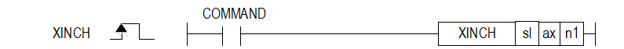

# XINCH

Manual section(s): 4.42.18. Original Korean notes below may cover the other variants on the same page; apply the widths and execution form of `XINCH`.

## Editing route

Use `get_ir` → `apply_patch` for this instruction edit. `insert_ladder_instruction` is the internal writer route, not a separate MCP tool. Preserve the exported revision and native constraints.
The writer mnemonic is `XINCH`; the catalog records opcode `1149` and `3` operands in order.
Inspect the CPU/project and target cells first. Use the inspected revision and positions, preserve expected values, dry-run when useful, then save and inspect the result. See the [editing skill](../../SKILL.md) and [ladder workflow](../ladder.md).

## Operands

| Order | Operand | Description (Korean manual) | Reviewed types | Device areas | Constant |
| --- | --- | --- | --- | --- | --- |
| 1 | sl | 위치 모듈이 장착된 베이스(x)와 슬롯(y) 번호:h00xy | WORD | Unknown | Unknown |
| 2 | ax | 지령을 내릴 축 (0:X 축, 1:Y 축, 2:Z 축) | WORD | PMK, L, Z, N, D, R | Allowed |
| 3 | n1 | 인칭운전으로 이동할 이동량 (?2147483648 ∼ 2147483647 pulse) | DINT | PMK, L, Z, N, D, R | Allowed |

These are the current library's reviewed operand rules. A shared type union is not a per-variant type choice; use the manual behavior to select the required width. Missing permissions stay unknown.

## CPU and acceptance

No separately reviewed CPU-model restriction is available in the current catalog; this means unknown, not universal compatibility.
Check the applicable model, firmware, modules and memory spans stated in the manual notes. Local parsing, writer validation and IL conversion do not prove native compilation or PLC behavior. Native acceptance requires XG5000 Open → Check Program → Save As → comparison.

## Manual behavior notes (Korean)

- ※ 오퍼랜드 설정 범위는 XGF-PN8B를 기준으로 합니다. 축에 대한 오퍼랜드(ax)의 설정 범위는 제품에서 지원하는 제어 축수에 따라 다르니, 제품 사용설명서를 참조하여 주십시오.
- 이 명령은 수동 운전의 일종으로 수동운전 파라미터에 설정한 인칭속도로 인칭 운전 명령의 보조 데이터로설정된 이동량 만큼 위치결정을 실행합니다.목표 위치로 위치결정 운전을 합니다.
- 수동 운전 파라미터에서 설정한 인칭 운전 속도로 위치값(n1) 만큼의 상대 좌표 운전을 실행합니다.
- 수동운전의 하나로 조그 기동과 간략히 비교시,조그 명령에 의한 운전은 조그 신호의 On/Off에 따라 운전이 시작과 정지함으로 정확한 위치로 이동시키기 어려우나 인칭 명령을 사용하면 원하는 이동량 만큼을 쉽게 설정하여 목표점에 도달할 수 있습니다.
- 작업위치 가까이는 조그 명령으로 빠르게 이동한 후 미세 이동은 인칭 명령으로 운전하여 정확한 목표 위치에 도달할 수 있습니다.

## Manual flags

| 플래그 | 내 용 | 디바이스 번호 |
| --- | --- | --- |
| 에러 | ax 값이 범위를 벗어날 경우 | F110 |

## Manual applicability and restrictions

- 적용 기종 : XGK, XBC, XBM, XBF
- ax의 설정값이 제품에서 지원하는 설정 범위와 다른 값을 입력하면 에러가 발생(F110이 Set)됩니다.

## Manual flag and step matrix

The shared usage table marks affected flags with `O`, and `-` where it lists no effect. Native steps are the manual's instruction size, not the number of operand arguments. Conditions for setting/clearing flags are in the behavior notes.

| Manual instruction group | Native steps | 에러 (F110) | 제로 (F111) | 캐리 (F112) |
| --- | --- | --- | --- | --- |
| XINCH | 4~7 | O | - | - |

## Additional source notes after examples

The manual places some execution restrictions and timing conditions after its example heading. Retain those checks below. Example addresses and circuit assumptions describe the source example and are not defaults for a new program.

- 이동 방향은 보조데이터로 설정된 인칭량의 부호에 의해 결정됩니다.
- (1) 인칭 이동량의 값이 양( + )일 때:정방향(현재 위치 증가 방향)으로 위치결정 운전
- (2) 인칭 이동량의 값이 음( - )일 때:역방향(현재 위치 감소 방향)으로 위치결정 운전
- (1) 인칭 운전의 가감속 시간은 수동운전 조그 가속시간과 조그 감속시간을 사용합니다.
- (2) XG-PM의 수동운전 파라미터 설정 항목 중 조그 가속시간과 조그 감속시간에 가속과 감속 시간을 설정 하십시오.
- (3) 인칭 속도는 XG-PM의 수동운전 파라미터 설정 항목 중 인칭 속도에 설정합니다.
- (4) 인칭 속도는 설정 범위를 초과하여 설정하면 에러가 발생되고 운전이 되지 않습니다.

## Referenced manual figures

These figures belong to the shared source topic. Read the source corrections above before using variant-specific layouts or example values.

## Provenance

Source: `XGK(B)InstructionHelp_Kr_V3.5.chm`, SHA-256 `b866d589d800addcb039f9f09b182592464d6367faa55abf6dde9ac34a1580e0`.

- `44218xinch.htm` — §4.42.18; source SHA-256 `68e4bec03f399706504f1085c30ca426d0f2b506831db24bd365d7b2a6fc6808`.
- Additional behavior/operand evidence: `44218xinch.htm`.
