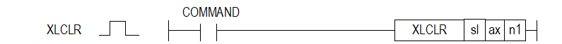

# XLCLREX

Manual section(s): 4.42.60. Original Korean notes below may cover the other variants on the same page; apply the widths and execution form of `XLCLREX`.

## Editing route

Use `insert_ladder_instruction` after calling `describe_operation` for its current schema.
The writer mnemonic is `XLCLREX`; the catalog records opcode `1594` and `3` operands in order.
Inspect the CPU/project and target cells first. Use the inspected revision and positions, preserve expected values, dry-run when useful, then save and inspect the result. See the [editing skill](../../SKILL.md) and [ladder workflow](../ladder.md).

## Operands

| Order | Operand | Description (Korean manual) | Reviewed types | Device areas | Constant |
| --- | --- | --- | --- | --- | --- |
| 1 | sl | 위치 모듈이 장착된 베이스(x)와 슬롯(y) 번호:h00xy | WORD | Unknown | Unknown |
| 2 | ax | 지령을 내릴 축 | WORD | PMK, L, Z, N, D, R | Allowed |
| 3 | n1 | 래치 리셋 항목 설정 0:래치 완료 상태 리셋 1:래치 위치 데이터 및 래치 완료 상태 리셋 | WORD | PMK, L, Z, N, D, R | Allowed |

These are the current library's reviewed operand rules. A shared type union is not a per-variant type choice; use the manual behavior to select the required width. Missing permissions stay unknown.

## CPU and acceptance

No separately reviewed CPU-model restriction is available in the current catalog; this means unknown, not universal compatibility.
Check the applicable model, firmware, modules and memory spans stated in the manual notes. Local parsing, writer validation and IL conversion do not prove native compilation or PLC behavior. Native acceptance requires XG5000 Open → Check Program → Save As → comparison.

## Manual behavior notes (Korean)

- ※ 오퍼랜드 설정 범위는 XGF-PN8B를 기준으로 합니다. 축에 대한 오퍼랜드(ax)의 설정 범위는 제품에서 지원하는 제어 축 수에 따라 다르니, 제품 사용설명서를 참조하여 주십시오.
- 이 명령은 위치결정 모듈에 저장된 래치된 데이터 개수 및 래치 위치 데이터 또는 래치 완료 상태를 초기화 하고자 하는 경우에 사용되는 명령입니다.
- n1에 지정된 래치 리셋 항목에 따라 리셋되는 항목은 다음과 같습니다.
- 0:래치 완료 상태 리셋
- 1:래치 위치 데이터 및 래치 완료 상태 리셋(“1” 이상의 값은 “1”과 동일하게 처리됩니다.)
- n1에 1을 설정하여 래치 리셋 명령을 실행 한 후 래치 위치 데이터 읽기 명령(XLRD)으로 래치 위치 데이터를 읽으면 데이터는 모두 0이 됩니다.
- 래치 설정 명령은 네트워크 위치결정 모듈 XBF-PN04B/08B, XGF-PN4B/8B 전용 명령어 입니다.

## Manual flags

| 플래그 | 내 용 | 디바이스 번호 |
| --- | --- | --- |
| 에러 | ax 값이 범위를 벗어날 경우 | F110 |

## Manual applicability and restrictions

- 적용 기종 : XGK, XBC, XBM, XBF
- ax의 설정값이 제품에서 지원하는 설정 범위와 다른 값을 입력하면, 에러가 발생(F110이 Set)합니다.

## Manual flag and step matrix

The shared usage table marks affected flags with `O`, and `-` where it lists no effect. Native steps are the manual's instruction size, not the number of operand arguments. Conditions for setting/clearing flags are in the behavior notes.

| Manual instruction group | Native steps | 에러 (F110) | 제로 (F111) | 캐리 (F112) |
| --- | --- | --- | --- | --- |
| XLCLR | 4~7 | O | - | - |

## Additional source notes after examples

The manual places some execution restrictions and timing conditions after its example heading. Retain those checks below. Example addresses and circuit assumptions describe the source example and are not defaults for a new program.

- 이 동작은 여러 스캔만에 완료될 수 있습니다.

## Referenced manual figures

These figures belong to the shared source topic. Read the source corrections above before using variant-specific layouts or example values.

## Provenance

Source: `XGK(B)InstructionHelp_Kr_V3.5.chm`, SHA-256 `b866d589d800addcb039f9f09b182592464d6367faa55abf6dde9ac34a1580e0`.

- `44260xlclr1.htm` — §4.42.60; source SHA-256 `7a867999cba6cae79b7bae08d7873d6792f193d80307eedd103aa27bbff40de3`.
- Additional behavior/operand evidence: `44260xlclr1.htm`.
