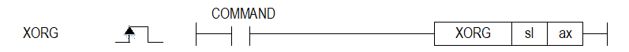
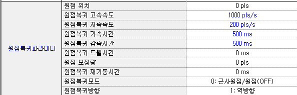
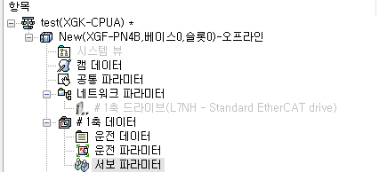
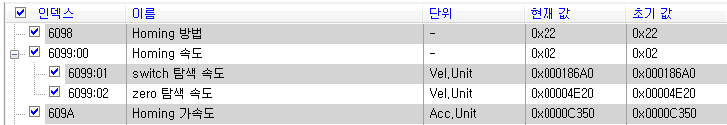
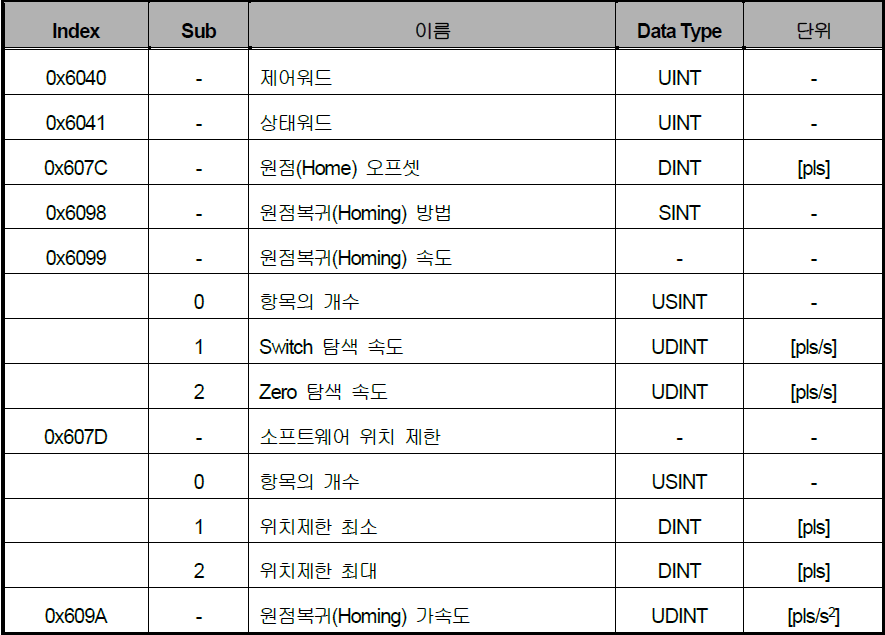

# XORG

Manual section(s): 4.42.1. Original Korean notes below may cover the other variants on the same page; apply the widths and execution form of `XORG`.

## Editing route

Use `insert_ladder_instruction` after calling `describe_operation` for its current schema.
The writer mnemonic is `XORG`; the catalog records opcode `1097` and `2` operands in order.
Inspect the CPU/project and target cells first. Use the inspected revision and positions, preserve expected values, dry-run when useful, then save and inspect the result. See the [editing skill](../../SKILL.md) and [ladder workflow](../ladder.md).

## Operands

| Order | Operand | Description (Korean manual) | Reviewed types | Device areas | Constant |
| --- | --- | --- | --- | --- | --- |
| 1 | sl | 위치 모듈이 장착된 베이스(x)와 슬롯(y) 번호:h00xy | WORD | Unknown | Unknown |
| 2 | ax | 원점 복귀를 실행할 축:1~8(실축) | WORD | PMK, L, Z, N, D, R | Allowed |

These are the current library's reviewed operand rules. A shared type union is not a per-variant type choice; use the manual behavior to select the required width. Missing permissions stay unknown.

## CPU and acceptance

No separately reviewed CPU-model restriction is available in the current catalog; this means unknown, not universal compatibility.
Check the applicable model, firmware, modules and memory spans stated in the manual notes. Local parsing, writer validation and IL conversion do not prove native compilation or PLC behavior. Native acceptance requires XG5000 Open → Check Program → Save As → comparison.

## Manual behavior notes (Korean)

- ※ 오퍼랜드 설정 범위는 XGF-PN8B를 기준으로 합니다. 축에 대한 오퍼랜드(ax)의 설정 범위는 제품에서 지원하는 제어 축수에 따라 다르니, 제품 사용설명서를 참조하여 주십시오.
- 원점 복귀는 전원을 인가한 후에 기계 원점의 확립을 위해 실행합니다.
- 원점 복귀를 실행하기 전에 각 축마다 원점 복귀 파라미터를 설정 해야만 합니다.
- 원점 복귀로 원점 위치가 결정되면 위치결정 운전 중에는 원점 검출 신호를 인식하지 않습니다.
- XBF-DxxxUP, XBM-H(P) 및 XGF-PxxH 등의 펄스타입 모듈의 경우, PLC자체에서 원점 결정 기능을 실행합니다.
- 원점 복귀 방법:
- 근사 원점에 의한 방법
- (1) 근사 원점 Off 후 원점 검출 (0:근사원점/원점(Off))
- (2) 근사 원점 On시 감속 후 원점 검출 (1:근사원점/원점(On))
- (3) 근사 원점에 의한 원점 검출 (3:근사원점)
- 근사 원점을 사용하지 않는 방법
- (1) 원점 및 상하한에 의한 원점 검출 (2:상하한/원점)
- (2) 고속 원점 검출 (4:고속원점)
- (3) 상하한에 의한 원점 검출 (5:상하한)
- (4) 원점에 의한 원점 검출 (6:원점)
- *각 항목의 ()내부 설정은 XG-PM의 원점복귀 파라미터의 원점복귀 모드에 설정할 수 있습니다.
- XBF-PN0xB 및 XGF-PNx(A)B 등의 네트워크 타입 위치결정 모듈의 경우, PLC는 원점 결정 지령을 내리고 서보 드라이브에서 원점 결정 기능을 실행합니다. PLC에서는 원점 결정 결과를 피드백 받습니다.
- 각 항목의 ()내부 설정은 제조사 별 슬레이브를 XG-PM에서 추가 이후,각 축별 서보 파라미터 설정에서 원점 운전 방법
- XG-PM설정 (ex) L7NH:0x6098)에서 설정 가능 예시
- 원점 복귀 관련 파라미터

## Manual flags

| 플래그 | 내 용 | 디바이스 번호 |
| --- | --- | --- |
| 에러 | ax 값이 범위를 벗어날 경우 | F110 |

## Manual applicability and restrictions

- 적용 기종 : XGK, XBC, XBM, XBF
- ax의 설정값이 제품에서 지원하는 설정 범위와 다른 값을 입력하면 에러가 발생(F110이 Set)됩니다.

## Manual flag and step matrix

The shared usage table marks affected flags with `O`, and `-` where it lists no effect. Native steps are the manual's instruction size, not the number of operand arguments. Conditions for setting/clearing flags are in the behavior notes.

| Manual instruction group | Native steps | 에러 (F110) | 제로 (F111) | 캐리 (F112) |
| --- | --- | --- | --- | --- |
| XORG | 4~7 | O | - | - |

## Additional source notes after examples

The manual places some execution restrictions and timing conditions after its example heading. Retain those checks below. Example addresses and circuit assumptions describe the source example and are not defaults for a new program.

- XBF-DxxxUP, XBM-H(P)의 내장 펄스 위치결정 모듈, XGF-PxxH 등의 펄스타입 모듈의 경우:
- 비상정지 발생 시, 축의 원점결정 상태를 ‘0:이전상태 유지’또는 ‘1:원점미결정’중에서 설정합니다.
- 0:이전상태 유지:비상정지로 인하여 축이 정지하여도 원점결정 상태가 변하지 않습니다.
- 1:원점미결정:비상정지로 인하여 축이 정지한 경우 원점결정 상태가 해제 됩니다.
- 원점 복귀 속도를 설정할 때에는 원점 복귀 저속 속도는 가능한 낮은 속도로 설정해 주는 것이 좋습니다.
- 원점 복귀 저속 속도를 너무 빠르게 설정하면 원점 신호 검출시 원점 위치와 원점 복귀 완료 후 위치 사이에 오차가 발생할수 있습니다.
- XBF-PN0xB 및 XGF-PNx(A)B 등의 네트워크 타입 위치결정 모듈의 경우:
- 원점 결정 중에 비상정지/감속정지 감속 속도제어는 아래에서 설정합니다. (Quick Stop 감속도 값)

## Referenced manual figures

These figures belong to the shared source topic. Read the source corrections above before using variant-specific layouts or example values.

## Provenance

Source: `XGK(B)InstructionHelp_Kr_V3.5.chm`, SHA-256 `b866d589d800addcb039f9f09b182592464d6367faa55abf6dde9ac34a1580e0`.

- `4421xorg.htm` — §4.42.1; source SHA-256 `a3b3d67a4f0a23c890a4ec4b3dd176f63ac46f9b5ba6233fe2d5f260e0e7a748`.
- Additional behavior/operand evidence: `4421xorg.htm`.
