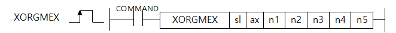
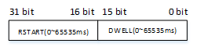

# XORGMEX

Perform module-controlled homing from an LS servo touch-probe or index signal.

Manual section(s): 4.42.76. Original Korean notes below may cover the other variants on the same page; apply the widths and execution form of `XORGMEX`.

## Editing route

Use `insert_ladder_instruction` after calling `describe_operation` for its current schema.
The writer mnemonic is `XORGMEX`; the catalog records opcode `1723` and `7` operands in order.
Inspect the CPU/project and target cells first. Use the inspected revision and positions, preserve expected values, dry-run when useful, then save and inspect the result. See the [editing skill](../../SKILL.md) and [ladder workflow](../ladder.md).

## Behavior

- Unlike XORG servo-side homing, the positioning module controls this homing operation. sl/ax select the module and axis.
- n1 selects touch-probe1/2 rising edge (0/1), falling edge (2/3), or index-Z pulse (4/5); n2 selects increasing-position direction (0) or reverse (1).
- n3 is the final origin position (DINT) and n4 its compensation movement (DINT), both in pulses. Positive compensation follows the homing direction; negative compensation opposes it.
- n5 is a DWORD: low16 bits dwell time in 0..65,535 ms; high16 bits restart delay in 0..65,535 ms.

## Instruction constraints

- XORGMEX is for XGF-PN4B/8B; XORGM is for XBF-PN04B/08B. This instruction applies only to the LS servo product family.
- Invalid axis (0 or >=9 in the source) sets F110. The module/CPU/tool version requirements are listed in the source.

## Source corrections

- The initial device/support matrix says XGET, the section heading number says 4.42.72 instead of the title 4.42.76, and the ST example is copied XPLOOPONEX_EN. Use the explicit homing operand table/body.

## Operands

| Order | Operand | Description (Korean manual) | Reviewed types | Device areas | Constant |
| --- | --- | --- | --- | --- | --- |
| 1 | sl | 위치결정모듈이 장착되어 있는 슬롯번호 | WORD | Unknown | Unknown |
| 2 | ax | 명령을 내릴 축 | WORD | Unknown | Unknown |
| 3 | n1 | 운전모드 0: 터치프로브1 상승에지 1: 터치프로브2 상승에지 2: 터치프로브1 하강에지 3: 터치프로브2 하강에지 4: 터치프로브1 인덱스(Z)펄스 5: 터치프로브2 인덱스(Z)펄스 | WORD | Unknown | Unknown |
| 4 | n2 | 원점 방향 (0: 정방향, 1:역방향) | WORD | Unknown | Unknown |
| 5 | n3 | 원점 위치 ( Pulse: -2,147,483,648 ~ 2,147,483,647) | DINT | Unknown | Unknown |
| 6 | n4 | 원점 보정량 ( Pulse: -2,147,483,648 ~ 2,147,483,647) | DINT | Unknown | Unknown |
| 7 | n5 | 드웰시간/재기동시간 하위 16비트: 드웰 시간(0~65,535ms) 상위 16비트: 재기동 대기 시간(0~65,535ms) | DWORD | Unknown | Unknown |

These are the current library's reviewed operand rules. A shared type union is not a per-variant type choice; use the manual behavior to select the required width. Missing permissions stay unknown.

## CPU and acceptance

No separately reviewed CPU-model restriction is available in the current catalog; this means unknown, not universal compatibility.
Check the applicable model, firmware, modules and memory spans stated in the manual notes. Local parsing, writer validation and IL conversion do not prove native compilation or PLC behavior. Native acceptance requires XG5000 Open → Check Program → Save As → comparison.

## Manual behavior notes (Korean)

- 이 명령은 LS 서보 제품 군에만 적용됩니다. 이 명령은 서보의 신호( 터치프로브 또는 인덱스(Z)펄스)를 받아 모듈에서 원점복귀 운전을 수행합니다. 네트워크 위치에서 제공하는 원점 복귀(XORG)는 서보측에서 원점복귀를 제어하지만 이 명령은 위치 모듈 자체에서 원점복귀 운전을 제어합니다.
- sl(위치결정 모듈의 슬롯번호)로 지정된 위치결정 모듈의 ax로 지정된 축을 설정 합니다.
- n1는 지정된 운전모드이며, 서보의 터치프로브신호를 받습니다.
- n2에 원점복귀 방향을 결정합니다. 원점복귀 방향은 위치 값이 증가하는 방향이 정방향입니다.
- n3에 운전완료 후 원점 위치값을 지정합니다.
- n4에 운전완료 후 이동할 원점 보정량을 지정합니다. +일경우 원점복귀 방향과 같은 방향으로 이동하고, -일 경우 반대방향으로 이동합니다.
- n5 에서 드웰 시간은 운전완료 후 대기시간이고, 재기동 대기시간은 상하한을 모두 만난 후 정지시점부터, 다시 원점복귀 동작 수행하기 전까지 대기시간입니다. 각각 16비트로 나눠서 저장합니다.

| 항목 | 내 용 |
| --- | --- |
| XGF-PN4B OS | V2.10 이상 |
| XGF-PN8B OS | V2.10 이상 |
| 고성능 XGK CPU | V1.60 이상 |
| XG5000 | V4.52 이상 |

## Manual flags

| 플래그 | 내 용 | 디바이스 번호 |
| --- | --- | --- |
| 에러 | ax값이 범위를 벗어날 경우 | F110 |

## Manual applicability and restrictions

- ax로 지정하는 지령축에 0이나 9이상의 값이 입력되면 에러(F110)를 SET합니다.

| 지원 기종 | XGK | XGK | XGK | XGK | XGK | XGK-N | XGK-N | XGK-N | XBC(내장) | XBC(내장) | XBC(내장) | XBC(내장) | XBM(내장) | XBM(내장) | XBM(내장) | XBF |
| --- | --- | --- | --- | --- | --- | --- | --- | --- | --- | --- | --- | --- | --- | --- | --- | --- |
| 지원 기종 | U | H | A | S | E | UN | HN | SN | U | H | SU | E | S | H | V2(P) | PNxxB |
| 지원 기종 | X | X | X | X | X | O*1 | O*1 | O*1 | X | X | X | X | X | X | X | O*2 |

## Additional source notes after examples

The manual places some execution restrictions and timing conditions after its example heading. Retain those checks below. Example addresses and circuit assumptions describe the source example and are not defaults for a new program.

- XORGMEX의 원점복귀 고/저속, 가/감속시간은 수동 운전파라미터의 조그 고/저속, 가/감속시간으로 설정합니다.
- 이 명령은 LS 서보 제품군에만 적용됩니다.

## Referenced manual figures

These figures belong to the shared source topic. Read the source corrections above before using variant-specific layouts or example values.

## Provenance

Source: `XGK(B)InstructionHelp_Kr_V3.5.chm`, SHA-256 `b866d589d800addcb039f9f09b182592464d6367faa55abf6dde9ac34a1580e0`.

- `44271xgearip5.htm` — §4.42.76; source SHA-256 `22d4d8cb87df4751012dc12a7c34bcce3c5df78cb6fc6c0ed9836e621ac2d577`.
- Additional behavior/operand evidence: `44271xgearip5.htm`.
