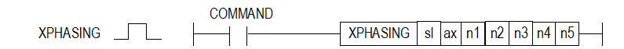

# XPHASING

Manual section(s): 4.42.63. Original Korean notes below may cover the other variants on the same page; apply the widths and execution form of `XPHASING`.

## Editing route

Use `insert_ladder_instruction` after calling `describe_operation` for its current schema.
The writer mnemonic is `XPHASING`; the catalog records opcode `1088` and `7` operands in order.
Inspect the CPU/project and target cells first. Use the inspected revision and positions, preserve expected values, dry-run when useful, then save and inspect the result. See the [editing skill](../../SKILL.md) and [ladder workflow](../ladder.md).

## Operands

| Order | Operand | Description (Korean manual) | Reviewed types | Device areas | Constant |
| --- | --- | --- | --- | --- | --- |
| 1 | sl | 위치 모듈이 장착된 베이스(x)와 슬롯(y) 번호:h00xy | WORD | Unknown | Unknown |
| 2 | ax | 지령을 실행할 축(종축):1~8(실축) | WORD | PMK, L, Z, N, D, R | Allowed |
| 3 | n1 | 위상 보정량 (-2,147,483,648 ~ 2,147,483,647) | DINT | PMK, L, Z, N, D, R | Allowed |
| 4 | n2 | 위상 보정 속도 (주축 속도에 대한 상대 속도) | DWORD | PMK, L, Z, N, D, R | Allowed |
| 5 | n3 | 가속 시간(0 ~ 2,147,483,647 ms) | DWORD | PMK, L, Z, N, D, R | Allowed |
| 6 | n4 | 감속 시간(0 ~ 2,147,483,647 ms) | DWORD | PMK, L, Z, N, D, R | Allowed |
| 7 | n5 | 주축 (1~8:1축~8축, 9:엔코더1, 10:엔코더2) | WORD | PMK, L, Z, N, D, R | Allowed |

These are the current library's reviewed operand rules. A shared type union is not a per-variant type choice; use the manual behavior to select the required width. Missing permissions stay unknown.

## CPU and acceptance

No separately reviewed CPU-model restriction is available in the current catalog; this means unknown, not universal compatibility.
Check the applicable model, firmware, modules and memory spans stated in the manual notes. Local parsing, writer validation and IL conversion do not prove native compilation or PLC behavior. Native acceptance requires XG5000 Open → Check Program → Save As → comparison.

## Manual behavior notes (Korean)

- ※ 오퍼랜드 설정 범위는 XGF-PN8B를 기준으로 합니다. 축에 대한 오퍼랜드(ax)의 설정 범위는 제품에서 지원하는 제어 축 수에 따라 다르니, 제품 사용설명서를 참조하여 주십시오.
- 이 명령은 위치결정 모듈의 해당 축에 위상 보정 기능을 실행하도록 하는 명령입니다.
- sl(위치결정 모듈의 슬롯번호)로 지정된 위치결정 모듈의 ax로 지정된 축이 n1로 지정된 위상 보정량 만큼 n2~n4으로 설정된 위상 보정 속도, 가속시간, 감속 시간을 사용하여 위상 보정 운전을 실행 합니다.
- 명령을 실행하는 축은 n5에 설정된 축을 주축으로 위상 보정 운전을 합니다.
- 해당 축이 속도 동기 운전 또는 캠 운전 중인 경우에만 동작 가능합니다.
- 위상 보정 속도는 현재 주축이 운전되는 속도에 대한 상대 속도로 동작합니다.
- 축이 엔코더 인 경우 위상 보정 제어 실행 시 종축의 속도 제한치와 가감속 패턴을 사용하여 운전 됩니다.
- 위상 보정 명령을 실행하여도 주축의 명령 위치 및 현재 위치는 변화하지 않으며, 종축이 동기 제어 운전 시 참조하는 주축 위치 값이 보정되어 위상 보정이 실행됩니다.
- 동기 운전 중 종축이 참조하는 주축 위치는 “주축 위치 + 위상 보정 제어 위치”가 됩니다.
- 보정 운전 중 다시 명령이 실행되면 그 지점에서 위상 보정량 만큼 다시 위상 보정을 실행합니다.
- 위상 보정량은 상대 값으로 추가 동작합니다.
- 보정 운전 중 위상 보정량을 0으로 설정하여 재실행하는 경우 기존 위상 보정 운전은 바로 중단됩니다. (상태 정보의 위상 보정 운전중 상태도 Off로 됩니다.)
- 동작은 여러 스캔만에 완료될 수 있습니다.

## Manual flags

| 플래그 | 내 용 | 디바이스 번호 |
| --- | --- | --- |
| 에러 | ax 값이 범위를 벗어날 경우 | F110 |

## Manual applicability and restrictions

- 적용 기종 : XGK, XBC, XBM, XBF
- ax의 설정값이 제품에서 지원하는 설정 범위와 다른 값을 입력하면, 에러가 발생(F110이 Set)합니다.

## Manual flag and step matrix

The shared usage table marks affected flags with `O`, and `-` where it lists no effect. Native steps are the manual's instruction size, not the number of operand arguments. Conditions for setting/clearing flags are in the behavior notes.

| Manual instruction group | Native steps | 에러 (F110) | 제로 (F111) | 캐리 (F112) |
| --- | --- | --- | --- | --- |
| XPHASING | 4~7 | O | - | - |

## Additional source notes after examples

The manual places some execution restrictions and timing conditions after its example heading. Retain those checks below. Example addresses and circuit assumptions describe the source example and are not defaults for a new program.

- 다음의 경우는 에러가 되어 위상 보정 제어를 실행할 수 없습니다.
- 종축이 동기 제어(속도 동기, 캠) 운전 중이 아닌 상태에서 위상 보정 명령을 실행한 경우 에러(771)가 발생합니다.
- 주축 설정이 동기 운전 중인 축의 주축이 아닌 경우 에러(772)가 발생합니다.
- 위상 보정 명령의 위상 보정량이 펄스 단위 위치 표현 범위(-2,147,483,648 ~ 2,147,483,647)를 벗어나게 설정한 경우 에러(773)가 발생합니다.
- 위상 보정 명령의 속도 설정 값이 0이하이거나 속도 제한치를 초과되게 설정한 경우 에러(774)가 발생합니다.
- 위상 보정 명령의 가속 시간 설정 값이 설정 범위(0 ~ 2,147,483,647ms)를 벗어난 경우 에러(775)가 발생합니다.
- 위상 보정 명령의 감속 시간 설정 값이 설정 범위(0 ~ 2,147,483,647ms)를 벗어난 경우 에러(776)가 발생합니다.

## Referenced manual figures

These figures belong to the shared source topic. Read the source corrections above before using variant-specific layouts or example values.

## Provenance

Source: `XGK(B)InstructionHelp_Kr_V3.5.chm`, SHA-256 `b866d589d800addcb039f9f09b182592464d6367faa55abf6dde9ac34a1580e0`.

- `44263xphasing.htm` — §4.42.63; source SHA-256 `af9ff9b8f197095087f66ff5209deb3f7ed0ad0d157104e0cec80cc00f6d34f5`.
- Additional behavior/operand evidence: `44263xphasing.htm`.
