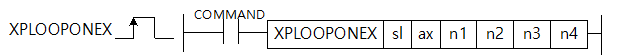

# XPLOOPON

Manual section(s): 4.42.73. Original Korean notes below may cover the other variants on the same page; apply the widths and execution form of `XPLOOPON`.

## Editing route

Use `insert_ladder_instruction` after calling `describe_operation` for its current schema.
The writer mnemonic is `XPLOOPON`; the catalog records opcode `1763` and `6` operands in order.
Inspect the CPU/project and target cells first. Use the inspected revision and positions, preserve expected values, dry-run when useful, then save and inspect the result. See the [editing skill](../../SKILL.md) and [ladder workflow](../ladder.md).

## Operands

| Order | Operand | Description (Korean manual) | Reviewed types | Device areas | Constant |
| --- | --- | --- | --- | --- | --- |
| 1 | sl | 위치결정모듈이 장착되어 있는 슬롯번호 | WORD | Unknown | Unknown |
| 2 | ax | 명령을 내릴 축 | WORD | Unknown | Unknown |
| 3 | n1 | 마스터 위치 루프 제어 비례 이득 (단위: 1/1000) | DWORD | Unknown | Unknown |
| 4 | n2 | 마스터 위치 루프 제어 적분 이득 (단위: 1/1000) | DWORD | Unknown | Unknown |
| 5 | n3 | 마스터 위치 루프 제어 속도 Feedforward 이득 (단위: 1/1000) | DINT | Unknown | Unknown |
| 6 | n4 | 마스터 위치 루프 제어 출력제한 (단위: 1/1000) | DWORD | Unknown | Unknown |

These are the current library's reviewed operand rules. A shared type union is not a per-variant type choice; use the manual behavior to select the required width. Missing permissions stay unknown.

## CPU and acceptance

No separately reviewed CPU-model restriction is available in the current catalog; this means unknown, not universal compatibility.
Check the applicable model, firmware, modules and memory spans stated in the manual notes. Local parsing, writer validation and IL conversion do not prove native compilation or PLC behavior. Native acceptance requires XG5000 Open → Check Program → Save As → comparison.

## Manual behavior notes (Korean)

- 이 명령은 슬레이브로 연결된 서보드라이브에서 수행 중인 위치 루프 제어’를 위치결정 모듈의 CPU에서 수행하기 위해 사용되는 명령입니다.
- 명령이 실행되면 ax에 설정된 서보드라이브의 실행모드를 CSV모드로 바꾸고 해당 축의 명령위치와 현재위치의 차이(위치오차)를 마스터에서 동작하는 PI-FF제어기에 명령 속도로 입력하게 됩니다. PDO Object에 목표속도(0x60FF)가 반드시 사전 맵핑 되어 있어야 합니다.
- 명령을 내릴 수 있는 모든 축에서 실행 가능하며, 실행 이후에는 기존 기동명령으로 축을 운전할 수 있습니다. 축이 ‘운전중’인 경우에는 실행할 수 없습니다.
- 명령어 실행 중에 이득을 갱신하려면 명령어의 오퍼랜드를 수정하고 다시 실행하면 됩니다. ‘운전중’에도 제어 이득을 갱신할 수 있습니다.
- n1에 지정된 마스터 위치 제어 비례이득의 단위는 1/1000이며 다음과 같이 지정할 수 있습니다.
- 0 ~ 4294967295
- n2에 지정된 마스터 위치 제어 적분이득의 단위는 1/1000이며 다음과 같이 지정할 수 있습니다.
- n3에 지정된 마스터위치제어 속도Feedforward이득의 단위는 1/1000이며 다음과 같이 지정할 수 있습니다.
- -2147483648 ~ 2147483647
- n4에 지정된 마스터 위치 제어 출력제한은 입력값이 출력 상한, 입력값의 음수가 출력 하한으로 적용됩니다. 마스터 위치 제어 루프 출력제한과 적분이득 두 항목 모두 0이 아니면 적분제어 Anti wind-up이 동작합니다. 다음과 같이 지정할 수 있습니다.
- 마스터 위치 제어 루프 실행의 이득이 적절하지 않은 경우 시스템이 불안정해질 수 있으니 주의가 필요합니다.

| 항목 | 내 용 |
| --- | --- |
| XGF-PN4B OS | V2.10 이상 |
| XGF-PN8B OS | V2.10 이상 |
| 고성능 XGK CPU | V1.60 이상 |
| XG5000 | V4.52 이상 |

## Manual flags

| 플래그 | 내 용 | 디바이스 번호 |
| --- | --- | --- |
| 에러 | ax값이 범위를 벗어날 경우 | F110 |

## Manual applicability and restrictions

- ax로 지정하는 지령축에 0이나 9이상의 값이 입력되면 에러(F110)를 SET합니다.

| 지원 기종 | XGK | XGK | XGK | XGK | XGK | XGK-N | XGK-N | XGK-N | XBC(내장) | XBC(내장) | XBC(내장) | XBC(내장) | XBM(내장) | XBM(내장) | XBM(내장) | XBF |
| --- | --- | --- | --- | --- | --- | --- | --- | --- | --- | --- | --- | --- | --- | --- | --- | --- |
| 지원 기종 | U | H | A | S | E | UN | HN | SN | U | H | SU | E | S | H | V2(P) | PNxxB |
| 지원 기종 | X | X | X | X | X | O*1 | O*1 | O*1 | X | X | X | X | X | X | X | O*2 |

## Manual flag and step matrix

The shared usage table marks affected flags with `O`, and `-` where it lists no effect. Native steps are the manual's instruction size, not the number of operand arguments. Conditions for setting/clearing flags are in the behavior notes.

| Manual instruction group | Native steps | 에러 (F110) | 제로 (F111) | 캐리 (F112) |
| --- | --- | --- | --- | --- |
| XPLOOP ONEX | 4~7 | O | - | - |

## Referenced manual figures

These figures belong to the shared source topic. Read the source corrections above before using variant-specific layouts or example values.

## Provenance

Source: `XGK(B)InstructionHelp_Kr_V3.5.chm`, SHA-256 `b866d589d800addcb039f9f09b182592464d6367faa55abf6dde9ac34a1580e0`.

- `44271xgearip2.htm` — §4.42.73; source SHA-256 `5fa5888cd3b3bfa78375632e51ee5835dd5372d9495bf6df8b3ac8e71ae6dfe3`.
- Additional behavior/operand evidence: `44271xgearip2.htm`.
