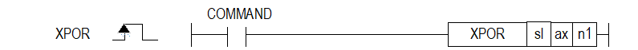

# XPOREX

Manual section(s): 4.42.14. Original Korean notes below may cover the other variants on the same page; apply the widths and execution form of `XPOREX`.

## Editing route

Use `get_ir` → `apply_patch` for this instruction edit. `insert_ladder_instruction` is the internal writer route, not a separate MCP tool. Preserve the exported revision and native constraints.
The writer mnemonic is `XPOREX`; the catalog records opcode `1703` and `3` operands in order.
Inspect the CPU/project and target cells first. Use the inspected revision and positions, preserve expected values, dry-run when useful, then save and inspect the result. See the [editing skill](../../SKILL.md) and [ladder workflow](../ladder.md).

## Operands

| Order | Operand | Description (Korean manual) | Reviewed types | Device areas | Constant |
| --- | --- | --- | --- | --- | --- |
| 1 | sl | 위치 모듈이 장착된 베이스(x)와 슬롯(y) 번호:h00xy | WORD | Unknown | Unknown |
| 2 | ax | 지령을 내릴 축 | WORD | PMK, L, Z, N, D, R | Allowed |
| 3 | n1 | 변경할 목표 위치값 (절대좌표) | DINT | PMK, L, Z, N, D, R | Allowed |

These are the current library's reviewed operand rules. A shared type union is not a per-variant type choice; use the manual behavior to select the required width. Missing permissions stay unknown.

## CPU and acceptance

No separately reviewed CPU-model restriction is available in the current catalog; this means unknown, not universal compatibility.
Check the applicable model, firmware, modules and memory spans stated in the manual notes. Local parsing, writer validation and IL conversion do not prove native compilation or PLC behavior. Native acceptance requires XG5000 Open → Check Program → Save As → comparison.

## Manual behavior notes (Korean)

- ※ 오퍼랜드 설정 범위는 XGF-PN8B를 기준으로 합니다. 축에 대한 오퍼랜드(ax)의 설정 범위는 제품에서 지원하는 제어 축수에 따라 다르니, 제품 사용설명서를 참조하여 주십시오.
- 위치결정 데이터에 의한 위치결정 제어 중 목표 위치를 변경하고자 하는 경우에 위치 오버라이드 명령을 사용하여 목표 위치를 변경할 수 있습니다.
- 위치 오버라이드 명령은 운전 패턴 중 가속, 정속, 감속 구간에서 사용이 가능하며, 사용할 수 있는 운전 모드는 종료 운전, 계속 운전, 연속 운전입니다.
- 운전 중인 경우 복수 번 실행 가능합니다.

## Manual flags

| 플래그 | 내 용 | 디바이스 번호 |
| --- | --- | --- |
| 에러 | ax 값이 범위를 벗어날 경우 | F110 |

## Manual applicability and restrictions

- 적용 기종 : XGK, XBC, XBM, XBF
- ax의 설정값이 제품에서 지원하는 설정 범위와 다른 값을 입력하면 에러가 발생(F110이 Set)됩니다.

## Manual flag and step matrix

The shared usage table marks affected flags with `O`, and `-` where it lists no effect. Native steps are the manual's instruction size, not the number of operand arguments. Conditions for setting/clearing flags are in the behavior notes.

| Manual instruction group | Native steps | 에러 (F110) | 제로 (F111) | 캐리 (F112) |
| --- | --- | --- | --- | --- |
| XPOR | 4~7 | O | - | - |

## Additional source notes after examples

The manual places some execution restrictions and timing conditions after its example heading. Retain those checks below. Example addresses and circuit assumptions describe the source example and are not defaults for a new program.

- 다음의 경우는 에러가 되어 위치 오버라이드 명령을 실행하지 않고, 원래의 목표위치로 계속 운전합니다.
- 드웰 중인 상태에서 위치 오버라이드 명령을 실행한 경우 (에러코드:362)
- 현재 실행 중인 운전이 위치 결정 (단축위치제어, 인칭운전) 제어가 아닌 경우 (에러코드:363)
- 직선보간 운전 중인 축에 대하여 위치 오버라이드 명령을 실행한 경우 (에러코드:364)
- 원호보간 운전 중인 축에 위치 오버라이드 명령을 실행한 경우 (에러코드:365)
- 동기운전 종축에 대하여 연속 운전 명령을 실행한 경우 (에러코드:366)
- 운전 중 위치 오버라이드 명령 시점에 따라서 운전 패턴이 다르기 때문에 사용에 주의하시기 바랍니다.
- 위치 오버라이드 명령 시점에서 위치 오버라이드 위치가 현재 속도에서 감속하여 정지된 위치보다 큰 경우, 현재 이동방향으로 위치결정 됩니다.
- 위치 오버라이드 위치가 현재 속도에서 감속하여 정지된 위치보다 작은 경우, 감속 정지한 후 반대 방향으로 운전하여 목표위치로 위치결정 합니다.

## Referenced manual figures

These figures belong to the shared source topic. Read the source corrections above before using variant-specific layouts or example values.

## Provenance

Source: `XGK(B)InstructionHelp_Kr_V3.5.chm`, SHA-256 `b866d589d800addcb039f9f09b182592464d6367faa55abf6dde9ac34a1580e0`.

- `44214xpor.htm` — §4.42.14; source SHA-256 `919f18985e188df6b65138535abb5ea0b93bbdd1620c0d42b4677f2c7b339b5d`.
- Additional behavior/operand evidence: `44214xpor.htm`.
