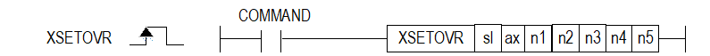

# XSETOVREX

Manual section(s): 4.42.66. Original Korean notes below may cover the other variants on the same page; apply the widths and execution form of `XSETOVREX`.

## Editing route

Use `insert_ladder_instruction` after calling `describe_operation` for its current schema.
The writer mnemonic is `XSETOVREX`; the catalog records opcode `1709` and `7` operands in order.
Inspect the CPU/project and target cells first. Use the inspected revision and positions, preserve expected values, dry-run when useful, then save and inspect the result. See the [editing skill](../../SKILL.md) and [ladder workflow](../ladder.md).

## Operands

| Order | Operand | Description (Korean manual) | Reviewed types | Device areas | Constant |
| --- | --- | --- | --- | --- | --- |
| 1 | sl | 위치 모듈이 장착된 베이스(x)와 슬롯(y) 번호:h00xy | WORD | Unknown | Unknown |
| 2 | ax | 지령을 실행할 축:1~8(실축) | WORD | PMK, L, Z, N, D, R | Allowed |
| 3 | n1 | 속도 오버라이드 비율 (또는 명령 속도) | DINT | PMK, L, Z, N, D, R | Allowed |
| 4 | n2 | 가속시간 오버라이드 비율 (또는 명령 가속시간) | UDINT | PMK, L, Z, N, D, R | Allowed |
| 5 | n3 | 감속시간 오버라이드 비율 (또는 명령 감속시간) | UDINT | PMK, L, Z, N, D, R | Allowed |
| 6 | n4 | 미사용 (S-커브 비율 (0=사다리꼴, 1~100=S-커브 비율)) | DINT | PMK, L, Z, N, D, R | Allowed |
| 7 | n5 | 운전 방향(1 ~3:1-정방향, 2-역방향, 3-현재 방향) | DINT | PMK, L, Z, N, D, R | Allowed |

These are the current library's reviewed operand rules. A shared type union is not a per-variant type choice; use the manual behavior to select the required width. Missing permissions stay unknown.

## CPU and acceptance

No separately reviewed CPU-model restriction is available in the current catalog; this means unknown, not universal compatibility.
Check the applicable model, firmware, modules and memory spans stated in the manual notes. Local parsing, writer validation and IL conversion do not prove native compilation or PLC behavior. Native acceptance requires XG5000 Open → Check Program → Save As → comparison.

## Manual behavior notes (Korean)

- ※ 오퍼랜드 설정 범위는 XGF-PN8B를 기준으로 합니다. 축에 대한 오퍼랜드(ax)의 설정 범위는 제품에서 지원하는 제어 축수에 따라 다르니, 제품 사용설명서를 참조하여 주십시오.
- 현재 운전 중인 위치결정 제어의 운전 속도와 운전 방향, 가감속을 변경하고자 하는 경우에 속도/가감속 오버라이드 명령을 사용하여 운전 속도와 가감속을 변경할 수 있습니다.
- 해당 지령은 운전 중인 경우 복수 번 실행 가능합니다.
- 공통 파라미터의 「속도 오버라이드」에 속도 오버라이드 값을 “%지정”, “속도지정”으로 설정할 수 있습니다.
- 관련 파라미터 설정 (공통 파라미터)
- 속도 오버라이드 명령의 보조 데이터 설정

| 항목 | 설정값 | 내용 |
| --- | --- | --- |
| 속도 오버라이드 | 0:%지정 | 속도 오버라이드 설정 값을 설정 속도의 %로 지정합니다. |
| 속도 오버라이드 | 1:속도지정 | 속도 오버라이드 설정 값을 운전 속도로 직접 지정합니다. |

| 항목 | 설정값 | 내용 |
| --- | --- | --- |
| 속도 | 1 ~ 65535 (1=0.01%) | 속도 오버라이드가 “%지정”인 경우 설정 속도에 대한 %를 지정합니다. (100%의 경우 10000 설정) |
| 속도 | 1 ~속도 제한치 | 속도 오버라이드가 “속도지정”인 경우 직접 운전 속도를 설정합니다. |

## Manual flags

| 플래그 | 내 용 | 디바이스 번호 |
| --- | --- | --- |
| 에러 | ax 값이 범위를 벗어날 경우 | F110 |

## Manual applicability and restrictions

- 적용 기종 : XGK, XBC, XBM, XBF
- ax의 설정값이 제품에서 지원하는 설정 범위와 다른 값을 입력하면, 에러가 발생(F110이 Set)합니다.

## Manual flag and step matrix

The shared usage table marks affected flags with `O`, and `-` where it lists no effect. Native steps are the manual's instruction size, not the number of operand arguments. Conditions for setting/clearing flags are in the behavior notes.

| Manual instruction group | Native steps | 에러 (F110) | 제로 (F111) | 캐리 (F112) |
| --- | --- | --- | --- | --- |
| XSETOVR | 4~7 | O | - | - |

## Additional source notes after examples

The manual places some execution restrictions and timing conditions after its example heading. Retain those checks below. Example addresses and circuit assumptions describe the source example and are not defaults for a new program.

- 방향 파라미터n4는 1(정방향), 2(역방향), 3(현재 방향)만 설정이 가능합니다. 만약 n4를 디폴트 0으로 지정하여 운전시 명령어 실행이 정상적으로 되지 않으니 주의가 필요합니다.
- 해당 지령은 IEC타입 명령(XPM_SETOVR)과 동작상 동일하지만 입력 조건에 따른 차이점이있습니다.
- IEC형의 XPM_SETOVR의 경우 입력 접점이 계속 On이 되어 있는 상태에서도 파라미터 값 변경시 실시간으로 변경된 내용이 반영되어 명령이 실행됩니다. (Level방식)
- MK형의 경우 CPU에 인스턴스 메모리가 존재하지 않는 관계로 Level방식이 아닌 Edge방식으로 동작됩니다.
- 파라미터의 조건을 변경하여 이를 반영 시키고자 한다면, 입력 접점을 OFF/ON시켜 Edge조건을 만들어야 동작에 반영됩니다.
- 다음의 경우는 에러가 되어 속도 오버라이드를 실행하지 않고, 이전의 속도로 계속 운전합니다.
- 속도 오버라이드 값이 기본 파라미터의 속도 제한치를 초과한 경우 (에러코드:372) 속도 오버라이드 속도 값은 속도 제한치 이하로 설정하시기 바랍니다
- 직선 보간 제어의 속도 오버라이드는 보간 축 각각에 대해서 속도 제한치 이하로 되도록 설정하시기 바랍니다.
- 직선보간의 종축에 대하여 속도 오버라이드 명령을 실행한 경우 (에러코드:373) 직선보간 운전 중인 경우의 속도 오버라이드 명령은 주축에 실행해야 합니다.
- 원호보간의 종축에 대하여 속도 오버라이드 명령을 실행한 경우 (에러코드:374) 원호보간 운전 중인 경우의 속도 오버라이드 명령은 주축에 실행해야 합니다.
- 동기운전 종축에 대하여 속도 오버라이드 명령을 실행한 경우 (에러코드:375)
- 감속 구간에서 속도 오버라이드 명령을 실행한 경우 (에러코드:377)
- 확장 파라미터의 가감속 패턴이 「S-커브운전」인 경우 (에러코드:378)
- 운전 방향에 0 또는 3보다 큰 값을 입력할 경우 (에러코드:781)운전 방향에는 1(정방향), 2(역방향), 3(현재 방향)만 입력하시기 바랍니다.
- 위치 제어 운전 중 속도값을 음수로 지정할 경우 (에러코드:782)
- 공통 파라미터의 속도 오버라이드가 「%지정」인 경우 가속도 또는 감속도에 65535보다 큰 값으로 명령을 실행한 경우 (에러코드:783)

## Referenced manual figures

These figures belong to the shared source topic. Read the source corrections above before using variant-specific layouts or example values.

## Provenance

Source: `XGK(B)InstructionHelp_Kr_V3.5.chm`, SHA-256 `b866d589d800addcb039f9f09b182592464d6367faa55abf6dde9ac34a1580e0`.

- `44266xsetovr.htm` — §4.42.66; source SHA-256 `3afa0794938ed9cba25e70fed42432c8b4c58291c9301d835cd1e6432d55ebbc`.
- Additional behavior/operand evidence: `44266xsetovr.htm`.
