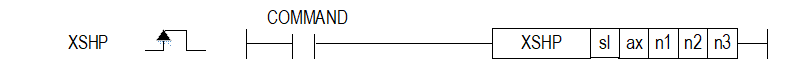

# XSHP

Manual section(s): 4.42.32. Original Korean notes below may cover the other variants on the same page; apply the widths and execution form of `XSHP`.

## Editing route

Use `insert_ladder_instruction` after calling `describe_operation` for its current schema.
The writer mnemonic is `XSHP`; the catalog records opcode `1182` and `5` operands in order.
Inspect the CPU/project and target cells first. Use the inspected revision and positions, preserve expected values, dry-run when useful, then save and inspect the result. See the [editing skill](../../SKILL.md) and [ladder workflow](../ladder.md).

## Operands

| Order | Operand | Description (Korean manual) | Reviewed types | Device areas | Constant |
| --- | --- | --- | --- | --- | --- |
| 1 | sl | 위치 모듈이 장착된 베이스(x)와 슬롯(y) 번호:h00xy | WORD | Unknown | Unknown |
| 2 | ax | 기본 파라미터 티칭을 실행할 지령 축:1~8(실축) | WORD | PMK, L, Z, N, D, R | Allowed |
| 3 | n1 | 티칭 데이터 (원점 복귀 파라미터 중 변경할 항목의 변경값) | DINT | PMK, L, Z, N, D, R | Allowed |
| 4 | n2 | 원점 복귀 파라미터 중 변경할 항목 (1 ~ 10) | WORD | PMK, L, Z, N, D, R | Allowed |
| 5 | n3 | 티칭 방법 설정 (0:RAM티칭 혹은 1:ROM티칭) | WORD | PMK, L, Z, N, D, R | Allowed |

These are the current library's reviewed operand rules. A shared type union is not a per-variant type choice; use the manual behavior to select the required width. Missing permissions stay unknown.

## CPU and acceptance

No separately reviewed CPU-model restriction is available in the current catalog; this means unknown, not universal compatibility.
Check the applicable model, firmware, modules and memory spans stated in the manual notes. Local parsing, writer validation and IL conversion do not prove native compilation or PLC behavior. Native acceptance requires XG5000 Open → Check Program → Save As → comparison.

## Manual behavior notes (Korean)

- ※ 오퍼랜드 설정 범위는 XGF-PxxH 모듈을 기준으로 합니다. 축에 대한 오퍼랜드(ax)의 설정 범위는 제품에서 지원하는 제어 축 수에 따라 다르니, 제품 사용설명서를 참조하여 주십시오.
- 이 명령은 원점 복귀 파라미터의 파라미터 항목을 티칭하는 명령어 입니다.
- 해당 지령은 지정 축의 n2(원점 복귀 파라미터 항목 중 변경할 항목)의 값을 n1(설정 값)으로 변경하는 명령입니다.
- n3항목을 0:RAM설정을 한 경우에는 변경한 값이 위치결정 모듈에 전원을 인가한 동안만 유지되며, 1:ROM설정을 한경우에는 위치결정 모듈에 전원을 인가하지 않았을 때도 유지가 됩니다.
- 위치결정 모듈의 기본 파라미터는 FRAM에 저장되므로 ROM설정의 실행 횟수는 제한이 없습니다.
- 원점 복귀 파라미터 설정 항목 (펄스 출력 타입 모듈 기준)

| 파라미터 항목 | 파라미터 항목 | 파라미터 값 설정 범위 |
| --- | --- | --- |
| 1 | 원점 어드레스 | - |
| 2 | 원점복귀 고속 속도 | - |
| 3 | 원점복귀 저속 속도 | - |
| 4 | 원점복귀 가속 시간 | - |
| 5 | 원점복귀 감속 시간 | - |
| 6 | 원점복귀 드웰타임 | - |
| 7 | 원점보정량 | - |
| 8 | 원점복귀 재기동 시간 | - |
| 9 | 원점복귀 방법 | 0:DOG/원점(OFF) 1:DOG/원점(ON) 2:상하한/원점 3:DOG 4:고속원점복귀 5:상하한 |
| 10 | 원점복귀 방향 | 0:정방향 1:역방향 |

## Manual flags

| 플래그 | 내 용 | 디바이스 번호 |
| --- | --- | --- |
| 에러 | ax 값이 범위를 벗어날 경우 | F110 |

## Manual applicability and restrictions

- 적용 기종 : XGK, XBC, XBM
- ax의 설정값이 제품에서 지원하는 설정 범위와 다른 값을 입력하면 에러가 발생(F110이 Set)됩니다.

## Manual flag and step matrix

The shared usage table marks affected flags with `O`, and `-` where it lists no effect. Native steps are the manual's instruction size, not the number of operand arguments. Conditions for setting/clearing flags are in the behavior notes.

| Manual instruction group | Native steps | 에러 (F110) | 제로 (F111) | 캐리 (F112) |
| --- | --- | --- | --- | --- |
| XSHP | 4~7 | O | - | - |

## Additional source notes after examples

The manual places some execution restrictions and timing conditions after its example heading. Retain those checks below. Example addresses and circuit assumptions describe the source example and are not defaults for a new program.

- 복수 티칭 데이터 개수에 따라 여러 스캔이 소요될 수 있습니다.
- 티칭 완료 플래그는 존재하지 않습니다.
- 복수의 티칭을 실행하고 티칭 개수에 따라 약간의 딜레이를 주고 다음 지령을 실행 해 주시기 바랍니다. (항목 개수에 따라 수백 ms이상)
- 원점 복귀 파라미터의 전체 항목을 한번의 XSHP 명령으로 모두 설정하려면 n2 파라미터 항목에 hFF(255)를 적용 할 수 없습니다.
- 원점 복귀 파라미터 설정 명령은 해당 축이 운전 중일 경우에는 실행할 수 없습니다.

## Referenced manual figures

These figures belong to the shared source topic. Read the source corrections above before using variant-specific layouts or example values.

## Provenance

Source: `XGK(B)InstructionHelp_Kr_V3.5.chm`, SHA-256 `b866d589d800addcb039f9f09b182592464d6367faa55abf6dde9ac34a1580e0`.

- `44232xshp.htm` — §4.42.32; source SHA-256 `37cc60eb44f81b97cec1ff67332c3aca7a0d2c4168569de1f6ae43a62caffb2e`.
- Additional behavior/operand evidence: `44232xshp.htm`.
