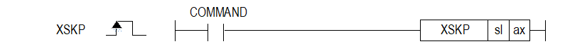

# XSKPEX

Manual section(s): 4.42.11. Original Korean notes below may cover the other variants on the same page; apply the widths and execution form of `XSKPEX`.

## Editing route

Use `insert_ladder_instruction` after calling `describe_operation` for its current schema.
The writer mnemonic is `XSKPEX`; the catalog records opcode `1699` and `2` operands in order.
Inspect the CPU/project and target cells first. Use the inspected revision and positions, preserve expected values, dry-run when useful, then save and inspect the result. See the [editing skill](../../SKILL.md) and [ladder workflow](../ladder.md).

## Operands

| Order | Operand | Description (Korean manual) | Reviewed types | Device areas | Constant |
| --- | --- | --- | --- | --- | --- |
| 1 | sl | 위치 모듈이 장착된 베이스(x)와 슬롯(y) 번호:h00xy | WORD | Unknown | Unknown |
| 2 | ax | 지령을 실행할 축:1~8(실축) | WORD | PMK, L, Z, N, D, R | Allowed |

These are the current library's reviewed operand rules. A shared type union is not a per-variant type choice; use the manual behavior to select the required width. Missing permissions stay unknown.

## CPU and acceptance

No separately reviewed CPU-model restriction is available in the current catalog; this means unknown, not universal compatibility.
Check the applicable model, firmware, modules and memory spans stated in the manual notes. Local parsing, writer validation and IL conversion do not prove native compilation or PLC behavior. Native acceptance requires XG5000 Open → Check Program → Save As → comparison.

## Manual behavior notes (Korean)

- ※ 오퍼랜드 설정 범위는 XGF-PN8B를 기준으로 합니다. 축에 대한 오퍼랜드(ax)의 설정 범위는 제품에서 지원하는 제어 축수에 따라 다르니, 제품 사용설명서를 참조하여 주십시오.
- 이 명령은 현재 실행 중이던 운전 스텝을 감속정지하고, 다음 운전 스텝 번호의 운전 데이터로 변경하여 위치결정 제어를 실행합니다.
- 스킵 운전 명령은 연속 운전 명령(XNMV)과 달리 명령 실행 후에 감속 정지하고 다음 스텝의 운전을 계속하게 됩니다.
- 운전 모드가 종료, 계속, 연속 운전일 경우와 운전 패턴 중 가속, 정속, 감속구간에서 사용할 수 있습니다.

## Manual flags

| 플래그 | 내 용 | 디바이스 번호 |
| --- | --- | --- |
| 에러 | ax 값이 범위를 벗어날 경우 | F110 |

## Manual applicability and restrictions

- 적용 기종 : XGK
- ax의 설정값이 제품에서 지원하는 설정 범위와 다른 값을 입력하면 에러가 발생(F110이 Set)됩니다.

## Manual flag and step matrix

The shared usage table marks affected flags with `O`, and `-` where it lists no effect. Native steps are the manual's instruction size, not the number of operand arguments. Conditions for setting/clearing flags are in the behavior notes.

| Manual instruction group | Native steps | 에러 (F110) | 제로 (F111) | 캐리 (F112) |
| --- | --- | --- | --- | --- |
| XSKP | 4~7 | O | - | - |

## Additional source notes after examples

The manual places some execution restrictions and timing conditions after its example heading. Retain those checks below. Example addresses and circuit assumptions describe the source example and are not defaults for a new program.

- 다음 스텝의 운전 데이터가 설정이 안된 상태에서 스킵 운전 명령을 실행하면 에러151이 발생합니다.
- 아래의 경우에는 에러가 되어 연속 운전 명령을 실행하지 않고, 이전 동작을 계속 합니다.
- 직선보간의 종축에 대하여 스킵 운전 명령을 실행한 경우 (에러코드:332)
- 직선보간 운전 중인 경우의 스킵 운전 명령은 주축에 실행해야 합니다.
- 동기운전 종축에 대하여 스킵 운전 명령을 실행한 경우 (에러코드:333)
- 조그 운전 중인 축에 대하여 스킵 운전 명령을 실행한 경우 (에러코드:335)
- 현재 운전 중인 축이 직접 기동으로 실행된 경우 (에러코드:336)
- 인칭 운전 중인 축에 대하여 스킵 운전 명령을 실행한 경우 (에러코드:337)
- 원호보간의 종축에 대하여 스킵 운전 명령을 실행한 경우 (에러코드 :338)
- 원호보간 운전 중인 경우의 스킵 운전 명령은 주축에 실행해야 합니다.
- 위치 데이터의 설정에서 절대 좌표와 상대 좌표에 따라 스킵 운전 명령에는 동작의 차이가 있습니다.
- (1) 절대 좌표에서의 스킵 운전 명령 후 다음 운전 스텝의 목표 위치는 스킵 운전 명령을 실행하지 않았을 경우와 같습니다.
- 즉, 스킵 운전 명령에 의해 위치 결정 완료된 현재 위치는 P2가 됩니다. (A영역과 B영역의 크기는 같습니다.)
- (2) 상대 좌표에서의 스킵 운전 명령 실행 시는 명령이 입력되는 시점에서의 현재 위치에서 목표 위치에 설정된 이동량 만큼 증분된 값이 목표 위치가 됩니다.
- 스킵 운전을 실행하지 않았을 경우와 목표 위치가 달라집니다. 즉, 스킵 명령에 의해 위치 결정 완료된 위치는 P1’+ P2 가 됩니다.

## Referenced manual figures

These figures belong to the shared source topic. Read the source corrections above before using variant-specific layouts or example values.

## Provenance

Source: `XGK(B)InstructionHelp_Kr_V3.5.chm`, SHA-256 `b866d589d800addcb039f9f09b182592464d6367faa55abf6dde9ac34a1580e0`.

- `44211xskp.htm` — §4.42.11; source SHA-256 `16e7284ee3c31b72ab65132dacbba6a39cfbe5004e36af02829b3ff60224b6e1`.
- Additional behavior/operand evidence: `44211xskp.htm`.
