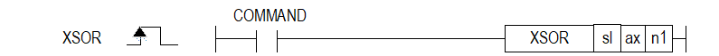

# XSOR

Manual section(s): 4.42.15. Original Korean notes below may cover the other variants on the same page; apply the widths and execution form of `XSOR`.

## Editing route

Use `insert_ladder_instruction` after calling `describe_operation` for its current schema.
The writer mnemonic is `XSOR`; the catalog records opcode `1147` and `3` operands in order.
Inspect the CPU/project and target cells first. Use the inspected revision and positions, preserve expected values, dry-run when useful, then save and inspect the result. See the [editing skill](../../SKILL.md) and [ladder workflow](../ladder.md).

## Operands

| Order | Operand | Description (Korean manual) | Reviewed types | Device areas | Constant |
| --- | --- | --- | --- | --- | --- |
| 1 | sl | 위치 모듈이 장착된 베이스(x)와 슬롯(y) 번호:h00xy | WORD | Unknown | Unknown |
| 2 | ax | 지령을 내릴 축 | WORD | PMK, L, Z, N, D, R | Allowed |
| 3 | n1 | 변경할 목표 속도값 | DWORD | PMK, L, Z, N, D, R | Allowed |

These are the current library's reviewed operand rules. A shared type union is not a per-variant type choice; use the manual behavior to select the required width. Missing permissions stay unknown.

## CPU and acceptance

No separately reviewed CPU-model restriction is available in the current catalog; this means unknown, not universal compatibility.
Check the applicable model, firmware, modules and memory spans stated in the manual notes. Local parsing, writer validation and IL conversion do not prove native compilation or PLC behavior. Native acceptance requires XG5000 Open → Check Program → Save As → comparison.

## Manual behavior notes (Korean)

- ※ 오퍼랜드 설정 범위는 XGF-PN8B를 기준으로 합니다. 축에 대한 오퍼랜드(ax)의 설정 범위는 제품에서 지원하는 제어 축수에 따라 다르니, 제품 사용설명서를 참조하여 주십시오.
- 현재 운전 중인 위치결정 제어의 운전 속도를 변경하고자 하는 경우에 속도 오버라이드 명령을 사용하여 운전 속도를 변경할 수 있습니다.
- 속도 오버라이드 명령은 운전 패턴 중 가속 및 정속 구간에서만 사용 가능하며 사용할 수 있는 운전 모드는 종료 운전, 계속 운전, 연속 운전입니다.
- 속도 오버라이드 값(n1)는 공통 파라미터의 “속도 오버라이드”에 설정된 값에 따라 “% 지정”이나 “속도값 지정”이 됩니다.
- 속도 오버라이드 값의 단위가 %일 경우 설정 영역은 1 ~ 65,535이며 이는 0.01% ~ 655.35%를 의미합니다.
- 속도 오버라이드 값의 단위는 축의 단위를 따릅니다.
- 운전 중인 경우 복수 번 실행 가능합니다.
- 속도 오버라이드 방향 전환이 필요할 경우 해당 명령이 아닌, XSETOVR명령을 사용하시기 바랍니다.
- IEC타입 XPM_SETOVR명령은 입력 조건이 Level타입이기 때문에 입력 접점을 off/on 시키지 않더라도 실시간 속도 오버라이드 적용 됩니다.
- XSETOVR명령은 입력 조건 edge타입이기 때문에 해당되지 않습니다.
- 관련 파라미터 설정 (공통 파라미터)
- 속도 오버라이드 명령의 보조 데이터 설정

| 항목 | 설정 값 | 내용 |
| --- | --- | --- |
| 속도 오버라이드 | 0:%지정 | 속도 오버라이드 설정 값을 설정 속도의 %로 지정합니다. |
| 속도 오버라이드 | 1:속도지정 | 속도 오버라이드 설정값을 운전 속도로 직접 지정합니다. |

| 항목 | 설정 값 | 내용 |
| --- | --- | --- |
| 속도 | 1 ~ 65535 (1=0.01%) | 속도 오버라이드가 “%지정”인 경우 설정 속도에 대한 %를 지정합니다. (100%의 경우 10000 설정) |
| 속도 | 1 ~ 속도 제한치 | 속도 오버라이드가 “속도지정”인 경우 직접 운전 속도를 설정합니다. |

## Manual flags

| 플래그 | 내 용 | 디바이스 번호 |
| --- | --- | --- |
| 에러 | ax 값이 범위를 벗어날 경우 | F110 |

## Manual applicability and restrictions

- 적용 기종 : XGK, XBC, XBM, XBF
- ax의 설정값이 제품에서 지원하는 설정 범위와 다른 값을 입력하면 에러가 발생(F110이 Set)됩니다.

## Manual flag and step matrix

The shared usage table marks affected flags with `O`, and `-` where it lists no effect. Native steps are the manual's instruction size, not the number of operand arguments. Conditions for setting/clearing flags are in the behavior notes.

| Manual instruction group | Native steps | 에러 (F110) | 제로 (F111) | 캐리 (F112) |
| --- | --- | --- | --- | --- |
| XSOR | 4~7 | O | - | - |

## Additional source notes after examples

The manual places some execution restrictions and timing conditions after its example heading. Retain those checks below. Example addresses and circuit assumptions describe the source example and are not defaults for a new program.

- 다음의 경우는 에러가 되어 속도 오버라이드를 실행하지 않고, 이전의 속도로 계속 운전합니다.
- 속도 오버라이드 값이 기본 파라미터의 속도 제한치를 초과한 경우 (에러코드:372)
- (1) 속도 오버라이드 속도 값은 속도 제한치 이하로 설정하시기 바랍니다.
- (2) 직선보간 제어의 속도 오버라이드는 보간축 각각에 대해 속도 제한치 이하로 되도록 설정하시기 바랍니다.
- 직선보간의 종축에 대하여 속도 오버라이드 명령을 실행한 경우 (에러코드:373)
- (1) 직선보간 운전 중인 경우의 속도 오버라이드 명령은 주축에 실행해야 합니다.
- 원호보간의 종축에 대하여 속도 오버라이드 명령을 실행한 경우 (에러코드:374)
- (1) 원호보간 운전 중인 경우의 속도 오버라이드 명령은 주축에 실행해야 합니다.
- 동기운전 종축에 대하여 속도 오버라이드 명령을 실행한 경우 (에러코드:375)
- 감속 구간에서 속도 오버라이드 명령을 실행한 경우 (에러코드:377)
- 확장 파라미터의 가감속 패턴이 「S-커브운전」인 경우 (에러코드:378)

## Referenced manual figures

These figures belong to the shared source topic. Read the source corrections above before using variant-specific layouts or example values.

## Provenance

Source: `XGK(B)InstructionHelp_Kr_V3.5.chm`, SHA-256 `b866d589d800addcb039f9f09b182592464d6367faa55abf6dde9ac34a1580e0`.

- `44215xsor.htm` — §4.42.15; source SHA-256 `d889dfe3a34481b74c703117bd22df3429c396dae21ee52dbc74572f6912b15c`.
- Additional behavior/operand evidence: `44215xsor.htm`.
