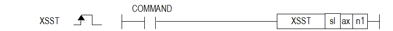

# XSSTEX

Start previously configured XPM steps on multiple axes simultaneously.

Manual section(s): 4.42.5. Original Korean notes below may cover the other variants on the same page; apply the widths and execution form of `XSSTEX`.

## Editing route

Use `get_ir` → `apply_patch` for this instruction edit. `insert_ladder_instruction` is the internal writer route, not a separate MCP tool. Preserve the exported revision and native constraints.
The writer mnemonic is `XSSTEX`; the catalog records opcode `1650` and `3` operands in order.
Inspect the CPU/project and target cells first. Use the inspected revision and positions, preserve expected values, dry-run when useful, then save and inspect the result. See the [editing skill](../../SKILL.md) and [ladder workflow](../ladder.md).

## Behavior

- ax is the command axis (1..8 for XGF-PN8B); n1 is the axis mask with bit0=axis1 through bit7=axis8. The command axis participates even if absent from the mask.
- Configure each participating axis simultaneous-start step with XSWR or PUT/PUTP before executing XSST.

## Instruction constraints

- At least two valid axes must participate. Module axis-count/range or step-data errors can prevent the complete start. XBC-U/XBM can use XBF-PNxxB in slots 2/3 only.

## Operands

| Order | Operand | Description (Korean manual) | Reviewed types | Device areas | Constant |
| --- | --- | --- | --- | --- | --- |
| 1 | sl | 위치 모듈이 장착된 베이스(x)와 슬롯(y) 번호:h00xy | WORD | Unknown | Unknown |
| 2 | ax | 지령을 실행할 축:1~8(실축) | WORD | PMK, L, Z, N, D, R | Allowed |
| 3 | n1 | 동시 기동할 축 설정 (Bit별로 설정) | WORD | PMK, L, Z, N, D, R | Allowed |

These are the current library's reviewed operand rules. A shared type union is not a per-variant type choice; use the manual behavior to select the required width. Missing permissions stay unknown.

## CPU and acceptance

No separately reviewed CPU-model restriction is available in the current catalog; this means unknown, not universal compatibility.
Check the applicable model, firmware, modules and memory spans stated in the manual notes. Local parsing, writer validation and IL conversion do not prove native compilation or PLC behavior. Native acceptance requires XG5000 Open → Check Program → Save As → comparison.

## Manual behavior notes (Korean)

- ※ 오퍼랜드 설정 범위는 XGF-PN8B를 기준으로 합니다. 축에 대한 오퍼랜드(ax)의 설정 범위는 제품에서 지원하는 제어 축수에 따라 다르니, 제품 사용설명서를 참조하여 주십시오.
- 이 명령은 위치결정 모듈에 동시기동 지령을 내리는 명령입니다.
- 동시 기동 명령을 내리는 축은 운전축에 설정되지 않더라도 기본적으로 포함됩니다.
- sl(위치결정 모듈의 슬롯번호)로 지정된 위치결정 모듈의 ax로 지정된 축에 n1으로 설정된 축들의 미리 저장된 동시기동 스텝을 동시에 실행하는 명령입니다.
- 축 설정은 축에 해당하는 각 Bit를 SET하여 설정합니다.
- EX. h000B로 설정하면 동시기동을 실행할 축으로 4축,2축,1축이 설정됩니다.
- 동시 기동을 할 축들의 스텝을 설정하기 위해서는 XSWR명령을 사용하거나 PUT/PUTP를 명령을 사용하여 축별 동시기동 스텝 메모리 번지에 동시 기동 할 스텝 번호를 설정해야 하며,이는 동시기동 명령이 실행되기 전까지 완료되어야 합니다.

| 15 ~ 8 Bit | 7 Bit | 6 Bit | 5 Bit | 4 Bit | 3 Bit | 2 Bit | 1 Bit | 0 Bit |
| --- | --- | --- | --- | --- | --- | --- | --- | --- |
| 사용안함 | 8축 | 7축 | 6축 | 5축 | 4축 | 3축 | 2축 | 1축 |

## Manual flags

| 플래그 | 내 용 | 디바이스 번호 |
| --- | --- | --- |
| 에러 | ax 값이 범위를 벗어날 경우 | F110 |

## Manual applicability and restrictions

- 적용 기종 : XGK, XBC, XBM, XBF
- ax의 설정값이 제품에서 지원하는 설정 범위와 다른 값을 입력하면 에러가 발생(F110이 Set)됩니다.

## Manual flag and step matrix

The shared usage table marks affected flags with `O`, and `-` where it lists no effect. Native steps are the manual's instruction size, not the number of operand arguments. Conditions for setting/clearing flags are in the behavior notes.

| Manual instruction group | Native steps | 에러 (F110) | 제로 (F111) | 캐리 (F112) |
| --- | --- | --- | --- | --- |
| XSST | 4~7 | O | - | - |

## Additional source notes after examples

The manual places some execution restrictions and timing conditions after its example heading. Retain those checks below. Example addresses and circuit assumptions describe the source example and are not defaults for a new program.

- 다음과 같은 경우에 에러가 되어 동시 기동에 설정된 모든 축의 운전을 실행할 수 없습니다.
- 동시 기동 설정 축들 중 한 축이라도 운전 데이터에서 에러가 발생한 경우 (해당 축에 에러코드 출력)
- 동시 기동 명령 축 설정이 잘못된 경우 (에러코드:296)
- 명령 축만 설정한 경우 (반드시 2축 이상 설정해야 합니다.)
- 설정 축들 중 현재 사용중인 모듈의 설정 가능한 축 번호를 초과한 경우

## Referenced manual figures

These figures belong to the shared source topic. Read the source corrections above before using variant-specific layouts or example values.

## Provenance

Source: `XGK(B)InstructionHelp_Kr_V3.5.chm`, SHA-256 `b866d589d800addcb039f9f09b182592464d6367faa55abf6dde9ac34a1580e0`.

- `4425xsst.htm` — §4.42.5; source SHA-256 `66a9f5f5cc6b9887b3ee485b2d6d47ecf65c0199a66a0e118d11861049cb94dc`.
- Additional behavior/operand evidence: `4425xsst.htm`.
