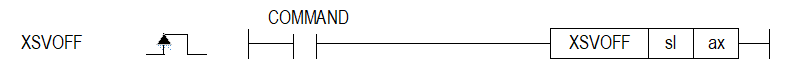

# XSVOFF

Manual section(s): 4.42.50. Original Korean notes below may cover the other variants on the same page; apply the widths and execution form of `XSVOFF`.

## Editing route

Use `get_ir` → `apply_patch` for this instruction edit. `insert_ladder_instruction` is the internal writer route, not a separate MCP tool. Preserve the exported revision and native constraints.
The writer mnemonic is `XSVOFF`; the catalog records opcode `1119` and `2` operands in order.
Inspect the CPU/project and target cells first. Use the inspected revision and positions, preserve expected values, dry-run when useful, then save and inspect the result. See the [editing skill](../../SKILL.md) and [ladder workflow](../ladder.md).

## Operands

| Order | Operand | Description (Korean manual) | Reviewed types | Device areas | Constant |
| --- | --- | --- | --- | --- | --- |
| 1 | sl | 위치 모듈이 장착된 베이스(x)와 슬롯(y) 번호:h00xy | WORD | Unknown | Unknown |
| 2 | ax | 서보 온 지령을 실행 할 축:1~8(실축) | WORD | PMK, L, Z, N, D, R | Allowed |

These are the current library's reviewed operand rules. A shared type union is not a per-variant type choice; use the manual behavior to select the required width. Missing permissions stay unknown.

## CPU and acceptance

No separately reviewed CPU-model restriction is available in the current catalog; this means unknown, not universal compatibility.
Check the applicable model, firmware, modules and memory spans stated in the manual notes. Local parsing, writer validation and IL conversion do not prove native compilation or PLC behavior. Native acceptance requires XG5000 Open → Check Program → Save As → comparison.

## Manual behavior notes (Korean)

- ※ 오퍼랜드 설정 범위는 XGF-PN8B를 기준으로 합니다. 축에 대한 오퍼랜드(ax)의 설정 범위는 제품에서 지원하는 제어 축 수에 따라 다르니, 제품 사용설명서를 참조하여 주십시오.
- 위치결정 모듈과 연결되어 서보 온 되어 있는 상태의 서보를 서보 오프 시키는 지령 입니다.
- sl(위치결정 모듈의 슬롯번호)로 지정된 위치결정 모듈의 ax 로 지정된 축에 서보 오프 명령을 합니다.
- 서보 오프 상태가 되면 모터가 기동될 수 없습니다.
- 서보 오프가 되었지만 서보 연결이 되어 있는 상태이면, 서보 파라미터는 쓸 수 있습니다.
- 서보 오프 지령은 축 별로 각각 실행되어야 합니다.

## Manual flags

| 플래그 | 내 용 | 디바이스 번호 |
| --- | --- | --- |
| 에러 | ax 값이 범위를 벗어날 경우 | F110 |

## Manual applicability and restrictions

- 적용 기종 : XGK, XBC, XBM, XBF
- ax의 설정값이 제품에서 지원하는 설정 범위와 다른 값을 입력하면, 에러가 발생(F110이 Set)합니다.

## Manual flag and step matrix

The shared usage table marks affected flags with `O`, and `-` where it lists no effect. Native steps are the manual's instruction size, not the number of operand arguments. Conditions for setting/clearing flags are in the behavior notes.

| Manual instruction group | Native steps | 에러 (F110) | 제로 (F111) | 캐리 (F112) |
| --- | --- | --- | --- | --- |
| XSVOFF | 4~7 | O | - | - |

## Additional source notes after examples

The manual places some execution restrictions and timing conditions after its example heading. Retain those checks below. Example addresses and circuit assumptions describe the source example and are not defaults for a new program.

- 서보 오프 및 서보 연결 끊김되어 있는 상태에서는 서보 파라미터를 쓸 수 없습니다.
- 서보 파라미터를 쓰고자 할 경우, 서보 연결 되어 있고 서보 OFF 된 상태에서 실행해 주시기 바랍니다.

## Referenced manual figures

These figures belong to the shared source topic. Read the source corrections above before using variant-specific layouts or example values.

## Provenance

Source: `XGK(B)InstructionHelp_Kr_V3.5.chm`, SHA-256 `b866d589d800addcb039f9f09b182592464d6367faa55abf6dde9ac34a1580e0`.

- `44250xsvoff.htm` — §4.42.50; source SHA-256 `8c583eb62f0b83e52294aa55c3f8944f558f6f73d18eb8da76099e82a5454f14`.
- Additional behavior/operand evidence: `44250xsvoff.htm`.
