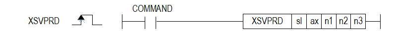

# XSVPRDEX

Manual section(s): 4.42.55. Original Korean notes below may cover the other variants on the same page; apply the widths and execution form of `XSVPRDEX`.

## Editing route

Use `get_ir` → `apply_patch` for this instruction edit. `insert_ladder_instruction` is the internal writer route, not a separate MCP tool. Preserve the exported revision and native constraints.
The writer mnemonic is `XSVPRDEX`; the catalog records opcode `1624` and `5` operands in order.
Inspect the CPU/project and target cells first. Use the inspected revision and positions, preserve expected values, dry-run when useful, then save and inspect the result. See the [editing skill](../../SKILL.md) and [ladder workflow](../ladder.md).

## Operands

| Order | Operand | Description (Korean manual) | Reviewed types | Device areas | Constant |
| --- | --- | --- | --- | --- | --- |
| 1 | sl | 위치 모듈이 장착된 베이스(x)와 슬롯(y) 번호:h00xy | WORD | Unknown | Unknown |
| 2 | ax | 지령을 실행할 축:1~8(실축) | WORD | PMK, L, Z, N, D, R | Allowed |
| 3 | n1 | 서보파라미터 Index (0x1000 ~ 0x9FFF) | WORD | PMK, L, Z, N, D, R | Allowed |
| 4 | n2 | 서보파라미터 Subindex (0x00 ~ 0xFF) | WORD | PMK, L, Z, N, D, R | Allowed |
| 5 | n3 | 서보파라미터 Length (Byte단위) (1~4) | WORD | PMK, L, Z, N, D, R | Allowed |

These are the current library's reviewed operand rules. A shared type union is not a per-variant type choice; use the manual behavior to select the required width. Missing permissions stay unknown.

## CPU and acceptance

No separately reviewed CPU-model restriction is available in the current catalog; this means unknown, not universal compatibility.
Check the applicable model, firmware, modules and memory spans stated in the manual notes. Local parsing, writer validation and IL conversion do not prove native compilation or PLC behavior. Native acceptance requires XG5000 Open → Check Program → Save As → comparison.

## Manual behavior notes (Korean)

- ※ 오퍼랜드 설정 범위는 XGF-PN8B를 기준으로 합니다. 축에 대한 오퍼랜드(ax)의 설정 범위는 제품에서 지원하는 제어 축 수에 따라 다르니, 제품 사용설명서를 참조하여 주십시오.
- 위치결정 모듈에 연결된 서보드라이브의 파라미터 (XGF-PN8B:CoE Object) 값을 읽는 명령입니다.
- 위치결정 모듈의 명령축의 서보파라미터 중 n1, n2, n3로 지정된 파라미터 (CoE Object) 값을 읽는 명령을 내립니다.
- 해당 축이 운전 중인 경우에도 실행할 수 있습니다.
- n1값은 XGF-PN8A의 경우 파라미터 어드레스이며, XGF-PN4B/XGF-PN8B (XBF-PN04B/08B)의 경우는 아래와 같이 설정할 수 있습니다.
- n2는 XGF-PN8A에서는 사용하지 않으며 XGF-PN4B/XGF-PN8B (XBF-PN04B/08B)의 경우 n2에 설정할 수 있는 값은 아래와 같습니다.
- n3는 XGF-PN8A의 경우 파라미터의 타입을 설정하는 데 사용되며, XGF-PN4B/XGF-PN8B (XBF-PN04B/08B)의 경우 데이터 길이를 설정하는 데 사용됩니다.
- n3에 설정할 수 있는 값은 아래와 같습니다.
- 서보 파라미터 읽기 명령을 실행하면, 위치결정 모듈에서 서보드라이브에서 데이터를 읽은 후 데이터 공용 영역에 저장합니다.
- PLC 프로그램에서 사용가능도록 디바이스에 저장하기 위해서는 서보 파라미터 읽기 명령 실행 후 GETM 또는 GETMP 명령을 사용하시기 바랍니다.
- GETM 또는 GETMP 명령에서 지정하는 데이터 공용 영역 주소는 다음과 같습니다.
- 읽은 서보파라미터의 Index와 SubIndex를 확인하고 싶은 경우는 GETMP 읽기 어드레스를 0으로 설정한 후, 읽을 데이터 개수를 2로 설정하시기 바랍니다.

| 모듈 | 설정값 | 내용 |
| --- | --- | --- |
| XGF-PN8A | 0x100 ~ 0x400 | 서보파라미터 어드레스 |
| XBF-PN04B/XBF-PN08B XGF-PN4B/XGF-PN8B | 0x1000 ~ 0x1FFF | Communication Profile Area |
| XBF-PN04B/XBF-PN08B XGF-PN4B/XGF-PN8B | 0x2000 ~ 0x5FFF | Manufacturer Specific Profile Area |
| XBF-PN04B/XBF-PN08B XGF-PN4B/XGF-PN8B | 0x6000 ~ 0x9FFF | Standardized Device Profile Area |

| 모듈 | 설정값 | 내용 |
| --- | --- | --- |
| XGF-PN8A | - | 사용하지 않음 |
| XBF-PN04B/XBF-PN08B XGF-PN4B/XGF-PN8B | 0x0 ~ 0xFF | 서보파라미미터 Object Subindex |

| 모듈 | 설정값 | 내용 |
| --- | --- | --- |
| XGF-PN8A | 0~1 | 0:Integer, 1:Float |
| XGF-PN4B/XGF-PN8B | 1~4 | 서보파라미터 Object Byte Length |

| 설정 어드레스 | 내용 |
| --- | --- |
| 0 | 축1 서보파라미터 Index (하위) / SubIndex (상위) |
| 1 | 축1 서보파라미터 데이터 값 |
| 2 | 축2 서보파라미터 Index (하위) / SubIndex (상위) |
| 3 | 축2 서보파라미터 데이터 값 |
| 4 | 축3 서보파라미터 Index (하위) / SubIndex (상위) |
| 5 | 축3 서보파라미터 데이터 값 |
| 6 | 축4 서보파라미터 Index (하위) / SubIndex (상위) |
| 7 | 축4 서보파라미터 데이터 값 |
| 8 | 축5 서보파라미터 Index (하위) / SubIndex (상위) |
| 9 | 축5 서보파라미터 데이터 값 |
| 10 | 축6 서보파라미터 Index (하위) / SubIndex (상위) |
| 11 | 축6 서보파라미터 데이터 값 |
| 12 | 축7 서보파라미터 Index (하위) / SubIndex (상위) |
| 13 | 축7 서보파라미터 데이터 값 |
| 14 | 축8 서보파라미터 Index (하위) / SubIndex (상위) |
| 15 | 축8 서보파라미터 데이터 값 |

## Manual flags

| 플래그 | 내 용 | 디바이스 번호 |
| --- | --- | --- |
| 에러 | ax 값이 범위를 벗어날 경우 | F110 |

## Manual applicability and restrictions

- 적용 기종 : XGK, XBC, XBM, XBF
- ax의 설정값이 제품에서 지원하는 설정 범위와 다른 값을 입력하면, 에러가 발생(F110이 Set)합니다.

## Manual flag and step matrix

The shared usage table marks affected flags with `O`, and `-` where it lists no effect. Native steps are the manual's instruction size, not the number of operand arguments. Conditions for setting/clearing flags are in the behavior notes.

| Manual instruction group | Native steps | 에러 (F110) | 제로 (F111) | 캐리 (F112) |
| --- | --- | --- | --- | --- |
| XSVPRD | 4~7 | O | - | - |

## Additional source notes after examples

The manual places some execution restrictions and timing conditions after its example heading. Retain those checks below. Example addresses and circuit assumptions describe the source example and are not defaults for a new program.

- 이 동작은 여러 스캔만에 완료될 수 있습니다.

## Referenced manual figures

These figures belong to the shared source topic. Read the source corrections above before using variant-specific layouts or example values.

## Provenance

Source: `XGK(B)InstructionHelp_Kr_V3.5.chm`, SHA-256 `b866d589d800addcb039f9f09b182592464d6367faa55abf6dde9ac34a1580e0`.

- `44255xsvprd1.htm` — §4.42.55; source SHA-256 `94eb194f1759329f586db25bc4e2f6b5b0ce72d35103e1655afa1ba5dcb59b30`.
- Additional behavior/operand evidence: `44255xsvprd1.htm`.
