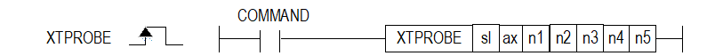
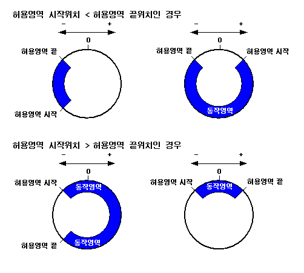

# XTPROBE

Manual section(s): 4.42.68. Original Korean notes below may cover the other variants on the same page; apply the widths and execution form of `XTPROBE`.

## Editing route

Use `insert_ladder_instruction` after calling `describe_operation` for its current schema.
The writer mnemonic is `XTPROBE`; the catalog records opcode `1570` and `7` operands in order.
Inspect the CPU/project and target cells first. Use the inspected revision and positions, preserve expected values, dry-run when useful, then save and inspect the result. See the [editing skill](../../SKILL.md) and [ladder workflow](../ladder.md).

## Operands

| Order | Operand | Description (Korean manual) | Reviewed types | Device areas | Constant |
| --- | --- | --- | --- | --- | --- |
| 1 | sl | 위치 모듈이 장착된 베이스(x)와 슬롯(y) 번호:h00xy | WORD | Unknown | Unknown |
| 2 | ax | 지령을 실행할 축(종축):1~8(실축) | WORD | PMK, L, Z, N, D, R | Allowed |
| 3 | n1 | 트리거 입력으로 사용할 신호 | WORD | PMK, L, Z, N, D, R | Allowed |
| 4 | n2 | 트리거 모드(0:단일 트리거, 1:연속 트리거) | WORD | PMK, L, Z, N, D, R | Allowed |
| 5 | n3 | 윈도우 모드(0:비활성, 1:활성) | WORD | PMK, L, Z, N, D, R | Allowed |
| 6 | n4 | 윈도우 모드 허용 영역 시작 위치값 (-2,147,483,648 ~ 2,147,483,647) | DINT | PMK, L, Z, N, D, R | Allowed |
| 7 | n5 | 윈도우 모드 허용 영역 종료 위치값 (-2,147,483,648 ~ 2,147,483,647) | DINT | PMK, L, Z, N, D, R | Allowed |

These are the current library's reviewed operand rules. A shared type union is not a per-variant type choice; use the manual behavior to select the required width. Missing permissions stay unknown.

## CPU and acceptance

No separately reviewed CPU-model restriction is available in the current catalog; this means unknown, not universal compatibility.
Check the applicable model, firmware, modules and memory spans stated in the manual notes. Local parsing, writer validation and IL conversion do not prove native compilation or PLC behavior. Native acceptance requires XG5000 Open → Check Program → Save As → comparison.

## Manual behavior notes (Korean)

- ※ 오퍼랜드 설정 범위는 XGF-PN8B를 기준으로 합니다. 축에 대한 오퍼랜드(ax)의 설정 범위는 제품에서 지원하는 제어 축수에 따라 다르니, 제품 사용설명서를 참조하여 주십시오.
- 이 명령은 위치결정 모듈의 외부 터치 프로브 기능을 설정하기 위해 사용되는 명령입니다.
- sl(위치결정 모듈의 슬롯번호)로 지정된 위치결정 모듈의 ax로 지정된 축의 터치 프로브 기능을 설정합니다.
- n1에 지정된 <트리거 입력>으로 사용할 신호는 다음과 같이 지정할 수 있습니다.
- 0:터치 프로브 1 상승 엣지
- 1:터치 프로브 2 상승 엣지
- 2:터치 프로브 1 하강 엣지
- 3:터치 프로브 2 하강 엣지
- 4:터치 프로브 1 인덱스(Z) 펄스
- 5:터치 프로브 2 인덱스(Z) 펄스
- ※ 각 터치 프로브의 상승 또는 하강 엣지와 인덱스(Z) 펄스는 동시에 실행될 수 없습니다.
- n2에 지정된 <트리거 모드> 항목에 따른 동작은 다음과 같습니다.
- 0:단일 트리거 (트리거 모드 설정된 후 입력되는 첫번째 터치 프로브 1 신호에서만 현재 위치 래치)
- 1:연속 트리거 (트리거 모드 설정된 후 매 터치 프로브 1 신호마다 현재 위치 래치)
- “1“ 이상의 값은 “1”과 동일하게 처리됩니다.
- n3에 지정된 윈도우 모드 항목에 따른 동작은 다음과 같습니다.
- 윈도우 모드가 활성화 된 경우 단일 트리거로만 동작합니다. (0:윈도우 모드 비활성, 1:윈도우 모드 활성)
- 래치 위치 데이터 읽기 명령(XLRD)으로 래치 위치 데이터 개수와 래치 위치 데이터를 읽을 수 있습니다.
- 터치 프로브 또는 인덱스(Z) 펄스 신호가 On 되는 순간 서보 드라이브의 현재 위치 값을 래치 위치 데이터로 저장합니다.
- 터치 프로브 또는 인덱스(Z) 펄스 신호가 On되어 래치가 완료되면 상태 정보의 축 정보 중 Bit 5:“트리거 완료” 비트에 정보가 저장됩니다.
- “트리거 완료” 상태 비트는 트리거 해제 명령으로 리셋 되기 전까지 On 상태를 유지합니다.
- 래치 모드가 단일 트리거인 경우 첫번째 터치 프로브 또는 인덱스(Z) 펄스 신호에서 래치 기능이 동작된 후트리거 해제 명령을 실행하면 다음의 터치 프로브 또는 인덱스(Z) 펄스 신호에서 다시 트리거 기능을 사용할 수 있습니다. (터치 프로브 설정 명령을 다시 실행한 경우에도 동일하게 동작합니다.)
- 래치(터치 프로브) 기능이 동작하는 영역을 지정할 수 있습니다.
- 허용영역을 지정하면 지정된 영역 안에서만 동작하게 할 수 있습니다.
- 무한 길이 반복 운전 (회전형 축) 일 때 허용영역의 시작 및 끝 위치에 따른 래치(터치 프로브) 동작영역의 관계는 다음과 같습니다.
- 래치(터치 프로브) 기능을 사용하기 위해서는 슬레이브 파라미터의 PDO 설정에 아래 오브젝트가 반드시 포함되어 있어야 합니다.

| 트리거 입력 | RxPDO | TxPDO |
| --- | --- | --- |
| 터치 프로브1 상승 엣지 | 0x60B8:0 터치 프로브 기능 | 0x60B9:0 터치 프로브 상태 0x60BA:0 터치 프로브 1 정방향 위치값 |
| 터치 프로브2 상승 엣지 | 0x60B8:0 터치 프로브 기능 | 0x60B9:0 터치 프로브 상태 0x60BC:0 터치 프로브 2 정방향 위치값 |
| 터치 프로브1 하강 엣지 | 0x60B8:0 터치 프로브 기능 | 0x60B9:0 터치 프로브 상태 0x60BB:0 터치 프로브 1 역방향 위치값 |
| 터치 프로브2 하강 엣지 | 0x60B8:0 터치 프로브 기능 | 0x60B9:0 터치 프로브 상태 0x60BD:0 터치 프로브 2 역방향 위치값 |

## Manual flags

| 플래그 | 내 용 | 디바이스 번호 |
| --- | --- | --- |
| 에러 | ax 값이 범위를 벗어날 경우 | F110 |

## Manual applicability and restrictions

- 적용 기종 : XGK, XBC, XBM, XBF
- ax의 설정값이 제품에서 지원하는 설정 범위와 다른 값을 입력하면, 에러가 발생(F110이 Set)합니다.

## Manual flag and step matrix

The shared usage table marks affected flags with `O`, and `-` where it lists no effect. Native steps are the manual's instruction size, not the number of operand arguments. Conditions for setting/clearing flags are in the behavior notes.

| Manual instruction group | Native steps | 에러 (F110) | 제로 (F111) | 캐리 (F112) |
| --- | --- | --- | --- | --- |
| XTPROBE | 4~7 | O | - | - |

## Additional source notes after examples

The manual places some execution restrictions and timing conditions after its example heading. Retain those checks below. Example addresses and circuit assumptions describe the source example and are not defaults for a new program.

- 각 터치 프로브의 상승 또는 하강 엣지와 인덱스(Z) 펄스는 동시에 실행될 수 없습니다.
- 이 동작은 여러 스캔만에 완료될 수 있습니다.

## Referenced manual figures

These figures belong to the shared source topic. Read the source corrections above before using variant-specific layouts or example values.

## Provenance

Source: `XGK(B)InstructionHelp_Kr_V3.5.chm`, SHA-256 `b866d589d800addcb039f9f09b182592464d6367faa55abf6dde9ac34a1580e0`.

- `44268xtprobe.htm` — §4.42.68; source SHA-256 `3a33cea699d1beabaacdf893f01c8a165ab5ddce721810757ba5258a45bb8939`.
- Additional behavior/operand evidence: `44268xtprobe.htm`.
