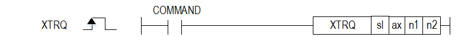

# XTRQ

Manual section(s): 4.42.58. Original Korean notes below may cover the other variants on the same page; apply the widths and execution form of `XTRQ`.

## Editing route

Use `insert_ladder_instruction` after calling `describe_operation` for its current schema.
The writer mnemonic is `XTRQ`; the catalog records opcode `1224` and `4` operands in order.
Inspect the CPU/project and target cells first. Use the inspected revision and positions, preserve expected values, dry-run when useful, then save and inspect the result. See the [editing skill](../../SKILL.md) and [ladder workflow](../ladder.md).

## Operands

| Order | Operand | Description (Korean manual) | Reviewed types | Device areas | Constant |
| --- | --- | --- | --- | --- | --- |
| 1 | sl | 위치 모듈이 장착된 베이스(x)와 슬롯(y) 번호:h00xy | WORD | Unknown | Unknown |
| 2 | ax | 캠 지령을 내릴 종축 (1 ~ 8:1축 ~ 8축) | WORD | PMK, L, Z, N, D, R | Allowed |
| 3 | n1 | 토크값 (단위:%, -32768 ~ 32767) | INT | PMK, L, Z, N, D, R | Allowed |
| 4 | n2 | 토크 기울기 (단위:ms, 0 ~ 65535ms) | WORD | PMK, L, Z, N, D, R | Allowed |

These are the current library's reviewed operand rules. A shared type union is not a per-variant type choice; use the manual behavior to select the required width. Missing permissions stay unknown.

## CPU and acceptance

No separately reviewed CPU-model restriction is available in the current catalog; this means unknown, not universal compatibility.
Check the applicable model, firmware, modules and memory spans stated in the manual notes. Local parsing, writer validation and IL conversion do not prove native compilation or PLC behavior. Native acceptance requires XG5000 Open → Check Program → Save As → comparison.

## Manual behavior notes (Korean)

- ※ 오퍼랜드 설정 범위는 XGF-PN8B를 기준으로 합니다. 축에 대한 오퍼랜드(ax)의 설정 범위는 제품에서 지원하는 제어 축 수에 따라 다르니, 제품 사용설명서를 참조하여 주십시오.
- 이 명령은 위치결정 모듈에 토크제어를 실행하게 하는 명령입니다.
- 토크값 및 토크 기울기를 설정하고 명령을 내리면 토크제어가 실행됩니다.
- n1에 운전하려는 토크값(%)을 설정합니다.
- 토크 값은 정격 토크에 대한 %로 동작합니다. (1 = 정격토크의 1%)
- 예를 들어 200%의 토크로 토크제어를 실행하려면 200을 설정합니다.
- 토크 값의 허용 범위는 연결된 서보드라이브 종류에 따라 다릅니다.
- 일반적으로, 목표 토크 값은 최대 토크 설정으로 제한됩니다.
- n2에 목표 토크까지 도달하는 시간을 설정합니다.
- 명령이 실행되면 이 기울기로 목표 토크에 설정된 토크값까지 토크가 증가하게 됩니다.
- 토크 명령의 보조 데이터인 토크 값의 설정에 따라 방향이 결정됩니다.
- (1) 토크 값이 양( + )일 때:정방향(현재 위치 증가 방향)으로 운전
- (2) 토크 값이 음( - )일 때:역방향(현재 위치 감소 방향)으로 운전

| 보조 데이터 | 설정값 | 내용 |
| --- | --- | --- |
| 토크 (%) | -32768 ~ 32767 | 토크 제어 시 목표가 되는 토크 값을 설정합니다. 토크 값은 정격 토크에 대한 %로 동작합니다. (1 = 정격토크의 1%) |
| 기울기 (ms) | 0 ~ 65535 | 목표 토크까지의 기울기를 시간으로 설정합니다. |

## Manual flags

| 플래그 | 내 용 | 디바이스 번호 |
| --- | --- | --- |
| 에러 | ax 값이 범위를 벗어날 경우 | F110 |

## Manual applicability and restrictions

- 적용 기종 : XGK, XBC, XBM, XBF
- ax의 설정값이 제품에서 지원하는 설정 범위와 다른 값을 입력하면, 에러가 발생(F110이 Set)합니다.

## Manual flag and step matrix

The shared usage table marks affected flags with `O`, and `-` where it lists no effect. Native steps are the manual's instruction size, not the number of operand arguments. Conditions for setting/clearing flags are in the behavior notes.

| Manual instruction group | Native steps | 에러 (F110) | 제로 (F111) | 캐리 (F112) |
| --- | --- | --- | --- | --- |
| XTRQ | 4~7 | O | - | - |

## Additional source notes after examples

The manual places some execution restrictions and timing conditions after its example heading. Retain those checks below. Example addresses and circuit assumptions describe the source example and are not defaults for a new program.

- 해당 축이 토크 제어 이외의 운전 중인 경우에는 실행할 수 없습니다.
- 이 동작은 여러 스캔만에 완료될 수 있습니다.
- 다음과 같은 경우에 에러가 되어 토크 제어를 실행할 수 없습니다.
- 토크 제어 이외의 운전 중인 상태에서 명령을 실행 한 경우 (에러코드:741)
- M코드 On 신호가 On되어 있는 상태에서 명령을 실행 한 경우 (에러코드:742)
- 서보 오프 상태에서 명령을 실행한 경우 (에러코드:743)
- 서보드라이브가 토크제어 모드를 지원하지 않는 경우 (에러코드:565)

## Referenced manual figures

These figures belong to the shared source topic. Read the source corrections above before using variant-specific layouts or example values.

## Provenance

Source: `XGK(B)InstructionHelp_Kr_V3.5.chm`, SHA-256 `b866d589d800addcb039f9f09b182592464d6367faa55abf6dde9ac34a1580e0`.

- `44258xtrq.htm` — §4.42.58; source SHA-256 `fbb2d06ea1fc0351a2d281a8df7d3f8f5d1d1e34011b3c547a9ccda48485ccf9`.
- Additional behavior/operand evidence: `44258xtrq.htm`.
