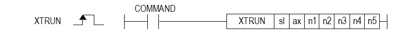

# XTRUN

Issue motion-module test operations while the module is STOP.

Manual section(s): 4.43.3. Original Korean notes below may cover the other variants on the same page; apply the widths and execution form of `XTRUN`.

## Editing route

Use `get_ir` → `apply_patch` for this instruction edit. `insert_ladder_instruction` is the internal writer route, not a separate MCP tool. Preserve the exported revision and native constraints.
The writer mnemonic is `XTRUN`; the catalog records opcode `1245` and `7` operands in order.
Inspect the CPU/project and target cells first. Use the inspected revision and positions, preserve expected values, dry-run when useful, then save and inspect the result. See the [editing skill](../../SKILL.md) and [ladder workflow](../ladder.md).

## Behavior

- sl selects the module; ax is 1..32,37..40 or 255 for all axes. n1 is a command code; n2..n5 are LREAL auxiliary values.
- Codes 1/2 connect/disconnect EtherCAT; 3/4 servo On/Off; 5 reset; 6 homing; 7/8 absolute/relative positioning; 9 speed control; 10 stop.

## Instruction constraints

- Using this test operation while the module is RUN raises module error 0x002A. Invalid ax sets F110. Verify the command-specific auxiliary values.

## Source corrections

- Reviewed title typo; usage table and native catalog identify this mnemonic.
- Page title/body heading incorrectly spells XTURN; the instruction matrix uses XTRUN.

## Operands

| Order | Operand | Description (Korean manual) | Reviewed types | Device areas | Constant |
| --- | --- | --- | --- | --- | --- |
| 1 | sl | 모션 모듈이 장착된 베이스(x)와 슬롯(y) 번호:h00xy | WORD | Unknown | Unknown |
| 2 | ax | 명령을 실행할 축:1~32(1축~32축), 37~40(37~40축), 255(전체축) | WORD | PMK, L, Z, D, R | Allowed |
| 3 | n1 | 명령 코드 | WORD | PMK, L, Z, D, R | Allowed |
| 4 | n2 | 명령 보조 데이터 1 | LREAL | PMK, L, Z, D, R | Not allowed |
| 5 | n3 | 명령 보조 데이터 2 | LREAL | PMK, L, Z, D, R | Not allowed |
| 6 | n4 | 명령 보조 데이터 3 | LREAL | PMK, L, Z, D, R | Not allowed |
| 7 | n5 | 명령 보조 데이터 4 | LREAL | PMK, L, Z, D, R | Not allowed |

These are the current library's reviewed operand rules. A shared type union is not a per-variant type choice; use the manual behavior to select the required width. Missing permissions stay unknown.

## CPU and acceptance

No separately reviewed CPU-model restriction is available in the current catalog; this means unknown, not universal compatibility.
Check the applicable model, firmware, modules and memory spans stated in the manual notes. Local parsing, writer validation and IL conversion do not prove native compilation or PLC behavior. Native acceptance requires XG5000 Open → Check Program → Save As → comparison.

## Manual behavior notes (Korean)

- 이 명령은 모션 제어 모듈에 EtherCAT Slave 연결/연결 끊기, 서보온/오프, 위치제어 등 간단한 모션 제어 동작을 실행할 수 있는 시험 운전 명령 입니다.
- sl(모션 제어 모듈의 슬롯번호)로 지정된 모션 제어 모듈의 ax 로 지정된 축에 n1 명령을 내립니다.
- 명령 코드 및 명령 보조 데이터 설정 값은 다음과 같습니다.

| 기능 | 명령 코드 | 보조 데이터1 | 보조 데이터2 | 보조 데이터3 | 보조 데이터4 |
| --- | --- | --- | --- | --- | --- |
| EtherCAT 연결 | 1 | - | - | - | - |
| EtherCAT 연결 끊기 | 2 | - | - | - | - |
| 서보 온 | 3 | - | - | - | - |
| 서보 오프 | 4 | - | - | - | - |
| 에러 리셋 | 5 | 종류 0:축 에러 1:공통 에러 | - | - | - |
| 원점 복귀 | 6 | - | - | - | - |
| 위치제어(절대) | 7 | 위치 | 속도 | 가속도 | 감속도 |
| 위치제어(상대) | 8 | 위치 | 속도 | 가속도 | 감속도 |
| 속도제어 | 9 | 속도 | 가속도 | 감속도 | - |
| 정지 | 10 | 감속도 |  | - | - |

## Manual flags

| 플래그 | 내 용 | 디바이스 번호 |
| --- | --- | --- |
| 에러 | ax 값이 범위를 벗어날 경우 | F110 |

## Manual applicability and restrictions

- 적용 기종 : XGK, XGK-N
- ax의 설정값이 제품에서 지원하는 설정 범위와 다른 값을 입력하면 에러가 발생(F110이 Set)됩니다.
- 모션 제어 모듈이 RUN 상태에서 시험 운전 명령을 실행하면 모션 제어 모듈에 0x002A 에러가 발생됩니다.

## Manual flag and step matrix

The shared usage table marks affected flags with `O`, and `-` where it lists no effect. Native steps are the manual's instruction size, not the number of operand arguments. Conditions for setting/clearing flags are in the behavior notes.

| Manual instruction group | Native steps | 에러 (F110) | 제로 (F111) | 캐리 (F112) |
| --- | --- | --- | --- | --- |
| XTRUN | 4~7 | O | - | - |

## Referenced manual figures

These figures belong to the shared source topic. Read the source corrections above before using variant-specific layouts or example values.

## Provenance

Source: `XGK(B)InstructionHelp_Kr_V3.5.chm`, SHA-256 `b866d589d800addcb039f9f09b182592464d6367faa55abf6dde9ac34a1580e0`.

- `4433xturn.htm` — §4.43.3; source SHA-256 `42d26d478148bc27e22f07c54b127b065d3ee28b691840d8b3bb464783f6114e`.
- Additional behavior/operand evidence: `4433xturn.htm`.
