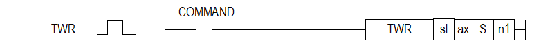

# XTWR

Manual section(s): 4.42.43. Original Korean notes below may cover the other variants on the same page; apply the widths and execution form of `XTWR`.

## Editing route

Use `get_ir` → `apply_patch` for this instruction edit. `insert_ladder_instruction` is the internal writer route, not a separate MCP tool. Preserve the exported revision and native constraints.
The writer mnemonic is `XTWR`; the catalog records opcode `1163` and `4` operands in order.
Inspect the CPU/project and target cells first. Use the inspected revision and positions, preserve expected values, dry-run when useful, then save and inspect the result. See the [editing skill](../../SKILL.md) and [ladder workflow](../ladder.md).

## Operands

| Order | Operand | Description (Korean manual) | Reviewed types | Device areas | Constant |
| --- | --- | --- | --- | --- | --- |
| 1 | sl | 위치 모듈이 장착된 베이스(x)와 슬롯(y) 번호:h00xy | WORD | Unknown | Unknown |
| 2 | ax | 복수 티칭 데이터 쓰기 지령을 내릴 축 | WORD | PMK, L, Z, N, D, R | Allowed |
| 3 | S | 복수 티칭 데이터가 저장되어 있는 디바이스의 선두번지 | DWORD | PMK, L, Z, N, D, R | Not allowed |
| 4 | n1 | 쓸 티칭 데이터 개수 | WORD | PMK, L, Z, N, D, R | Allowed |

These are the current library's reviewed operand rules. A shared type union is not a per-variant type choice; use the manual behavior to select the required width. Missing permissions stay unknown.

## CPU and acceptance

No separately reviewed CPU-model restriction is available in the current catalog; this means unknown, not universal compatibility.
Check the applicable model, firmware, modules and memory spans stated in the manual notes. Local parsing, writer validation and IL conversion do not prove native compilation or PLC behavior. Native acceptance requires XG5000 Open → Check Program → Save As → comparison.

## Manual behavior notes (Korean)

- ※ 오퍼랜드 설정 범위는 XGF-PN8B를 기준으로 합니다. 축에 대한 오퍼랜드(ax)의 설정 범위는 제품에서 지원하는 제어 축 수에 따라 다르니, 제품 사용설명서를 참조하여 주십시오.
- 이 명령은 위치결정 모듈이 복수 티칭을 할 때 필요한 티칭 데이터를 설정하는 명령어 입니다.
- sl(위치결정 모듈의 슬롯번호)로 지정된 위치결정 모듈의 ax로 지정된 축의 복수티칭 명령시 사용할 티칭 데이터 값들을 S로 지정된 CPU영역에서 n1개수만큼 위치결정 모듈의 ax축으로 옮깁니다.
- 이 명령 실행 후 XTEAA명령을 사용하면 해당 축의 데이터 티칭이 완료됩니다.
- n1에 설정되는 포인트 운전 스텝 개수는 1이상 16이하의 범위입니다.
- S로 지정된 CPU영역에서 읽어오는 값은 아래와 같습니다.

| CPU 영역 | Size | 포인트 운전 스텝 |
| --- | --- | --- |
| S | DWORD | 티칭 데이터 1 |
| ~ |  | ~ |
| S+15 | DWORD | 티칭 데이터 16 |

## Manual flags

| 플래그 | 내 용 | 디바이스 번호 |
| --- | --- | --- |
| 에러 | ax 값이 범위를 벗어날 경우 | F110 |

## Manual applicability and restrictions

- 적용 기종 : XGK, XBC, XBM, XBF
- ax의 설정값이 제품에서 지원하는 설정 범위와 다른 값을 입력하면 에러가 발생(F110이 Set)됩니다.

## Manual flag and step matrix

The shared usage table marks affected flags with `O`, and `-` where it lists no effect. Native steps are the manual's instruction size, not the number of operand arguments. Conditions for setting/clearing flags are in the behavior notes.

| Manual instruction group | Native steps | 에러 (F110) | 제로 (F111) | 캐리 (F112) |
| --- | --- | --- | --- | --- |
| XTWR | 4~7 | O | - | - |

## Additional source notes after examples

The manual places some execution restrictions and timing conditions after its example heading. Retain those checks below. Example addresses and circuit assumptions describe the source example and are not defaults for a new program.

- 복수 티칭 명령(XTEAA)을 실행하기 이전에 복수 티칭 데이터 설정 영역에 티칭 데이터가 반드시 설정(XTWR)되어 있어야 합니다.

## Referenced manual figures

These figures belong to the shared source topic. Read the source corrections above before using variant-specific layouts or example values.

## Provenance

Source: `XGK(B)InstructionHelp_Kr_V3.5.chm`, SHA-256 `b866d589d800addcb039f9f09b182592464d6367faa55abf6dde9ac34a1580e0`.

- `44243xtwr.htm` — §4.42.43; source SHA-256 `bb6562267841bd864a0e26dc2fcb1954c87d7bc94a31ec7fe00553fe9a479604`.
- Additional behavior/operand evidence: `44243xtwr.htm`.
